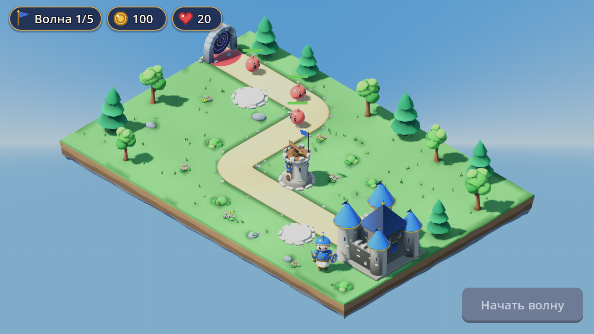

# Art Guide — Bimbleguard

Стиль: **уютная сказочная диорама**. Стилизованные персонажи с крупной головой,
гладкие формы с продуманными деталями, насыщенная, но сдержанная палитра, мягкий
тёплый свет. Читаемость с телефона важнее детализации.

## Принципы

1. **Силуэт первичен.** Герой узнаётся по золотой короне поверх стального шлема, высокому красному плюмажу, синему табарду с эмблемой-короной, плащу с золотой каймой и щиту с золотым крестом (рыцарь, а не солдат; жители — крестьяне, визуально 0.8 от героя, масштаб на узле Model в `villager.tscn`); башня — по
   зубцам, знамени и баллисте; слайм — по капле и большим глазам.
2. **Свои — синие/холодные, враги — красные/тёплые.** Синий с золотом — цвет
   королевства (герой, крыши, знамёна); коралловый — слаймы и их портал.
3. **Цвет — только из палитры.** Один атлас на всю игру, без текстур и карт нормалей.
4. **Гладко, но с характером:** скругления, фаски, лёгкий шум на органике
   (кроны, камни), выступающие камни на стенах. Без «голых» кубов и сфер.
5. **Никаких случайных декораций:** всё на карте — часть одного королевства.

## Палитра

Источник — `PALETTE` в `assets/blender/tg_common.py` (sRGB hex, roughness, metallic),
атлас — `assets/materials/tg_palette_albedo.png` / `tg_palette_orm.png`.

| Группа | Цвета |
|---|---|
| Королевство | броня `#3E6FD6`, тёмная броня `#2A4FA8`, крыши `#3F73D9`, плащ/знамёна `#2B4AA3`, золото `#E9B44C` (metal 0.85, rough 0.3), кремовый `#F1E4C6` |
| Герой | кожа `#F6C7A4`, румянец `#F0A39A`, волосы `#6E3F24`, кожа ремней `#6A4327`, сталь `#DCE3EC` (metal 0.55, доспехи), золото `#F2BE3A` (metal 0.35: при 0.85 корона темнела до коричневого) |
| Камень | `#B9B0A0`, светлый `#D2C9B6`, тёмный `#8E8678`, окна `#2A2F45` |
| Природа | трава `#6BA85C` / `#4E8A45`, листва `#5DAE4B` / `#3F8A3B` / `#79BF57`, хвоя `#2F7D4F`, тропа `#D9BE86`, земля `#8B6A4A`, скалы `#8F96A0`, ягоды `#D9425A`, цветы `#F4C842` `#EE8FB0` `#F6F1E7` |
| Враг | слизь `#EA5A4E` (rough 0.25), тёмная `#B53A3A`, блик `#FFA08C`, портал `#4B2F7A` / `#B48CF2` |
| Глаза | `#1E1C26` с белыми бликами |

Металл держим умеренным (≤ 0.85 и только на золоте): без отражений неба сильно
металлические поверхности на мобильном рендерере выглядят чёрными.

## Бюджеты (треугольники)

| Объект | Бюджет | Сейчас |
|---|---|---|
| Герой (уникальный) | ≤ 12 000, ≤ 8 мешей | 11 956, 8 |
| Башня | ≤ 4 000, ≤ 3 меша | 3 998, 3 |
| Враг (массовый) | ≤ 2 000, 1 меш | 1 830 |
| Замок / крупное строение | ≤ 11 000, 1 меш | 10 484 |
| Террейн уровня (26 × 18 + холмы до ±34 м) | ≤ 20 000 | 17 852 |
| Декор игровой зоны (8 чанков, с тенями) | ≤ 60 000 | 58 366 |
| Дальний лес (29 чанков, без теней) | ≤ 55 000 | 50 274 |
| Пропс | ≤ 1 200 | 162–1 192 |
| **Кадр целиком** | ≤ 170 000 треуг. (с тенью), < 60 3D draw calls | ~160 000, ~56 3D + ~45 HUD |

## Масштаб и ориентация

- 1 единица = 1 м = 1 клетка. Герой 1.25 м, башня 1.7 м, слайм 0.56 м, замок 2.1 м.
- Пивот — в центре основания. «Лицо» модели — −Y в Blender = +Z в Godot.
- Камера видит грани, обращённые к +X и +Z: важные детали размещать так, чтобы они
  читались с этих сторон (или со всех сторон, как у замка).

## Освещение (`scenes/main.tscn`)

- Процедурное небо (голубой градиент, снизу тоже голубой — фон под островом).
- Ambient от неба (0.75, вклад неба 0.6), отражения от неба.
- Тонмаппинг Filmic, экспозиция 0.95, насыщенность 1.12.
- Солнце тёплое `#FFF0D6`, 1.05, тени с размытием 1.5, **один ортогональный каскад**
  (карта маленькая, камера неподвижна).
- SSAO в Compatibility нет — **AO запекается в цвет вершин** каждой модели.

## Анимации

Без скелетов: ключи трансформаций отдельных частей, экспорт NLA-дорожками.

| Модель | Анимация | Что движется |
|---|---|---|
| Герой | `idle` (2 с, цикл) | дыхание корпуса, наклон головы, руки с мечом и щитом, плащ |
| Слайм | `idle` (1.33 с, цикл) | сжатие-растяжение и подскок; фаза случайная |
| Башня | `attack` (0.5 с) | отдача и пружинящие плечи арбалета; поворот к цели — кодом |

## Эффекты и звук

- Частицы — `CPUParticles3D` с маленькими сферами/монетками и цветом из палитры:
  коралловые брызги (попадание, смерть), золотые монеты (награда), песочная пыль
  (стройка), золотые искры по кольцу (улучшение). Без прозрачности: частицы уменьшаются к
  концу жизни.
- Звук — синтез из синусов, шума и огибающих (`tools/gen_sounds.py`), 22 кГц моно:
  короткие, мягкие, без резких щелчков. Громкость выстрела снижена (−14 дБ), он частый.

## Пайплайн

См. `assets/blender/README.md`. Коротко: правим `assets/blender/build_*.py` →
`blender -b --factory-startup --python assets/blender/build_all.py` → Godot переимпортирует.

## Интерфейс (`ui/theme.tres`)

- Тёмно-синие панели `#1C2950` с золотой каймой и скруглением 16 px.
- Основная кнопка — золотая с тёмным текстом, второстепенная — синяя с кремовым.
- Верхняя полоса — «таблетки» с иконками (флаг, монета, сердце), иконки рисуются
  кодом (`scripts/hud_icon.gd`), без картинок.
- Шрифт — встроенный шрифт Godot (поддерживает кириллицу), текст кремовый с тёмной обводкой.
- Интерактивные зоны ≥ 68 px по высоте при 720 px экрана.

## UI theme v2 (2026-10-17, редизайн)

Подробности и обоснование - `docs/UI_STYLE_GUIDE.md`. Кратко:

- Всё нарисовано своими скриптами (Pillow, детерминированно): `tools/make_ui_atlas.py` пишет
  `ui/theme_atlas.png` **и** `ui/theme.tres`; иконки - `tools/make_ui_icons.py`; эмблемы биомов -
  `tools/make_biome_art.py`. Один атлас, `StyleBoxTexture` 9-slice, draw calls HUD не растут.
- Шрифты: Rubik 900/800 (заголовки, кнопки, цифры; OFL) + Nunito 800 (текст). Шкала 14/16/22/32/48.
  Обводка: заголовки 6 (с тенью), ленты 5, кнопки 3, цифры HUD и подзаголовки 3, мелкий текст - без.
- Слои: тёмно-синяя кромка 3-4 px, цветная рамка, тело с градиентом, верхний блик, внутренняя тень,
  «ступенька» 8 px под кнопкой (при нажатии 4 px, тело опускается на 4). Радиусы 8 / 16 / 24.
- Цвета кнопок: золото - единственное главное действие экрана; синяя `SecondaryButton`;
  зелёная `GreenButton` (режим, покупка); красная `DangerButton`; тёмная `ToggleButton`
  (выбранная - зелёная); серая - `disabled`.
- Контейнеры: `PanelContainer` (модальное окно), `CardPanel`, `SelectedCard`, `InsetPanel`,
  `ToastPanel`, ленты `RibbonLabel[Gold|Green|Red]` (стиль Label), чипы HUD `HudChip[Blue|Wood|Red]`
  (круглый бейдж с иконкой нарисован в самой текстуре), `SlotButton` (кремовая карточка башни),
  `PricePill`.
- Безопасные зоны: `SafeArea.attach(root)` (отступы `ScreenUtil.safe_margins`); HUD и карта подключены.
- Окна и диалоги: только через `DialogFrame.attach(host, ширина, затемнение)`
  (`scripts/dialog_frame.gd`). Затемнение — на ВЕСЬ экран (top-level Control, игнорирует
  безопасную зону родителя, ловит касания), панель по центру ЭКРАНА, ширина = min(заданная,
  экран − вырезы − 2×16), высота с прокруткой, `footer` — кнопки, всегда на виду. Не делайте
  `ColorRect` + `CenterContainer` внутри корня со смещением на вырез: рядом с вырезом остаётся
  светлая полоса, окно съезжает. Проверка: `tests/test_dialog_layout.gd` (10 экранов × 4 выреза
  × RU/EN), скриншоты — `tools/shot_dialogs.gd`.
- Круглые кнопки HUD (атака, вихрь) - первые три региона атласа (0,0), (130,0), (260,0).
- Скриншоты: `tools/shot_ui.gd`, `shot_welcome.gd`, `shot_cards.gd`, `shot_controls.gd`,
  `shot_store.gd`; до/после - `docs/screenshots/theme2_*`.
