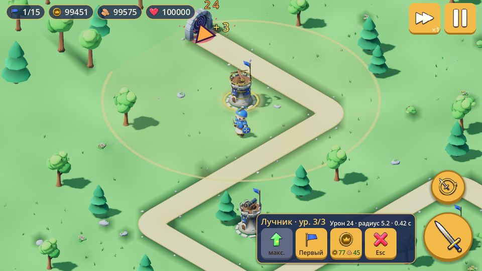
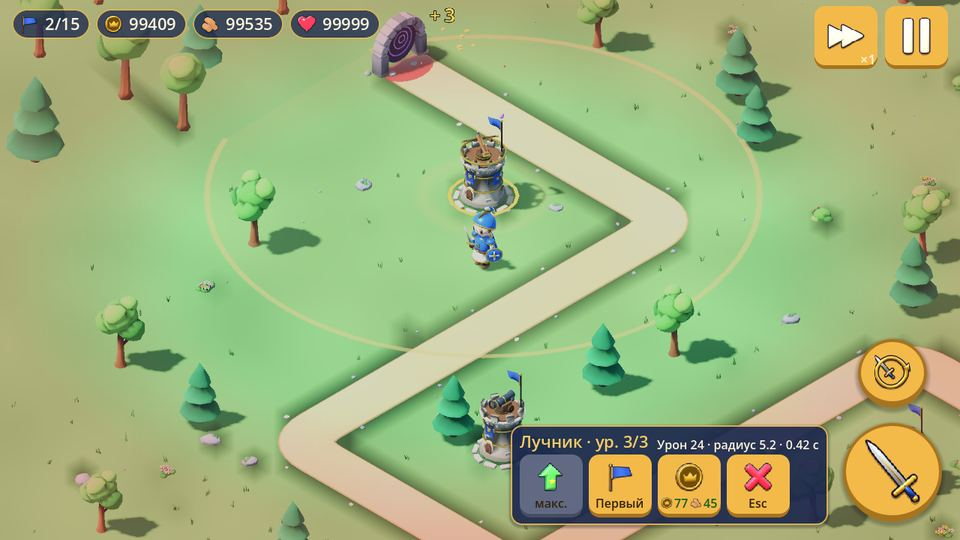
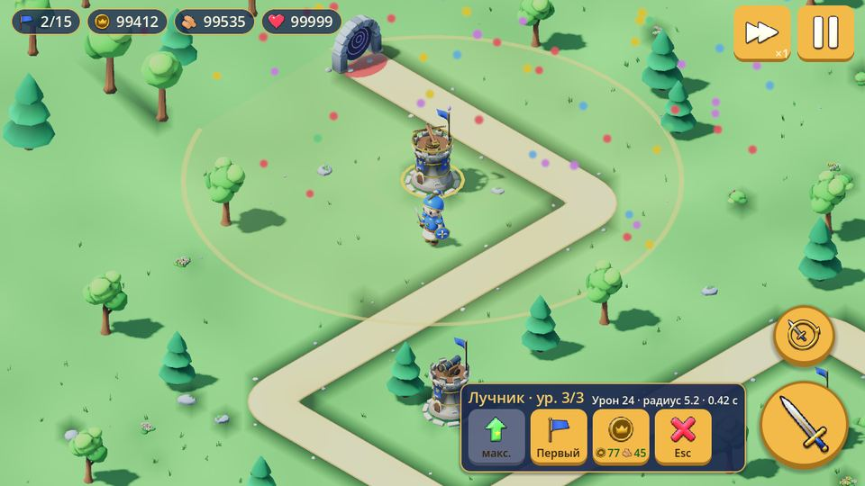

# Technical Design — Bimbleguard

Простая архитектура «сцена = сущность», данные — в ресурсах, связь — сигналами.

## Платформа и настройки

| Параметр | Значение |
|---|---|
| Движок | Godot 4.7.2 (стандартная сборка; см. `config/features`) |
| Язык | GDScript со статической типизацией |
| Рендерер | Compatibility (`gl_compatibility`, OpenGL ES 3.0 / WebGL2-уровень) |
| Viewport | 1280×720, stretch `canvas_items`, aspect `expand` |
| Ориентация | landscape (`display/window/handheld/orientation=0`) |
| Сжатие текстур | ETC2/ASTC (требуется для Android) |

Почему Compatibility: максимальная совместимость с недорогими Android-устройствами,
низкое энергопотребление; для плоских low-poly материалов возможностей Forward+/Mobile
не нужно.

## Сцены и данные уровня

`run/main_scene` — `scenes/level_select.tscn` (`level_select.gd`): 3D-остров
`worldmap.glb`, кнопки уровней ставятся по проекции пустышек `Site1..3`.
Выбор пишется в статическую `LevelCatalog.selected_id`, затем грузится `main.tscn`.

`resources/levels.json` — единый источник для Godot (`LevelCatalog`) и Blender
(`build_terrain.py`): границы (44 × 30 м, центр в начале координат), старт
(золото/дерево/жизни), план волн, тропы `paths` (ломаные из осевых отрезков, у
каждой свой портал на краю поля), замок, герой, площадки, рубимые деревья.
**Замок стоит у центра поля, враги идут со всех 4 сторон:** тропы 0–3 («замковые») кончаются
у ворот замка по одной с каждой стороны (+X, +Z, −X, −Z — это четыре четверти экрана: камера
смотрит вдоль (−1,−1,−1), «зад» замка — выше него на экране), последний отрезок каждой
(«подход») ≥ 9 м и приватный: у него стоят 3 площадки, и никто к нему не присоединяется ближе
9 м к замку. Тропы 4+ (уровни 2–6: 5–6 троп) заканчиваются на отрезке более
ранней (Т-образный перекрёсток под прямым углом, не ближе 1.6 м к её углу), и её
враги идут дальше по той тропе — полный маршрут строит `LevelCatalog.routes()`
(и так же `balance_sim.py`; замковая тропа — та, чья последняя точка ≤ 1.5 м по манхэттену от центра
замка, `LevelCatalog.is_gate`). Пересечения троп запрещены (проверка отрезок–отрезок), Т-слияния
разрешены. Порталы замковых троп — в ≥ 4 экранных направлениях (N/E/S/W). Площадки, старт героя и
деревья расставляет `tools/place_slots.py` (14–20 площадок, ≥ 2 у каждого подхода; запускать после правки
троп). `tools/validate_project.py` проверяет расстояния: все
отрезки всех троп ≥ 3 м друг от друга, кроме последнего отрезка тропы и отрезка, на
котором она кончается; площадки, деревья и герой — от всех троп и порталов.

```
Main (Node3D, main.gd)               — строит уровень из данных и связывает системы
├── WorldEnvironment, Sun, Camera     — окружение, свет, изометрия (camera_follow.gd)
├── Level (Node3D)
│   ├── Hero (hero.tscn)              — ставится в level.hero
│   ├── EnemyPath (Path3D)            — Curve3D маршрута тропы 0
│   └── (в _ready) EnemyPath2/3 (Path3D) для остальных троп, портал у начала
│       каждой, level_N_terrain/decor/forest.glb, замок,
│       TowerSlot × N (tower_slot.tscn), Grove (MultiMesh стоящих деревьев),
│       WoodTree × N на метках Chop_<вид>_<i> из level_N_decor.glb,
│       Villagers (villagers.gd) → Villager × 2 (villager.tscn), после сетки ходьбы
├── GameState (Node)                  — золото, дерево, жизни
├── WaveManager (Node)                — спавн по WavePlan на enemy_paths (по `lane` каждого спавна из WavePlan; летуны — по air_paths; по очереди для каждого вида врага)
├── BuildManager (Node)               — площадки, tower_types: archer/cannon/frost.tres
├── Sfx                               — рог, рёв босса, удар по замку, победа/поражение
└── HUD (ui/hud.tscn)                 — показатели, командная карта, атака, баннер босса
```

## Пауза, скорость, звёзды, кузница

- Пауза — `SceneTree.paused`; меню паузы и экран конца — один узел `HUD/EndScreen`
  (кнопки с `process_mode = ALWAYS`). Пауза включается кнопкой, действием `pause`,
  `NOTIFICATION_WM_GO_BACK_REQUEST` (`application/config/quit_on_go_back=false`) и
  на мобильных при `NOTIFICATION_APPLICATION_PAUSED/FOCUS_OUT`. На карте «Назад» — выход.
- ×2 — `Engine.time_scale`, сбрасывается в конце уровня и при выходе со сцены.
- Звёзды и звук — `LevelCatalog` (`user://progress.cfg`: `stars_<id>`, `settings/sound`);
  тесты подменяют `LevelCatalog.save_path`.
- Кузница — карта команд `main.gd` (`_forge_card`), цены меча — `@export` героя,
  ремонт — `@export` `GameState` (`repair_lives`, `repair_wood`).
- Продажа — `BuildManager.sell()` → `TowerData.sell_value()` (70 %), `WalkGrid.unblock()`.
- «Вихрь» — `Hero.try_spin()`, эффект `scenes/fx/spin_fx.tscn`.

## Прогресс, улучшения, осада

- `Perks` (`scripts/perks.gd`, статический) — звёзды и улучшения: `earned_stars`,
  `free_stars`, `buy`, `reset`, `value(id)`. Улучшения — `PerkData` в
  `resources/perks/`; загружаются лениво (`Perks.all()`): `preload` в константе
  ломал ресурсы, пока компилируются скрипты с типом `PerkData`.
- `main.gd` применяет улучшения при старте: `GameState.configure` (золото, дерево,
  жизни), `Hero.damage_multiplier` / `wood_bonus`, `BuildManager.damage_multiplier`
  (умножается после каждого `apply_level`).
- Осада: `LevelCatalog.endless` → `WavePlan(waves, true)` (`ENDLESS_WAVES`, без
  финального босса); рекорд — `LevelCatalog.save_endless()`.

## Иконки, иконка приложения, заставка

- `assets/blender/build_icons.py` → `icon_*.glb` (палитра, без текстур).
- `tools/render_icons.gd` → `ui/icons/*.png` 256 px: ортокамера по силуэту, небо для
  бликов металла, обводка и тень (дилатация альфы через `blit_rect_mask`).
  Импорт с мипмапами, `default_texture_filter` = Linear Mipmap.
- `tools/render_app_icon.gd` → `icon.png` (192), `ui/app/icon_foreground.png` и
  `icon_background.png` (адаптивная 432), `ui/app/splash.png` (заставка
  `application/boot_splash`). Пути прописаны в `export_presets.cfg`.

## Биомы, новые враги и башни

- `levels.json` → `"biome"`: `meadow` / `winter` / `autumn` / `desert`. Blender
  перекрашивает террейн, декор и лес по `tg.BIOMES` (замена цветов палитры), рубимые
  деревья — `tree_<round|pine>_<biome>.glb`; `WoodTree.model_scene()` грузит модель по
  имени варианта.
- `EnemyData.flying` / `fly_height` (летун; снаряды пушки и её прицел его не видят),
  `arrow_damage_mult` (щитовик). Урон передаётся с типом: `take_damage(amount, kind)`.
- `TowerData.chain_levels` / `chain_range` (молния: без снаряда, мгновенный урон по
  цепи, эффект `scenes/fx/lightning_fx.tscn`), `damage_kind`, `hits_air`.
- Коллайдеры моделей — выпуклые (`-convcolonly`, `tg.COLLIDER_SUFFIX`), по одному на
  ствол: полые trimesh-коллайдеры позволяли рыцарю «провалиться» внутрь куста.

## Онлайн (Firebase)

`scripts/online.gd` — autoload `Online` (единственный): REST Firebase без плагинов.
Анонимный вход (Identity Toolkit, обновление токена), рекорды осады
(`leaderboards/level_<id>/scores/<uid>`, запрос `runQuery` топ-10), облачная копия
прогресса (`saves/<uid>`, текст `ConfigFile`). Конфиг — `res://firebase.cfg`
(не коммитится, есть `firebase.example.cfg`), правила — `firestore.rules`.
Без конфига `Online.is_configured()` = false, кнопка «Рекорды» скрыта.

### Структура сервисов `Online` (2026-10-17)

`scripts/online.gd` (~360 строк) — **фасад**: единственный autoload, прежний публичный API
(методы, сигналы, свойства `auth`, `firestore`, `rtdb`, `auto_sync`, `retry_base` и т. д. —
свойства проброшены в контекст). Работа выполняется обычными `RefCounted`-классами
(не autoload), которые делят общий `OnlineContext` (`scripts/online_context.gd`: ключи и
URL, `auth`/`firestore`/`rtdb`, флаги занятости, сигналы и ссылки на остальные сервисы).
Связь «вниз» — вызовы методов сервисов; «вверх» — сигналы контекста, фасад переизлучает
их под прежними именами.

| Класс (`scripts/`) | Ответственность |
|---|---|
| `OnlineSession` (`online_session.gd`) | `start`, `needs_welcome`, `choose_guest`, тип аккаунта, `start_new_guest`, `wipe_local`, запомненный uid |
| `OnlineSync` (`online_sync.gd`) | `sync_now` (read-merge-write `users/{uid}`), `sync_state`, авто-синхронизация с отложкой и back-off, `cloud_save/load` |
| `OnlineNicknames` (`online_nicknames.gd`) | резерв ника одной транзакцией, 24-часовые часы смены, переименование рекордов |
| `OnlineAccounts` (`online_accounts.gd`) | почта: регистрация, привязка, вход, выход, письма, сброс пароля; удаление аккаунта |
| `OnlineRecords` (`online_records.gd`) | `start_run`, очередь рекорда с повторами, `send_score`, таблицы уровней, разбор ответов |
| `OnlineDaily` (`online_daily.gd`) | очередь результата дня, таблица дня |
| `OnlineCoop` (`online_coop.gd`) | транспорт Realtime Database, очистка комнат при удалении аккаунта |

```
Online (facade, autoload)
  └─ OnlineContext (state + signals) ◄── shared by:
       OnlineSession ──► OnlineSync ──► OnlineNicknames
       OnlineAccounts ─► OnlineSync, OnlineNicknames, OnlineSession, OnlineCoop
       OnlineRecords ◄── OnlineDaily (send_score)
       OnlineSync/Records/Accounts ─► AuthService (+ AuthErrors), FirestoreClient, RtdbClient
```

Сервисы обращаются друг к другу только через публичные методы (`ctx.sync.sync_now()` и т. п.);
не должны кешировать `ctx.auth`/`ctx.firestore` через `await` (`Online.setup` подменяет их).
`AuthService` дополнительно разделён: таблицы кодов ошибок и разбор ответа — `AuthErrors`
(`auth_errors.gd`), запросы и токены — `AuthService`. Правила боя (заголовок журнала,
сложность, перки, стартовые ресурсы) — `BattleSetup` (`battle_setup.gd`), `main.gd` лишь вызывает.
На фасаде отключено только `max-public-methods` (он обязан отдавать весь старый API).

### Изоляция тестов

`tests/run_all.sh` запускает каждый тест с отдельными пустыми `HOME` и `XDG_DATA_HOME`:
`user://` (сохранения, сессии, логи) у каждого процесса свой, поэтому прогоны не мешают друг
другу, параллельному `run_all.sh` и обычному запуску игры (настоящий `progress.cfg` не трогается).
`--only <regex>` запускает подмножество: `tests/run_all.sh <godot> --only 'accounts|records'`.

## Сохранение

`LevelCatalog.data()` — кэш `ConfigFile`; `commit()` пишет атомарно (`.tmp` →
переименование, прошлая версия — `.bak`). Повреждённый файл: берётся `.bak`, а если
и он не читается — игра работает на значениях по умолчанию и **не** перезаписывает
файл.

## Тесты и баланс

`tests/run_all.sh <godot>` — headless-тесты: `test_gameplay.gd` (рубка, постройка,
улучшение, продажа, кузница, вихрь, боссы; на каждом уровне), `test_walk.gd` (рыцарь
доходит до всех площадок), `test_pause.gd` (пауза, «Назад», ×2, звёзды, звук),
`test_meta.gd` (звёзды, улучшения, осада, повреждённое сохранение), `test_combat.gd`
(летуны, щиты, молния), `test_villagers.gd` (жители: появление, курс, падение цены,
нельзя продать больше, чем есть; карта торговли; на каждом уровне), `test_online.gd` (Firebase без сети: разбор ответов,
восстановление прогресса). Геймплей и проходимость — на всех 6 уровнях.
`tools/balance_sim.py` — дискретная симуляция волн с жадным игроком и героем у замка.

## Камера

- `Camera3D`, `projection = Orthogonal`, `size ≈ 10`.
- Истинная изометрия: камера смотрит на центр карты из направления `(1, 1, 1)`
  (наклон ≈ 35.26°, поворот 45°). Камера не вращается.
- Позже: ограниченный zoom жестом pinch (изменение `size` в диапазоне).

## Сущности

| Сцена | Корень | Скрипт | Назначение |
|---|---|---|---|
| `scenes/enemy.tscn` | `PathFollow3D` | `enemy.gd` (`Enemy`) | движение, HP, полоска здоровья |
| `scenes/projectile.tscn` | `Node3D` | `projectile.gd` (`Projectile`) | самонаводящийся снаряд |
| `scenes/tower.tscn` | `Node3D` | `tower.gd` (`Tower`) | поиск цели, стрельба |
| `scenes/tower_slot.tscn` | `Area3D` | `tower_slot.gd` (`TowerSlot`) | площадка, состояния |
| `ui/hud.tscn` | `CanvasLayer` | `hud.gd` (`Hud`) | показатели, кнопки, меню строительства |

**Движение врагов:** `PathFollow3D` внутри `Path3D` (`loop = false`,
`rotation_mode = Y`), `progress += speed * delta`. При `progress_ratio ≥ 0.999`
враг испускает `reached_base(damage)` и удаляется. NavMesh не нужен.

**Смерть врага:** `take_damage()` уменьшает HP; при 0 — флаг `_is_dead`,
выход из группы `enemies`, `died(reward)`, `queue_free()`. Флаг защищает от
повторных сигналов, если в один кадр прилетело несколько снарядов.

**Выбор цели:** башня перебирает группу `enemies` и берёт **ближайшего** врага
в радиусе `range_m` (расстояние в плоскости XZ). При единицах–десятках врагов это
дешевле и проще, чем `Area3D` со слоями коллизий; пересмотреть, если врагов станет
сотни.

**Снаряд:** `top_level = true` (живёт в мировых координатах), летит к
`get_aim_point()` цели, наносит урон при сближении. Если цель умерла или
удалена — снаряд исчезает (`is_instance_valid`).

## Строительство

**Площадка** (`TowerSlot`, корень `Area3D`, `collision_layer = 1`, цилиндрическая
форма): состояния `FREE` / `SELECTED` / `OCCUPIED`. Состояние показывается
`material_override` площадки (серый / жёлтый со слабым свечением / тёмный) и
кольцом `TorusMesh`, которое видно только при выборе. Построенная башня становится
дочерним узлом площадки; `Tower`, размещённый под площадкой в редакторе, делает её
занятой с самого старта.

**Данные башни:** `TowerData` (`scripts/tower_data.gd`,
`resources/tower_archer.tres`): `display_name`, `cost`, `scene`. Это единственное
место, где задана цена; HUD получает её параметром. Боевые параметры пока остаются
`@export` в `tower.gd`.

**Ввод:** `BuildManager._unhandled_input` реагирует только на нажатие левой кнопки
мыши. На Android касания превращаются в события мыши
(`input_devices/pointing/emulate_mouse_from_touch=true`, явно задано в
`project.godot`), поэтому мышь и тач идут одним путём, а кнопки HUD перехватывают
свои нажатия раньше `_unhandled_input`. `InputEventScreenTouch` отдельно не
обрабатывается, чтобы одно касание не обрабатывалось дважды. Верхняя панель HUD
имеет `mouse_filter = IGNORE`, чтобы не блокировать карту.

**Выбор:** луч `Camera3D.project_ray_origin/normal` → `intersect_ray` с
`collide_with_areas = true` по маске слоя 1. Свободная площадка → выбор и
`slot_selected`; занятая площадка или пустое место → `clear_selection()` и
`selection_cleared`.

**Покупка:** `build_selected()` проверяет, что площадка выбрана и свободна, затем
`GameState.spend_gold(cost)`; при нехватке золота ничего не меняется и возвращается
`false`. Меню стоит в левом нижнем углу: по расчёту проекции камеры это единственная
нижняя область без площадок, базы и тропы на 16:9 и 20:9 (в центре оно закрывало
площадку 3 и базу). Кнопка «Построить» при нехватке золота неактивна, но это только
подсказка — решение принимает `BuildManager`. Новая башня автоматически ищет врагов
через группу `enemies`, отдельной регистрации не требуется.

Сигналы: `slot_selected(slot)`, `selection_cleared`, `tower_built(slot, tower)`;
HUD: `build_pressed`, `build_cancelled`. Связывает их `main.gd`.

## Волны

`WavePlan` (`scripts/wave_plan.gd`) строится из блока `waves` уровня: число волн,
задержки, `count_base + count_step·(n−1)` врагов, HP × `hp_mult·hp_growth^(n−1)`,
с какой волны идут быстрые (`fast_from`, каждый 3-й) и толстые (`tank_from`,
каждый 4-й), интервал спавна ×0.97 за волну до `interval_min`. Каждая
`boss_every`-я и последняя волна заканчивается боссом (на 20+ — двумя), его HP
растёт медленнее (показатель 0.75). Типы врагов — `EnemyData` в `resources/enemies/`.

`WaveManager`: очередь спавна `[{data, hp}]`, `start_next_wave() -> bool`
(защита от двойного запуска), `schedule_next_wave`, `stop()`.
Сигналы: `wave_started(wave, total, boss)`, `wave_cleared`, `all_waves_cleared`,
`enemy_killed(reward)`, `enemy_reached_base(damage)`.

## Состояние игры

`GameState` — **обычный узел** в `main.tscn`, а не autoload: пока уровень один,
глобальный синглтон не нужен (CLAUDE.md: autoload только при необходимости).
Поля `gold`, `wood`, `lives`, `is_defeated`; методы `configure(start)`, `add_gold`,
`add_wood`, `can_afford(Vector2i)`, `spend(Vector2i) -> bool`, `lose_lives`; сигналы
`gold_changed`, `wood_changed`, `lives_changed`, `defeated`. Старт — из `level.start`.

Герой (`hero.gd`): `try_attack()` с кулдауном 0.5 с, удар через 0.2 с по врагам
(группа `enemies`) и деревьям (группа `wood_trees`, `WoodTree.chop() -> int`) в
конусе перед собой; сигнал `wood_gathered(amount, at)`. Деревья — слой коллизий 3,
маска героя 1 + 3.

Все деревья внутри поля рубятся. `build_terrain.py` не запекает их в декор, а
кладёт пустышки `Chop_<pine|round>_<i>`; `main.gd` ставит на них `WoodTree`.
Стоящие деревья рисует `Grove`: по одному `MultiMeshInstance3D` на модель
(около 50 деревьев = 2 draw call вместо 50). Дерево, которое качается, падает,
растёт или подсвечено как цель, прячет свой экземпляр и показывает собственную
модель. Замер на уровне 1: 85–120 draw calls в кадре (было 150–180).
Декор, земля и дальний лес не отбрасывают теней: кадр уровня 1 ≈ 99 тыс.
треугольников (было 127 тыс.), уровня 3 ≈ 109 тыс. Полоска HP видна только у
раненых врагов и боссов; HUD обновляет текст только при изменениях.

Приказы героя идут по `WalkGrid` (`AStarGrid2D`, клетка 0.5 м): сетка строится
один раз после первого физического кадра запросами `intersect_shape` (цилиндр
r = 0.34) к слоям 1 и 3; новая башня блокирует свои клетки. Путь упрощается
проверкой прямой видимости по клеткам.

Тап (`BuildManager`) срабатывает на отпускание, если палец сдвинулся меньше
24 px и не было второго пальца (`CameraFollow.is_pinch_gesture()`); щипок и
колесо мыши меняют `size` орто-камеры в пределах 7–16.

`main.gd` соединяет: `WaveManager → GameState` (награда, потеря жизней),
`GameState/WaveManager → HUD` (показатели), `HUD → WaveManager` (кнопка).
При поражении или победе — сообщение и `get_tree().paused = true`.

## Конец игры и перезапуск

- Победа (`all_waves_cleared`, если не было поражения) или поражение (`defeated`) →
  `main._end_game()`: снимает выбор площадки (меню закрывается), показывает
  `Hud.show_end_screen()` и ставит `get_tree().paused = true`.
- Экран конца — `MessageLabel` и `RestartButton` («Играть заново») по центру,
  оба скрыты до конца игры. У кнопки `process_mode = ALWAYS`, поэтому она
  нажимается на паузе — мышью и касанием (через `emulate_mouse_from_touch`).
  После первого нажатия кнопка блокируется до перезагрузки.
- `restart_pressed` → `main._on_restart_pressed()`: **сначала**
  `get_tree().paused = false`, затем `get_tree().reload_current_scene()`.
  Если перезагрузка вернула ошибку — `push_error` и пауза возвращается.

Почему перезагрузки сцены достаточно: всё состояние уровня хранится в узлах
`main.tscn` — золото и жизни (`GameState`), номер волны и таймеры (`WaveManager`),
враги (дети `EnemyPath`), снаряды (дети башен), построенные башни (дети площадок),
выбор (`BuildManager`). Autoload'ов и `static var` нет, `Engine.time_scale` не
меняется. Все соединения сигналов создаются в `_ready()` узлов сцены (и на новых
врагах в `WaveManager`), поэтому при перезагрузке они удаляются вместе со старыми
узлами и подключаются заново ровно один раз; `WaveManager` в сцене один.
Единственное, что переживает перезагрузку, — `SceneTree.paused`, его снимаем вручную.

При появлении autoload'а (например, для настроек или прогресса) его состояние
уровня придётся сбрасывать явно — перезагрузка сцены его не затронет.

## Будущие данные (Resource)

`TowerData` уже есть (имя, цена, сцена). При появлении нескольких типов башен и
врагов в неё переедут `damage`, `fire_interval`, `range_m`, появится `EnemyData`,
а `WaveConfig` заменится списком групп «тип × количество × интервал».

## Ввод

- Тап/клик → луч из камеры → `PhysicsRayQueryParameters3D` (см. «Строительство»).
- Слои коллизий: 1 — площадки (используется), 2 — башни (зарезервирован).
  Враги коллизий не имеют.

## Визуал и игровая логика

Логика не зависит от мешей: модели — дочерние узлы `Model` (инстансы `.glb`), у них
нет коллизий, они не участвуют в выборе цели и в лучах выбора площадок.

| Скрипт | Где | Что делает |
|---|---|---|
| `looping_model.gd` | `Model` героя и чупакабры | зацикливает анимацию `idle`, случайная фаза |
| `tower_model.gd` | `Model` башни | по сигналу `Tower.fired(target)` поворачивает `Turret` к цели и играет `attack`; тень — только у `Base` и `Turret` |
| `no_shadow.gd` | террейн, кольца площадок | отключает отбрасывание теней у мешей ниже (экономия draw calls) |
| `hud_icon.gd` | HUD | рисует иконки флага, монеты, сердца |

- `tower.gd` только испускает `fired` и выпускает снаряд у кончика арбалета
  (`muzzle_reach`); урон, радиус и темп не менялись.
- `projectile.gd` разворачивает стрелу по направлению полёта (`look_at`).
- Чупакабра в `enemy.tscn` повёрнут на 180°: модель смотрит в +Z, а `PathFollow3D` ведёт по −Z.
- Все модели используют один материал `assets/materials/tg_palette.tres`
  (альбедо-палитра × цвет вершин с AO; roughness/metallic из ORM).
- Тени: один ортогональный каскад, `shadow_blur = 1.5`; мелкие пропсы теней не отбрасывают.
- Замер (Godot 4.3, Compatibility, 1280×720, программный OpenGL): ~56 draw calls 3D
  (вместе с тенями) и ~45 2D-вызовов HUD, 100–125 всего; ~160 тыс. треугольников в кадре
  (с тенью). Дальний лес (`level_01_forest.glb`) теней не отбрасывает; декор и лес разбиты на
  чанки 10 × 10 м для отсечения. FPS на телефоне не измерялся.
- Тени (v0.5): у башни тень отбрасывают только `Base` и `Turret` (`tower_model.gd` гасит
  `Lv2`, `Lv3` и деталь на турели), не отбрасывают плита площадки, снаряды (в сценах
  снарядов, а не в `_ready` каждого выстрела) и все `CPUParticles3D` эффектов. Молния
  рисуется одним `MultiMeshInstance3D` на разряд вместо `MeshInstance3D` на отрезок.
  Уровень 6, все 14 площадок застроены и улучшены до 3-го уровня (`RENDERING_INFO_TOTAL_
  DRAW_CALLS_IN_FRAME`, 1280×720): 153 → 118 draw calls (без HUD 119 → 92); пустой
  уровень 90 → 72; в бою (волны идут) в среднем 154 → 119, пик 165 → 124.
- Большие карты 44 × 30 м с 2–3 путями (v0.6; тот же скрипт замера: все площадки застроены,
  4 вида башен, 6 волн идут одновременно, 3x скорость, 1280×720, Godot 4.7, Metal/GL
  Compatibility, `TOTAL_DRAW_CALLS_IN_FRAME`, включая HUD). Среднее / пик draw calls, пик врагов:
  ур. 1 127 / 127 (48), ур. 2 135 / 140 (36), ур. 3 119 / 127 (41), ур. 4 126 / 128 (36),
  ур. 5 107 / 108 (46), ур. 6 140 / 154 (52). Тот же замер на коммите до карт (ур. 1 / 3 / 6):
  123, 115, 126 (в среднем), т. е. +4, +4, +14: хуже на 3–11 %, цель < 100–120 пока не
  достигнута на уровнях 2, 4, 6. Треугольников в кадре (стандартный вид) 100–125 тыс.
  (ур. 3 и 6 стали легче: 134 → 109 и 149 → 125 тыс.). Обзорные снимки: `docs/screenshots/map_01.png` …
  `map_06.png`. FPS на телефоне не измерялся.

Замер после анимации и подписей карточки (`tools/measure_draw_calls.gd`, 1280×720, стресс):
уровень 1 — 110 / 124 (среднее / пик), уровень 3 — 109 / 127; число мешей героя и жителей не
менялось, подписи кнопок карточки добавляют 4–5 текстовых батчей только пока карточка открыта.

### Draw calls: причины роста и результат (v0.7)

Замер — `tools/measure_draw_calls.gd` (окно, **не** `--headless`, 1280×720, Godot 4.7.2,
Metal/GL Compatibility, `TOTAL_DRAW_CALLS_IN_FRAME` с HUD): каждая площадка с башней 3-го
уровня (4 вида по кругу), открыта командная карта, волны запускаются каждые 2 с при ×3,
40 с боя. Это тяжёлый случай (раньше карта была закрыта, часть башен ниже уровнем), поэтому
цифры «до» выше, чем в предыдущих замерах. Разбор по частям — тем же скриптом (прячет узел
и считает разницу).

Причины (ур. 2, башни + бой): HUD 26–48 (каждый `Label` с обводкой — две пачки глифов,
тени `StyleBoxFlat`), тени от солнца 28–41 (у башни тень давали тело и турель, у героя 7
мешей), на каждую башню отдельные `Lv2`/`Lv3`, плита-площадка под башней и каменное
кольцо (по одному мешу на площадку), 10–15 кусочков земли/декора/леса в ячейках 10 м.

Что сделано:

| Мера | Эффект |
|---|---|
| Украшения ур. 2–3 запечены в варианты тела (`Base`, `Base2`, `Base3`); `tower_model.gd` меняет `mesh` | −1…2 на башню |
| Плита площадки скрыта под башней; тень башни только от тела | −2 на башню |
| Каменное кольцо площадки запечено в террейн (`build_terrain.py`), `slot_ring.glb` удалён | −1 на площадку |
| Ячейки деталей/декора/леса 22/22/30 м → 15 м (`CHUNK`, `FOREST_CHUNK`) | −10…15 |
| Герой: тень только от `Body` | −6 |
| HUD: без обводки у текста на панелях, без теней `StyleBoxFlat`, значки и тексты на слоях `z_index` | −15…20 |
| Пустыня: земля `path_dark` (раньше почти белый `sand`), тропа `dirt` | читаемость |

Среднее / пик draw calls в бою (до → после), пик врагов, треугольники в кадре (тыс.):

| Ур. | До: сред. / пик | После: сред. / пик | Треуг. до → после |
|---|---|---|---|
| 1 | 155 / 164 | 106 / 115 | 123 → 157 |
| 2 | 165 / 182 | 111 / 127 | 127 → 152 |
| 3 | 130 / 138 | 97 / 105 | 114 → 138 |
| 4 | 155 / 165 | 108 / 126 | 127 → 153 |
| 5 | 127 / 135 | 92 / 102 | 104 → 115 |
| 6 | 151 / 172 | 107 / 121 | 125 → 166 |

Цена: больше треугольников в кадре (ячейки крупнее — за кадром рисуется больше), все уровни
выше бюджета 100 тыс., ур. 1, 6 близки к 170 тыс. FPS на телефоне не измерялся; если окажется
узким местом — вернуть `CHUNK` к 10–12 м (цена ≈ +8 draw calls) или проредить лес.
Модели башен теперь содержат 3 варианта тела (в файле ≈ 12 тыс. треуг., в кадре видно ≤ 4 тыс.).

## Интерфейс

`ui/hud.tscn` с темой `ui/theme.tres`: `Root` (Control, `mouse_filter = IGNORE`) →
`TopBar` (компактные «фишки» `HudChip`: флаг «3/15», золото, дерево, жизни),
`TopRight` (только ×2 и пауза), `Hint` (подсказка первых шагов — сама гаснет через
`hint_seconds` и возвращается только при смене текста), `Banner` (один раз на событие:
«Первая волна через 30 секунд» в начале, «Волна N!» + «Следующая через 30 секунд» при старте
волны, «Последняя волна!»; волна с боссом — тот же баннер с иконкой короля и коралловым
заголовком), `CommandCard`, `AttackButton`/`SpinButton`, `Joystick`, `EndScreen`.
Вызова волны раньше времени нет: волны идут строго по таймеру `WavePlan.wave_duration`;
при старте волны звучит `wave_boom.wav`.

- Кузница открывается из меню паузы (кнопка «Кузница» снимает паузу и открывает карту)
  или клавишей K (`Hud._unhandled_key_input`), поэтому справа сверху не больше двух кнопок.
- Командная карта компактная: заголовок и статы в одной строке («Лучник · ур. 2/3  Урон
  24 · радиус 5.2 · 0.42 с»), кнопки 84 × 84 (≈ 48 dp на телефоне 1080p, холст 720 px),
  строка подсказки — только «Не хватает…» / «Рыцарь идёт…». Роли башен, «Дальше: …» и
  цена ремонта — во всплывающих подсказках кнопок (только на ПК; на тач-сборке `_touch`
  их нет). Доход от продажи — зелёными цифрами. Карта растёт влево-вверх от кнопки атаки
  и не заходит в центр поля и на джойстик (проверено при 1280×720 и 1600×720).
- Снимки: `docs/screenshots/hud_desktop.png`, `hud_phone.png`, `hud_phone_build.png`.

## Симуляция боя (детерминизм, журнал команд)

Бой идёт на фиксированном шаге 30 Гц (`scripts/sim.gd`): кадровый `delta` копится и тратится целыми
шагами, враги/башни/снаряды/волны/деревья обновляются в `sim_step()` в порядке id (подробно и честно
о границах — `docs/MULTIPLAYER.md`, §8.1). Узлы только рисуют (интерполяция по `Sim.alpha()`).
Все действия игрока — `GameCommand` через `GameCommands.submit()` (штамп тика, исполнение, запись в
`CommandLog`); UI слушает `applied`. Таймеры в геймплее — `Sim.schedule_in()`; случайность геймплея —
`Sim.rng` (`SimRng`, PCG32). Состояние сверяется `Sim.state_hash()`; `tests/test_replay.gd` проверяет
бит-в-бит повтор по журналу при другом темпе кадров на всех уровнях. Герой (физика) вне симуляции,
его замах/вихрь входят командами с позицией. **Защита от «спирали смерти»**: если шаги одного кадра
занимают дольше `Sim.STEP_BUDGET_USEC` (22 мс; не применяется при `manual`, т.е. в тестах), остаток
накопителя отбрасывается — игра замедляется, а не копит долг (на слабом телефоне это раньше давало
кадры по 150–200 мс); при сворачивании/возврате (`NOTIFICATION_APPLICATION_PAUSED/RESUMED/FOCUS_*`) накопитель
сбрасывается. `QualityGuard` при среднем кадре > 30 мс ступенчато понижает только картинку (тени, MSAA, эффекты); бой начинается со ступени по уровню графики
(`GameSettings.graphics_tier()`: настройка «авто/низкое/среднее/высокое», авто — по ОЗУ и GPU, только на телефоне; MSAA на телефоне
выключен в `project.godot`, см. `docs/DEVICE_COMPATIBILITY.md`),
`DiagOverlay` (скрыт, 5 тапов по версии в настройках) и `CrashTrace` — см. `docs/DEBUG_ANDROID.md`, замеры — `docs/SOAK_REPORT.md`.
`main.gd` создаёт `Sim` и `GameCommands` в коде,
`sim.start()` вызывается после построения сетки проходимости. Карточки кузницы и торговли — `command_cards.gd`.

## Герой, камера, ввод

- `scenes/hero.tscn`: `Hero` (`CharacterBody3D`, слой 2, маска 1, `motion_mode = FLOATING`) + капсула
  + модель. `hero.gd`: движение по действиям `move_up/down/left/right` **относительно камеры**
  («вверх» — вверх по экрану) плюс `joystick_vector`; приказы `move_to(point, reach, callback)`,
  отмена при ручном вводе или если 1.5 с нет продвижения; анимации `idle` / `walk`.
- Действия ввода — в `project.godot` (`[input]`): WASD, стрелки, левый стик и крестовина;
  `build_tower` (B / A), `upgrade_tower` (U / Y), `cancel_command` (Esc / B геймпада).
- Препятствия: модели с узлами `*-colonly` из Blender импортируются как `StaticBody3D`
  (слой 1): башня, замок, портал, стволы деревьев, стены по границам поля (44 × 30 м). Площадки — `Area3D`,
  герою не мешают; луч выбора площадок их тел не видит (`collide_with_bodies = false`).
- `camera_follow.gd`: камера сохраняет изометрический угол и плавно следует за героем;
  точка взгляда ограничена `bounds`.
- `virtual_joystick.gd`: виден только на мобильных (`OS.has_feature("mobile")`), работает с
  `InputEventScreenTouch/Drag` по индексу пальца (мультитач), мышиные события от того же
  касания поглощает.
- Тап по земле: `BuildManager.ground_tapped(point)` → герой идёт туда.

## Жители и торговля деревом

`Villagers` (узел в `Level`, создаётся `main.gd`) после постройки `WalkGrid` выбирает дома
жителей на решётке 1 м в 3–9 м от замка: клетка свободна на сетке ходьбы (с запасом на
ширину жителя), ≥ 1.5 м от осевой тропы, ≥ 1.4 м от площадок, ≥ 2.5 м от старта героя,
вокруг достаточно свободного места; лучшие по простору и близости к замку, через 2.5 м.
`Villager` гуляет по прямой к случайной точке в 1.8 м от дома, если весь отрезок прошёл
`Villagers.is_open()` (башни блокируют сетку, так что и их обходит); без тел и коллизий,
без теней (`no_shadow.gd`), 6 мешей = 6 draw calls на жителя. Оживляет жителя и героя
`Puppet` (`scripts/anim/puppet.gd`, клипы в `puppet_clips.gd`): процедурно двигает части
модели (Body/Head/ArmL/R/LegL/R/Cape/Sword) по реальной скорости (шаг, подскок со squash &
stretch, наклон вперёд и крен на поворотах, плащ по ветру; в покое дыхание, переминание,
оглядывание), поверх играют клипы: у героя `attack` (удар в ~0.21 с, как и урон в Sim) и
`spin`; у жителя `wave` (герой ближе 4 м или торговля), `cheer` (прыжки при продаже), `hop`/`skip`
(случайно раз в 4–9 с). Только отрисовка: не влияет на Sim и хэш. AnimationPlayer из glb не
используется. Кадры: `tools/shot_walkers.gd`. Торговлей правит `Villagers.sell(lots)`: не больше целых
партий, чем есть дерева; цена партии — `VillagerTrade.lot_gold(lots_sold)` =
max(min_gold, round(start_gold · price_decay^n)). `main.gd` открывает карту торговли, когда
герой ближе `trade_reach` к жителю или после тапа по нему (герой идёт к жителю), закрывает,
когда герой отошёл; ✕ закрывает до тех пор, пока герой не отойдёт.

Покупка дерева и дровосеки (`docs/ECONOMY_V2.md`, этап 1): `Villagers.buy(lots)` /
`Villagers.hire(index)` через команды `TRADE_BUY` и `HIRE`; `Villagers.sim_step()` (из `Sim.step()`)
даёт дерево нанятым целыми числами по тикам; `Villagers.state_ints()` входит в `state_hash`
только после первой покупки или найма (старые журналы дают прежний хэш); `Sim.VERSION` = 2;
режим — `Villagers.wood_economy` (выкл. в рекорде и daily). Тест `tests/test_wood_economy.gd`.

## Командная карта и приказы

`main.gd` превращает кнопки карты в приказы: выбранная площадка (тапом или подходом героя
ближе 1.1 м) + команда BUILD / UPGRADE → если герой ближе 1.25 м — сразу, иначе
`hero.move_to(..., callback)`. `BuildManager.build_on(slot)` / `upgrade(slot)` проверяют
золото в момент выполнения. Уровни башни — массивы в `TowerData`
(`upgrade_costs`, `damage_levels`, `range_levels`, `interval_levels`); `Tower.apply_level()`
берёт статы, `level_changed` включает украшения `Lv2` / `Lv3` модели.

## Отклик: звук и частицы

- Звуки синтезируются `tools/gen_sounds.py` в `assets/audio/*.wav` (детерминированно).
- `one_shot_fx.gd`: сцена эффекта запускает свои `CPUParticles3D` и `AudioStreamPlayer`
  **в конце кадра** (позицию ставят после `add_child`) и удаляет себя по `lifetime`.
- `scenes/fx/`: `hit_fx` (снаряд при попадании), `death_fx` (враг при смерти, + монеты),
  `build_fx`, `upgrade_fx` (main.gd по сигналам `BuildManager`). Выстрел — `ShotSound`
  в `tower.tscn`; рог волны, удар по замку, победа/поражение — узел `Sfx` в `main.tscn`.

## Эффекты (game feel)

Одна точка входа: `scripts/fx/fx.gd` (`class_name Fx`). Уровень (`main.gd`, `_start_fx`) создаёт один узел `Fx`
и вызывает `setup(...)`; дальше `Fx` сам подписывается на сигналы боя. **Эффекты только визуальные**: они
слушают сигналы (`Enemy.died/damaged`, `Tower.fired`, `BuildManager.*`, `GameState.lives_changed`,
`Hero.swung/spun/wood_gathered`, `WaveManager.wave_started/all_waves_cleared`), не пишут в состояние симуляции,
не используют `SimRng` (у `Fx` свой `RandomNumberGenerator`, `randomize()`) и не создают узлов, которые видит
`Sim.state_hash`. Единственные правки «боевых» скриптов: сигналы `Enemy.damaged`, `Hero.swung/spun` (только
`emit`), визуальные поля `Enemy.hit_flash` / `crowd_slot`, `EnemyData.fx_color`.

Настройка «Эффекты» (кнопка в `SettingsPanel`, ключи `SET_FX*`; хранится в `user://settings.cfg`,
`GameSettings.effects()`): **выключено** — ничего не создаётся и не рисуется; **минимум** — числа золота,
облачко смерти, кольца постройки, потеря жизни (тряска + виньетка), конфетти (меньше); **полные** — всё
остальное: числа урона, вспышка попадания, искры выстрелов, шаги героя, взмахи, пульс выбранной площадки,
подпрыгивание башни при улучшении. Переменная окружения `BIMBLEGUARD_FX=off|min|full` перекрывает настройку
(тесты, скриншоты). Вспышка врага включается при старте боя (смена настройки в паузе действует со следующего боя).

| Что | Как | Draw calls |
|---|---|---|
| Частицы (пыль, искры, снежинки, конфетти) | `FxParticles`: один `MultiMesh` из билбордов (генерируемая текстура-точка), до 192 штук, CPU-симуляция, лишние отбрасываются | 1 |
| Кольца (постройка, улучшение, взмах, выбранная площадка) | второй `FxParticles` с плоскими квадами и текстурой-кольцом | 1 |
| Числа урона и золота | `FxNumbers`: атлас цифр рисуется один раз `SubViewport`-ом, числа — прямоугольники из атласа (до 10 штук). `Label`/`draw_string` стоят вызов на строку и на обводку (10 чисел = 20 вызовов) | 1 |
| Красная виньетка | один `TextureRect` с радиальным градиентом, виден ~0,5 с | 1 (пока виден) |
| Вспышка попадания | цвет экземпляра `MultiMesh` врагов (`use_colors`), копия материала части с `vertex_color_use_as_albedo`; цвет пишется только при изменении | 0 |
| Тряска камеры | `Camera3D.h_offset/v_offset` (скрипт камеры не трогаем), затухание, свой RNG | 0 |
| Удар по замку, подпрыгивание башни | `Tween` по `scale` узла (визуал; `Tower.state_ints` масштаб не читает) | 0 |
| Щелчок кнопок HUD, конфетти-звук | `ui_click.wav`, `confetti.wav` (`tools/gen_sounds.py`) | 0 |

Замер (`tools/measure_draw_calls.gd`, Apple M4, Compatibility, 1280×720, все слоты башнями макс. уровня, волны
каждые 2 с при ×3; `BIMBLEGUARD_FX=...`; `script_ms` — `TIME_PROCESS + TIME_PHYSICS_PROCESS`, мс на кадр при ×3,
то есть три шага симуляции в кадре — только для сравнения режимов). Стоимость слоёв по отдельности —
`tools/measure_fx_cost.gd`.

| Уровень | Эффекты | Пустая сцена | Башни | Бой, среднее | Бой, пик | script_ms |
|---|---|---|---|---|---|---|
| 1 | выкл | 69 | 98 | 105 | 120 | 17.3 |
| 1 | минимум | 69 | 101 | 106 | 122 | 18.3 |
| 1 | полные | 69 | 101 | 107 | 123 | 17.8 |
| 6 | выкл | 73 | 115 | 126 | 142 | 17.9 |
| 6 | минимум | 73 | 117 | 127 | 144 | 19.2 |
| 6 | полные | 73 | 117 | 128 | 145 | 18.9 |

Итого эффекты стоят +1…+3 draw call в бою (бюджет — не больше 8) и ≈ +1 мс скриптов на кадр при ×3. Первая
версия с `Label` на каждое число давала +9…+18 вызовов — отсюда атлас цифр. Инвариантность: `tests/test_fx.gd`
записывает бой с выключенными эффектами и проигрывает журнал с «минимум» и «полные» — хэши состояния совпадают;
`tests/run_all.sh` проходит (0 не пройдено) с `BIMBLEGUARD_FX=full` и с `BIMBLEGUARD_FX=off`.
Кадры: `docs/screenshots/fx_*.jpg` (`tools/shot_fx.gd`).







## Ссылки на узлы в сценах

Экспортируемое свойство типа узла (`@export var enemy_path: Path3D`) в `.tscn`
записывается как `NodePath(...)` **и** должно быть перечислено в заголовке узла:
`[node ... node_paths=PackedStringArray("enemy_path")]`. Без этого Godot 4 оставляет
свойство `null` (так было с `WaveManager` и `BuildManager` до проверки в движке).
Редактор пишет это сам; при ручной правке `validate_project.py` это проверяет.

## Известные ограничения

- `emulate_touch_from_mouse=true` порождает лишние `InputEventScreenTouch` на
  десктопе; код их игнорирует. Настройку можно убрать, если не понадобится тач-отладка.
- Луч выбора площадки делается из `_unhandled_input`, а не из `_physics_process`.
  При физике в основном потоке (по умолчанию) это допустимо; при
  `physics/3d/run_on_separate_thread` выбор нужно перенести в физический кадр.
- `WaveManager` считает живых врагов по сигналам `died` / `reached_base`. Враг,
  удалённый иначе (например, `queue_free()` извне), навсегда «зависит» волну.
- На 4:3 при `keep_height` обрезаются пустые углы земли (≈0.4 м); геймплейные
  объекты остаются в кадре.

## Сохранения

`user://save.cfg` через `ConfigFile`: открытые уровни, звёзды, громкость.

## Производительность

- Пул врагов и снарядов при необходимости (после профилирования).
- Общие материалы, без уникальных материалов на инстанс.
- Тени: только от `DirectionalLight3D`, ограниченная дистанция теней.
- Профилирование на реальном устройстве через Remote Debug.


## Тропы волн, цели башен, подсказки сторон

- `levels.json` → `waves.lanes`: `patterns` (веса каждой тропы по волнам, цикл), `scout_paths`, `boss_paths`;
  `waves.elite`: `from`, `every`, `step`, `kind`, `hp`, `reward`, `scale`. Проверяет `tools/validate_project.py`.
- `WavePlan.spawns(wave)` отдаёт для каждого врага `lane` (индекс тропы, метод наибольшего частного: вес / (выдано + 1),
  отдельно для каждого вида, старт перебора сдвигается с волной) и `elite`. Без `lanes` менеджер раздаёт тропы по очереди.
- `WaveManager`: сигнал `wave_lanes(wave, lanes)` перед `wave_started`; `air_paths` — прямые Path3D портал → ворота замка
  (`LevelCatalog.air_routes`: от портала до ворот, где кончается маршрут этой тропы, т.е. летуны тоже идут со всех сторон) для летунов. Порядок «враг дошёл до базы» → «волна зачищена» не менялся.
- `Enemy.distance_to_goal()` — остаток пути до замка по своей тропе (сравним между тропами); `is_slowed()` для синергии.
- `Tower.priority` (`TowerData.Priority`: FIRST, LAST, STRONGEST, NEAREST), по умолчанию `TowerData.default_priority`;
  кнопка «цель» на командной карте. Урон Молнии по замедленным умножается на `chilled_bonus`.
- `LaneHint` (экранные кольца/стрелки у краёв) + пульс порталов, текст «С севера!» — `LevelCatalog.direction_text`
- `LaneHint` теперь глобальный: кольца у видимых порталов (6 с), стрелки по краям экрана на каждую дорогу
  волны (на всё время волны, мигают, с подписью стороны «С севера!»; гаснут по `wave_cleared`/концу боя),
  компас-миникарта в правом верхнем углу (замок, дороги сверху, дороги волны подсвечены) — сам открывается
  на 10 с в начале волны и закрепляется кнопкой-флажком. В баннере волны вторая строка — «С севера!». Контракт
  `announce(portals, lanes)` не менялся; добавились `level`, `finish()`, `stop()`, `toggle_compass()`. Тест `tests/test_lane_hint.gd`.
- Выход из боя (`Main._leave_to`): смена сцены откладывается на idle кадра, перед ней гасятся `Fx` (`shutdown()`),
  часы симуляции и `_process`; туториал выходит через сигнал `leave_requested`. Фоновая предзагрузка моделей уровней (`LevelPrefetch`) УБРАНА (2026-10-16): она освобождала ресурсы рендера, пока они
  использовались (ошибки «uninitialized RID» в 5 запусках из 8, 0 из 10 после удаления) — вероятная причина вылета по «К карте». Тест
  `tests/test_end_to_map.gd` (победа → «К карте» → уровень ×20, туториал, fake-Online, напоминание, эффекты Full).
- Герой: замах поворачивается к цели, которую способен поразить (`Hero._aim_target`: враг в радиусе меча, иначе дерево),
  враг в радиусе всегда приоритетнее дерева (удар по врагу не рубит дерево), `strike_slack` 0.4 м на уход врага за
  `attack_hit_delay`. Карточка: выбранный слот следует за рыцарем (`CardController._auto_select_near_hero`).
  (стороны считаются по экрану: камера смотрит вдоль (-1,-1,-1), верх экрана — угол (-X, -Z) мира).
- `tools/balance_sim.py` играет три стратегии (balanced / greedy / turtle) и предупреждает, если «черепаха» у замка выигрывает.


### Draw calls на картах с 3–5 дорогами (`tools/measure_draw_calls.gd`)

Стресс-режим: все слоты (14–18) заняты башнями макс. уровня, волны накладываются каждые 2 с при ×3, HUD включён.
Замер на Apple M4 (Compatibility, 1280×720), после слияния оптимизаций draw calls (чанки 15 м, запечённые кольца слотов).

| Уровень | Дорог / слотов | Пустая сцена | Башни построены | Бой, среднее | Бой, пик | Врагов в пике | Треуг., тыс. |
|---|---|---|---|---|---|---|---|
| 1 | 3 / 14 | 69 | 98 | 104 | 117 | 45 | 141 |
| 2 | 5 / 17 | 78 | 114 | 124 | 146 | 35 | 155 |
| 3 | 5 / 17 | 68 | 82 | 103 | 120 | 22 | 143 |
| 4 | 5 / 18 | 66 | 94 | 107 | 128 | 42 | 145 |
| 5 | 5 / 18 | 73 | 100 | 114 | 137 | 20 | 129 |
| 6 | 5 / 18 | 73 | 115 | 115 | 122 | 19 | 174 |

Тема UI v2 (текстурные 9-slice кнопки и панели из одного атласа `ui/theme_atlas.png`, шрифт Nunito), замер
2026-10-15 до → после: уровень 1 — бой среднее 105 → 104, пик 120 → 119, HUD 35 → 34 вызова; уровень 3 — среднее 103,
пик 119. Атлас один, поэтому кнопки и панели батчатся; тени и обводки текста не добавлялись.

Итог: статичная сцена 66–78 вызовов (до слияния оптимизаций было 83–96); средний бой в стрессе ≤ 124, пики до 146
(2-й уровень), т.е. цель «< 120 в бою» в самом тяжёлом режиме (все слоты максимальными башнями) выдержана не везде.
Основной вклад даёт число башен (≈ 2 вызова на башню с тенью) и толпа врагов; порталы и маркеры сторон (экранные
стрелки, пульс портала) новых вызовов не добавляют. Реальная партия с половиной слотов укладывается в ~100–110
(оценка, на устройстве не мерялось).

## Замок в центре: замеры (`tools/measure_draw_calls.gd`, 1280x720, стресс: все площадки заняты прокачанными башнями, волны внахлёст x3)

| Уровень | draw calls до (среднее / пик) | после | треуг., тыс. до → после | пик врагов до → после |
|---|---|---|---|---|
| 1 | 112 / 112 | 129 / 145 | 134 → 200 | 45 → 112 |
| 2 | 126 / 153 | 136 / 155 | 152 → 203 | 37 → 88 |
| 3 | 105 / 122 | 136 / 155 | 140 → 204 | 22 → 38 |
| 4 | 112 / 134 | 137 / 166 | 144 → 200 | 42 → 67 |
| 5 | 115 / 134 | 144 / 168 | 126 → 207 | 20 → 82 |
| 6 | 127 / 144 | 143 / 159 | 178 → 201 | 21 → 65 |

Рост — от геометрии, а не от террейна: пустая сцена без башен та же (64-78 вызовов), но все 16-18 башен теперь стоят
вокруг замка, в одном кадре (раньше были разбросаны), и врагов в стресс-прогоне больше. Расход ближе к цели
(≤ 120 / ≤ 170k треуг.) не доведён: открытый пункт.

## balance_sim: жизни в конце (до → после), balanced / greedy / turtle

| Уровень | до | после |
|---|---|---|
| 1 (жизней 20) | 19 / 20 / 20 | 7 / 5 / 7 |
| 2 (15) | 15 / 15 / 8 | 15 / 14 / 0 |
| 3 (10) | 7 / 9 / 9 | 9 / 8 / 10 |
| 4 (12) | 12 / 0 / 12 | 12 / 4 / 12 |
| 5 (12) | 10 / 0 / 11 | 12 / 9 / 11 |
| 6 (10) | 9 / 2 / 6 | 10 / 5 / 10 |

Симулятор теперь ведёт героя к подходу ближайшего к замку врага (3,2 м/с, +30% на обход замка).
Уровень 1 стал заметно тяжелее (маршруты ~65 м вместо ~100 м): числа волн не трогались (их правит другой агент).

## Оптимизация треугольников и draw calls (2026-10-17)

Замер тем же стрессом (`tools/measure_draw_calls.gd`, 1280x720, M4; в нём всегда открыт компас подсказки
дорог, врагов 60-150). Построчный вклад в кадр (уровень 1, тыс. треугольников, скрытие узла):

| Часть | До | После |
|---|---|---|
| рельеф (земля + дороги + мелкий декор + кольца слотов) | 64 | 31 |
| декор (кусты, цветы, камни) | 34 | 5.5 |
| лес за стеной | 10 | 2 |
| башни (14-18 шт., с тенями) | ≈ 50-60 | ≈ 35 |
| замок | 14 | 13.5 |
| тени солнца (всего) | 20 | 19 |
| толпа врагов / герой / жители | 8 / 6.6 / 3.9 | без изменений |

Что сделано: земля внутри поля 1 м вместо 0.5 м (рябь высоты затухает у дорог, чтобы не поднимать землю над
дорогой), сечение дороги 4 грани вместо 6 и шаг 0.75 м; камни, травинки и гальки легче; декор карт (кусты, цветы,
камни) - облегчённые модели `bush_lite`/`flowers_lite`/`rock_lite` (деревья и рубимые деревья не тронуты:
те же места, число и модели `tree_*`); лес за стеной - `tree_pine_lite`, реже (шаг 2.3 м); в башнях, замке и
кольцах слотов у `box` один сегмент фаски (`tg.MAX_BEVEL_SEG`), меньше декоративных камней и колец; тело башни 3
уровня 4.3 -> ~2.9 тыс. треугольников. Компас подсказки (`lane_hint.gd`) рисует дороги тремя `draw_multiline`
вместо вызова на каждую, без сглаживания: -36 draw calls HUD при открытом компасе.

Результат (стресс), среднее / пик draw calls; треугольники, тыс.; до - прогон на том же железе до правок:

| Ур. | До: сред. / пик | После: сред. / пик | Треуг. до -> после |
|---|---|---|---|
| 1 | 170 / 198 | 146 / 166 | 201 -> 117 |
| 2 | 190 / 216 | 156 / 175 | 206 -> 124 |
| 3 | 190 / 216 | 156 / 176 | 205 -> 127 |
| 4 | 195 / 233 | 155 / 184 | 200 -> 123 |
| 5 | 206 / 243 | 150 / 164 | 207 -> 127 |
| 6 | 201 / 236 | 161 / 191 | 201 -> 126 |

Треугольники в бюджете (< 140 тыс., почти 100-130). Draw calls в самом тяжёлом режиме всё ещё выше цели 110:
в бою ≈ 70 вызовов HUD (при открытом компасе; без него ≈ 40) и ≈ 90 вызовов 3D (около 4 на башню +
тень, 12 жители, 15 толпа). Следующие шаги: общие меши для башен одного вида/уровня (MultiMesh), слияние
частей жителя, одна тень на группу башен. Замеров на телефоне не было.

### Мини-карта (компас дорог), v0.5.1

`scripts/lane_map.gd` считает карту один раз на уровень и размер панели: вид сверху в ориентации экрана (верх карты = верх экрана, как стороны света в баннере; поле уровня видно ромбом), дороги упрощены Дугласом-Пекером (3.4 м, не более 12 точек на путь) и скруглены, порталы на ободе с короткой подписью стороны (С/В/Ю/З, N/E/S/W), замок значком, дороги волны золотые и пульсируют, летуны пунктиром. Точки и замок рисуются из одного запечённого атласа, подписи с тёмной подложкой: компас стоит 5 draw calls (как раньше). Панель почти квадратная (`HudLayout.MAP_SIZES`). Скриншоты: `tools/shot_compass.gd`; тест `tests/test_lane_hint.gd`.

## Лестница качества, память и вылеты (2026-10-17)

- `QualityGuard` (6 ступеней, см. `docs/DEBUG_ANDROID.md`, раздел 6): тени -> MSAA -> эффекты «минимум» + 3D 85% ->
  эффекты выкл. + 75% -> лес скрыт + анимация жителей заморожена + 65% -> декор скрыт + 60%. Масштаб 3D включается только
  после выключения MSAA (баг Godot #124258). Группы `qg_forest`, `qg_decor` ставит `LevelBuilder`.
- Стартовая ступень: низкий тир 3 (ОЗУ <= 4 ГБ или слабый GPU, включая Adreno 610–613/619), ОЗУ < 3.3 ГБ — 4,
  плюс штраф `CrashTrace.penalty()` (0..2) после боя, в котором процесс умер.
- `MemoryWatch`: свободная память раз в 4 с (`OS.get_memory_info()`, иначе `/proc/meminfo`); < 450 МБ — ступень,
  < 250 МБ или `NOTIFICATION_OS_MEMORY_WARNING` — сразу последняя. Записка `user://last_session.json` хранит
  `avail_mb`, `rss_mb`, ступень; счётчик смертей — `user://crash_count.json`.
- Бюджет: `tests/test_memory_budget.gd` (волна 12 daily внахлёст: объекты <= 6000, узлы <= 1700, статика <= 110 МБ,
  сирот 0; на ступенях 0 и 6). Замеры VRAM: `tools/soak_test.gd` (колонки `tex_mb`, `buf_mb`, `GFX=low`),
  `tools/probe_tex.gd` (текстуры по группам), `tools/wave_peaks.gd` (врагов по волнам), `tools/daily_dates.gd`.
