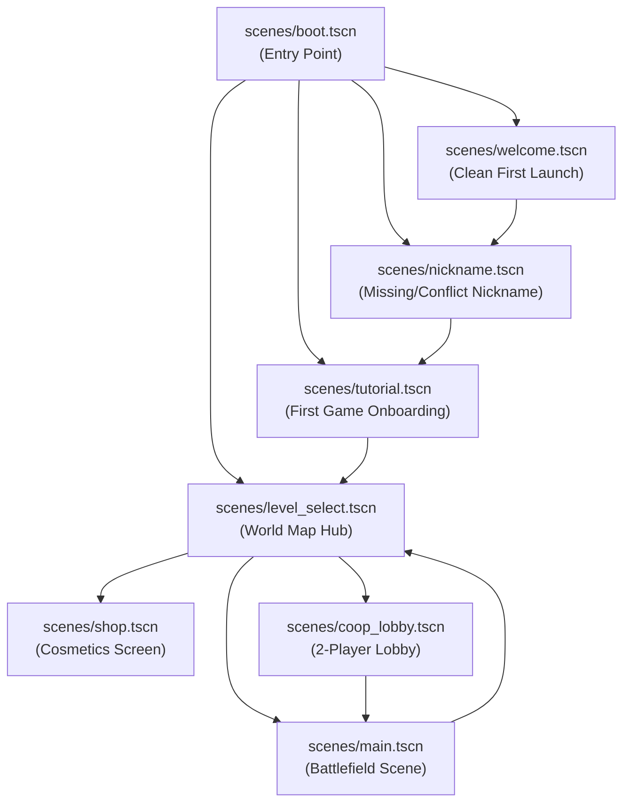
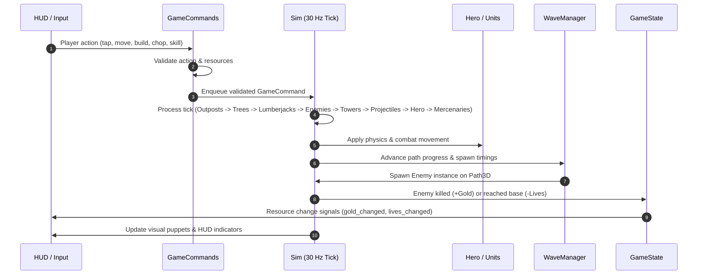
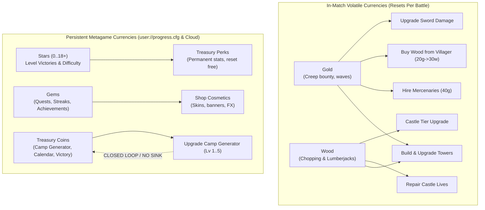

# Bimbleguard — Phase 1 Project Discovery Audit

**Audit Date:** 2026-10-21  
**Auditor Role:** Codebase & Systems Auditor (Phase 1 & Phase 2)  
**Target Repository:** Bimbleguard (former internal name Tinyguard)  
**Scope:** Architecture, configuration, scene hierarchy, scripts, gameplay loop, state storage, economy/currencies, and runtime risks.

---

## 1. Executive Summary & Project Identity

Bimbleguard is a lightweight, low-poly 3D Tower Defense game designed specifically for Android mobile devices in landscape orientation, with full offline capability and optional online features (Firebase REST services).

### Core Identity Metrics
* **Game Title:** Bimbleguard (`GameInfo.TITLE`, `project.godot:config/name="Bimbleguard"`)
* **Project Version:** `0.6.0` (`project.godot:config/version="0.6.0"`, with roadmap milestones targeting v0.6–v1.0)
* **Target Engine:** Godot Engine **4.7.2.stable.official.ed1daf0bf** (`config/features=PackedStringArray("4.7", "GL Compatibility")`)
* **Target Platforms:** Android (primary, touch-first input), Desktop/macOS/Linux (supported development & headless CI test environment).
* **Renderer:** `gl_compatibility` (OpenGL ES 3.0 / WebGL2 feature set). Advanced rendering features (SDFGI, VoxelGI, Volumetric Fog, SSR, SSAO, Compute Shaders) are strictly prohibited for maximum hardware compatibility and battery efficiency.
* **Architecture Paradigm:** Deterministic 30 Hz simulation loop (`Sim`), command journaling (`GameCommands`), "Scene = Entity" structure, resource-driven balance configuration, and reactive signal-driven presentation layers.

---

## 2. Engine Configuration & Project Settings (`project.godot`)

### 2.1 Rendering & Display
| Setting | Configured Value | Architectural Justification |
| :--- | :--- | :--- |
| `rendering_method` | `gl_compatibility` | Targets low-tier and mid-tier Android devices (Adreno 5xx/6xx, Mali-Gxx). |
| `rendering_method.mobile` | `gl_compatibility` | Ensures identical visual rendering pipeline across desktop and mobile. |
| `textures/vram_compression/import_etc2_astc` | `true` | Required for ASTC texture compression on Android devices to reduce RAM and bandwidth. |
| `viewport_width` / `viewport_height` | `1280` × `720` | Reference resolution designed for 16:9, dynamically adapted via stretch settings. |
| `window/stretch/mode` | `canvas_items` | UI and 2D canvas scale cleanly with device DPI. |
| `window/stretch/aspect` | `expand` | Supports wide-aspect modern phones (18:9, 19.5:9, 20:9) without black bars. |
| `window/handheld/orientation` | `4` (`SENSOR_LANDSCAPE`) | Auto-rotates between regular and reverse landscape depending on how the device is held. |
| `anti_aliasing/quality/msaa_3d` | `1` (2x MSAA desktop) | Provides clean geometry edges on desktop. |
| `anti_aliasing/quality/msaa_3d.mobile` | `0` (Disabled on mobile) | Conserves mobile GPU fillrate; geometry utilizes low-poly flat shading. |
| `run/max_fps.mobile` | `60` | Caps mobile refresh rate to prevent battery drain and thermal throttling. |

### 2.2 Input System & Touch Mapping
* **Touch Emulation:** `pointing/emulate_touch_from_mouse=true`. Desktop clicks behave as single-finger touches.
* **Multi-touch & Gestures:** Pinched zoom and two-finger pans are intercepted in `camera_follow.gd` and `build_manager.gd` to prevent accidental building or hero movement during camera gestures.
* **Configured Input Actions (15 Total):**
  1. `move_up` (W, Up, Joypad Left Stick Y-, DPad Up)
  2. `move_down` (S, Down, Joypad Left Stick Y+, DPad Down)
  3. `move_left` (A, Left, Joypad Left Stick X-, DPad Left)
  4. `move_right` (D, Right, Joypad Left Stick X+, DPad Right)
  5. `build_tower` (Key 1, B, Joypad Button A)
  6. `build_cannon` (Key 2, N)
  7. `build_frost` (Key 3, M)
  8. `build_lightning` (Key 4, L)
  9. `upgrade_tower` (Key U, Joypad Button Y)
  10. `sell_tower` (Key X)
  11. `attack` (Space, Key J, Joypad Button X)
  12. `spin` (Key Q, Key E, Joypad Left Shoulder)
  13. `forge` (Key K)
  14. `pause` (Key P, Joypad Start)
  15. `speed` (Key F)
  16. `cancel_command` (Escape, Joypad Button B)

### 2.3 Internationalization (i18n)
* **Translation Source:** `translations/strings.csv` compiled into 12 binary `.translation` files:
  - English (`en`), Russian (`ru`), Chinese (`zh`), Italian (`it`), Spanish (`es`), Korean (`ko`), German (`de`), Polish (`pl`), Portuguese (`pt`), Turkish (`tr`), French (`fr`), Japanese (`ja`).
* **Runtime Language Selection:** Controlled by `GameSettings.language()`, applied through `GameSettings.apply_language()` on bootstrap.

### 2.4 Autoload Singletons
* **Single Authorized Autoload:** `Online="*res://scripts/online.gd"`.
* **Autoload Restriction Rule:** Project rules explicitly restrict autoloads to $\le 1$ to maintain state isolation and testability. `Online` manages long-running HTTP REST requests, Firebase token refresh cycles, profile sync queues, and co-op transport sessions that must survive scene transitions.

---

## 3. Scene Hierarchy, Screens, and Scripts

The project adheres to a strict separation of concerns, decoupling presentation scenes (`scenes/`, `ui/`) from simulation logic (`scripts/sim.gd`) and procedural content generation (`scripts/level_builder.gd`).

### 3.1 Screen & Scene Hierarchy



### 3.2 Main Battle Scene Tree (`scenes/main.tscn`)

```
Main (Node3D, scripts/main.gd)
├── WorldEnvironment
├── Sun (DirectionalLight3D)
├── Camera (Camera3D, scripts/camera_follow.gd / scripts/game_camera.gd)
├── Level (Node3D)
│   ├── EnemyPath (Path3D, Lane 0)
│   ├── Hero (CharacterBody3D, scenes/hero.tscn, scripts/hero.gd)
│   │   ├── Model (hero_knight.glb)
│   │   ├── Puppet (scripts/anim/puppet.gd)
│   │   ├── HitBox (Area3D)
│   │   ├── HurtBox (Area3D)
│   │   └── Audio (SwingSound, HurtSound)
│   ├── [Dynamically Spawned at Runtime via scripts/level_builder.gd]:
│   │   ├── EnemyPath1..N (Path3D for remaining ground lanes)
│   │   ├── AirPath0..N (Path3D for flying lanes)
│   │   ├── SpawnPortal × N (spawn_portal.glb at lane heads)
│   │   ├── Outpost × N (scenes/outpost.tscn, scripts/outpost.gd)
│   │   ├── Terrain (level_N_terrain.glb)
│   │   ├── Decor (level_N_decor.glb)
│   │   ├── Forest (level_N_forest.glb)
│   │   ├── Castle (castle_lv1..4.glb, scripts/castle_model.gd)
│   │   ├── TowerSlot × N (scenes/tower_slot.tscn, scripts/tower_slot.gd)
│   │   ├── Grove (scripts/grove.gd MultiMeshInstance3D)
│   │   ├── WoodTree × N (scenes/wood_tree.tscn, scripts/wood_tree.gd)
│   │   ├── Villagers (scripts/villagers.gd) -> Villager × 2 (scenes/villager.tscn)
│   │   ├── LumberjackCamp (scripts/camp_structures.gd:LumberjackCamp)
│   │   └── MercenaryCamp (scripts/camp_structures.gd:MercenaryCamp)
├── GameState (Node, scripts/game_state.gd)
├── WaveManager (Node, scripts/wave_manager.gd)
├── BuildManager (Node, scripts/build_manager.gd)
├── TargetRing (MeshInstance3D - Ground target focus decal)
├── RangeRing (MeshInstance3D - Tower firing range preview)
├── UpgradeRangeRing (MeshInstance3D - Next level range preview)
├── GuideArrow (MeshInstance3D - Tutorial/hint directional arrow)
├── Sfx (Node)
│   ├── WaveBoom, BossRoar, BaseHit, Victory, Defeat
└── HUD (CanvasLayer, ui/hud.tscn, scripts/hud.gd)
    ├── Root (Control, scripts/safe_area.gd)
    ├── TopLeft (Gold, Wood, Castle Lives)
    ├── TopCenter (Wave Banner, Boss Bar)
    ├── TopRight (Threat Alarm, Speed Toggle, Pause Button)
    ├── CommandCard (Action card container, buttons, shortcuts)
    ├── ActionButtons (Attack button, Whirlwind/Spin button)
    ├── TouchJoystick (Virtual joystick controller)
    └── EndScreen (Unified pause, defeat, and victory dialog)
```

### 3.3 Scripts Breakdown by Domain & Responsibility

| Subsystem | Script Files | Primary Responsibilities |
| :--- | :--- | :--- |
| **Simulation & Determinism** | `sim.gd`, `sim_rng.gd`, `game_command.gd`, `game_commands.gd`, `command_log.gd`, `walk_grid.gd` | Runs 30 Hz fixed-step tick; entity indexing (enemies, towers, projectiles, trees, outposts, mercenaries); deterministic pseudo-RNG; command validation; state serialization and hash verification. |
| **Battlefield Management** | `main.gd`, `level_builder.gd`, `wave_manager.gd`, `wave_plan.gd`, `build_manager.gd`, `tower_placement_controller.gd`, `battle_end.gd`, `guide_hints.gd` | Orchestrates scene assembly; wave spawning and path routing; free vs slot-based tower placement; camera rays; victory/defeat triggers; contextual hints. |
| **Combat Entities** | `hero.gd`, `enemy.gd`, `enemy_data.gd`, `enemy_crowd.gd`, `tower.gd`, `tower_data.gd`, `tower_model.gd`, `projectile.gd`, `mercenary.gd` | Unit state machines, navigation along paths or navigation grids, targeting prioritization, projectile ballistics, damage application, resistances, status effects. |
| **In-Match Economy** | `game_state.gd`, `wood_tree.gd`, `grove.gd`, `villagers.gd`, `villager.gd`, `villager_trade.gd`, `camp_structures.gd`, `castle_upgrades.gd` | In-battle Gold & Wood bookkeeping; tree felling and regeneration; villager trade (buying/selling wood); hiring lumberjacks; hiring mercenaries; castle HP and armor upgrades. |
| **Metagame & Retention** | `wallet.gd`, `camp.gd`, `calendar28.gd`, `streak.gd`, `quests.gd`, `quest_tracker.gd`, `achievements.gd`, `achievement_tracker.gd`, `perks.gd`, `perk_data.gd`, `cosmetics.gd`, `shop.gd`, `economy.gd` | Gem ledger & cosmetics purchases; offline treasury coin generator (`Camp`); 28-day cumulative login calendar; 7-day streak tracker; daily quests; achievements; star-based perk tree. |
| **Persistence & Profile** | `player_profile.gd`, `level_catalog.gd`, `battle_checkpoint.gd`, `session_store.gd` | Schema-versioned player profile (v4); ConfigFile serialization to `user://progress.cfg`; mid-run battle checkpoints to `user://battle_checkpoint.json`; level unlocking. |
| **Online & Co-op** | `online.gd`, `online_session.gd`, `online_sync.gd`, `online_accounts.gd`, `online_nicknames.gd`, `online_records.gd`, `online_daily.gd`, `online_coop.gd`, `auth_service.gd`, `firestore_client.gd`, `rtdb_client.gd`, `coop_lockstep.gd`, `coop_protocol.gd`, `coop_run.gd`, `coop_session.gd` | Firebase REST communication (Auth, Firestore, RTDB); cloud profile synchronization; nickname atomic reservations; endless siege leaderboards; 2-player lockstep co-op via RTDB. |
| **UI & Presentation** | `hud.gd`, `hud_layout.gd`, `ui_kit.gd`, `dialog_frame.gd`, `safe_area.gd`, `screen_util.gd`, `gems_hud.gd`, `modes_panel.gd`, `streak_panel.gd`, `camp_panel.gd`, `calendar_panel.gd`, `achievements_panel.gd`, `encyclopedia_panel.gd`, `settings_panel.gd`, `records_panel.gd`, `account_panel.gd`, `email_auth_dialog.gd`, `account_reminder.gd`, `toast.gd`, `touch_joystick.gd` | Procedural UI construction adhering to 8 px layout grid; touch safe area handling; modal dialog transitions; particle and text toasts. |
| **Hardware & Stability** | `quality_guard.gd`, `memory_watch.gd`, `crash_reporter.gd`, `crash_trace.gd`, `exit_reasons.gd`, `diag_overlay.gd` | Dynamic degradation of shadow/mesh/MSAA settings on weak devices; `/proc/meminfo` monitoring; Crashlytics breadcrumbs; low-memory kill attribution. |

---

## 4. Core Gameplay Loop & State Storage

### 4.1 Gameplay Loop Architecture



### 4.2 Deterministic Simulation Engine (`scripts/sim.gd`)
* **Fixed Clock:** Ticks at exactly 30 Hz ($dt = 0.033333\dots$ s).
* **Accumulator Loop:** `_process(delta)` accumulates engine time and runs up to a maximum step budget per frame (`MAX_STEPS_PER_FRAME = 4`). If the device lags significantly, remaining time is clamped to avoid a "spiral of death."
* **Entity Registries:** Centralizes lists for `towers`, `enemies`, `projectiles`, `trees`, `outposts`, `mercenaries`, and `villagers`. Entities do not run autonomous uncontrolled `_process` steps for gameplay state; their logic is explicitly invoked in deterministic sequence during `sim.step()`.
* **State Hashing:** Generates deterministic 32-bit state hashes via `sim.state_hash()`, incorporating entity coordinates, health, gold, wood, and castle lives. Used for desync detection in replays and 2-player co-op.

### 4.3 Command Layer (`scripts/game_commands.gd`)
* Every mutation of battle state passes through `GameCommands.apply_command(cmd)`.
* **Validated Commands:**
  - `MOVE_TO`: Hero target position.
  - `BUILD`: Places tower on slot (`slot_id`, `tower_type`).
  - `UPGRADE`: Advances tower level.
  - `SELL`: Removes tower and refunds 70% of total invested gold/wood.
  - `SET_PRIORITY`: Changes tower targeting rule (`FIRST`, `CLOSEST`, `STRONGEST`, `WEAKEST`).
  - `ATTACK`: Triggers hero sword swing.
  - `SPIN`: Triggers hero 360-degree whirlwind attack.
  - `UPGRADE_SWORD`: Upgrades hero weapon in Forge.
  - `REPAIR_CASTLE`: Restores castle lives in Forge.
  - `TRADE_BUY` / `TRADE_SELL`: Exchanges gold and wood with village merchant.
  - `HIRE`: Hires villager as automated lumberjack.
  - `HIRE_MERCENARY`: Recruits allied sword fighter at Mercenary Camp.
  - `UPGRADE_CASTLE`: Upgrades castle tier, increasing maximum lives and adding passive armor against leaking creeps.
* **Replay & Lockstep Journaling:** Commands are recorded in `CommandLog` with exact tick numbers, allowing full offline replay verification (`tests/test_replay.gd`).

### 4.4 In-Match State Storage (`scripts/game_state.gd`)
* Manages runtime volatile variables for the active match:
  - `gold: int`: Starting value dictated by level JSON + star perks; incremented by creep bounty.
  - `wood: int`: Starting value dictated by level JSON + star perks; incremented by tree chopping and lumberjacks.
  - `lives: int` / `max_lives: int`: Base castle hit points; decremented when creeps breach gates; repaired via wood.
  - `castle_level: int`: Current castle upgrade tier (0 to 4), read from `resources/castle_upgrades.json`.
  - `castle_armor: int`: Cumulative damage reduction against creeps reaching the gate.
* Completely resets when a level restarts or exits to the World Map.

---

## 5. Economy, Currencies, and Persistence Architecture

Bimbleguard implements a dual-layer economy split between **volatile in-match tactical currencies** and **persistent metagame currencies**.



### 5.1 Currency Taxonomy

| Currency | Scope | Storage Location | Acquisition Sources | Sinks / Utility |
| :--- | :--- | :--- | :--- | :--- |
| **Gold** | In-Match | `GameState.gold` (RAM) | Creep kills, wave clear bonus, selling wood to villagers. | Building towers, upgrading towers, hero sword upgrades, hiring mercenaries (40g), buying wood. |
| **Wood** | In-Match | `GameState.wood` (RAM) | Chopping trees with hero, lumberjack villager automation, buying from villagers. | Tower construction/upgrades, repairing damaged castle lives, upgrading castle tiers. |
| **Lives** | In-Match | `GameState.lives` (RAM) | Level starting balance + Wall perk bonus. | Lost when enemies reach castle gate; repaired using wood. |
| **Stars** | Permanent Meta | `[progress] stars_<id>` in `progress.cfg` | Beating campaign levels (1 star for win, 1 star for $\ge 80\%$ lives, 1 star for speed/clearing trees), daily bonus stars. | Spent in Treasury on 7 perks (`axe`, `sword`, `walls`, `towers`, `gold_start`, `wood_start`, `swift`). Fully refundable at any time. |
| **Gems** | Permanent Meta | `[wallet] claims` in `progress.cfg` | First clear bonuses, 16 achievements, daily login streak, 28-day calendar, daily quests. Derived balance: `sum(claims) - sum(buys)`. | Exclusively spent in `Shop` on cosmetic skins (Hero skins, Tower stone themes, Castle banners, Hit FX). Zero gameplay power. |
| **Treasury Coins** | Permanent Meta | `[camp] coins` in `progress.cfg` | Passive offline accumulation (`Camp`), battle victory reward (+40 coins, +80 on First Win of the Day), 28-day calendar. | **Upgrading the Camp offline generator itself (Level 1 $\to$ 5). No other sink exists in the entire game.** |

### 5.2 Persistence & Save Files

1. **Primary Save (`user://progress.cfg`):**
   Standard Godot `ConfigFile` format. Written atomically using a `.tmp` file and `.bak` fallback.
   - `[profile]`: schemaVersion (4), nickname, createdAt, updatedAt, achievements bitmask (uint32).
   - `[progress]`: unlocked level id (1..6), `stars_<id>`, `endless_<id>` (record waves), `crown_<id>` (difficulty cleared).
   - `[perks]`: perk levels for `axe`, `sword`, `walls`, `towers`, `gold_start`, `wood_start`, `swift`.
   - `[settings]`: `sound: bool`, `language: String`.
   - `[wallet]`: gem claims dictionary, purchases dictionary, equipped cosmetics.
   - `[streak]`: current day streak, best streak, last visit date, weekly forgiveness tracker.
   - `[camp]`: camp level (1..5), last collection timestamp (`last_collect`), coin balance, total collected.
   - `[calendar]`: claimed visit days (0..28), last claim date string (`YYYY-MM-DD`).

2. **Mid-Battle Checkpoint (`user://battle_checkpoint.json`):**
   Managed by `BattleCheckpoint` (`scripts/battle_checkpoint.gd`). Saves battle state atomically at the start of every wave.
   - Stores: `level_id`, `wave`, `gold`, `wood`, `castle_lives`, `castle_level`, `sword_level`, `difficulty`, `endless`, all built towers (including dynamic Warcraft-style placement positions), villager trade counts and lumberjack assignments, and combat statistics.
   - Allows resuming long campaign matches or endless siege waves after exiting or app termination.

3. **Cloud Save & Sync (Firestore `users/{uid}`):**
   - Synced via `OnlineSync` using HTTP REST.
   - Merges local and cloud profiles: stars, endless records, and camp levels resolve using `max()`; wallet claims merge idempotently by key union.
   - Server-side validation strictly enforced by `firestore.rules` (Schema Version 4).

---

## 6. Dependencies, External Integrations, and Runtime Risks

### 6.1 External Integrations
* **Firebase Authentication (REST):** Anonymous guest login, email/password signup, password reset, account deletion.
* **Cloud Firestore (REST):** Private user documents (`users/{uid}`), public profiles (`publicProfiles/{uid}`), unique nickname locks (`nicknames/{normalized}`), endless siege leaderboards (`leaderboards/level_N/scores/{uid}`), and daily trial boards (`daily/{yyyy-mm-dd}/scores/{uid}`). Spark plan compliant (no Cloud Functions).
* **Firebase Realtime Database (REST + SSE):** Co-op lobby negotiation and 2-player lockstep frame dispatching.
* **Firebase Crashlytics (Android Gradle Build only):** Lightweight native crash reporting enabled via `tools/prepare_android_build.py`. Strictly reports crash stack traces and low-memory kills (`ExitReasons`), with zero analytics or ad trackers.

### 6.2 Architectural & Runtime Risks

1. **The "Camp Treasury Coin" Dead-End (High Design Debt):**
   The offline Camp generator produces "treasury coins" (`Camp.coins`), but the talent tree and automation assistants planned in `docs/RETENTION_V2.md` were never implemented. The only sink is upgrading the Camp itself up to Level 5. Once at Level 5, coins accumulate infinitely with zero player value. Furthermore, naming overlaps between the meta `Camp` and in-match `CampStructures` (`LumberjackCamp` / `MercenaryCamp`) create player confusion.
2. **Missing Store URLs in `GameInfo` (Release Blocker):**
   `tools/validate_project.py` flags empty constants in `scripts/game_info.gd`:
   - `PRIVACY_URL = ""`
   - `DELETION_URL = ""`
   - `SUPPORT_EMAIL = ""`
   Google Play store publication requires active privacy and account deletion web links.
3. **Headless Audio Object Leaks at Exit:**
   Running tests under headless Godot reports harmless but noisy ObjectDB leak warnings:
   `ObjectDB instances were leaked at exit / AudioStreamPlaybackWAV resources still in use`.
   Documented in `docs/CODE_REVIEW.md` (M2); caused by Godot's dummy audio driver in headless mode.
4. **Co-op Realtime Database Latency Sensitivity:**
   Because lockstep commands rely on REST polling and Server-Sent Events (SSE) without UDP or direct sockets, mobile networks with high jitter (>300 ms) can trigger lockstep pauses.
5. **Headless Test Frame Timing Sensitivity:**
   Tests executing without `--fixed-fps 60` or under high CPU contention can occasionally fail timeout predicates in `wait_until()` calls that rely on raw frame count rather than wall-clock deadlines.

---

## 7. Discovery Conclusion

The Bimbleguard codebase is exceptionally well-engineered, following rigorous GDScript static typing, clean architectural decoupling, and strict resource budgets. Core simulation, tower defense combat, procedural level generation, cosmetics, and cloud networking are robust and thoroughly verified by 59 automated test suites. 

The primary architectural discrepancies lie in **incomplete retention features (the Camp coin economy)** and **minor duplicate class abstractions**, which will be inventoried and evaluated in Phase 2.
