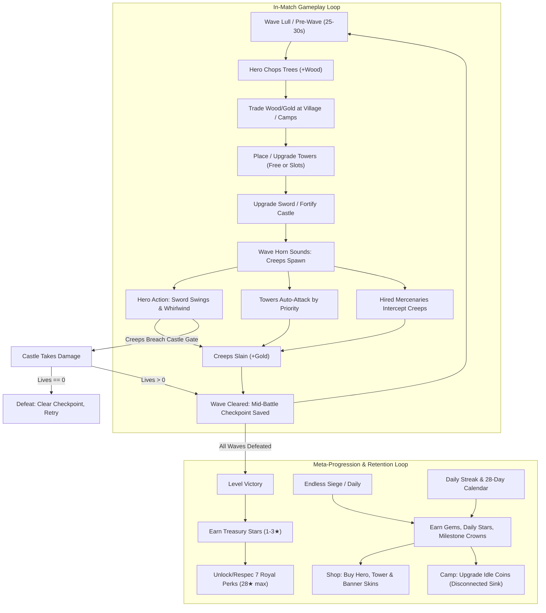

# Bimbleguard — Comprehensive Game Design Document (GDD)
**Document Version:** 1.0 (Audit Baseline)  
**Date:** October 2026  
**Status:** Verified Implementation Audit  
**Target Engine:** Godot 4.x (GDScript, Lockstep/Sim Architecture)  
**Target Platforms:** Mobile First (Android / iOS) + Desktop (PC / macOS / Linux)

---

## 1. Game Overview and Verified Premise

### 1.1 Premise and Genre Definition
**Bimbleguard** is a hybrid **Top-Down Action RPG / Warcraft-style Tower Defense** with real-time resource harvesting. The player commands a single Knight hero defending a central royal castle against converging waves of Chupacabra monsters (formerly stylized slimes) invading from 4 to 6 elemental portals across the island.

Unlike conventional passive Tower Defense games where the player acts as a detached overseer, Bimbleguard demands simultaneous physical presence and micro-tactics:
- The hero physically runs across the battlefield, chops timber, trades with villagers, swings a steel blade in melee combat, unleashes devastating whirlwinds, and physically supervises tower construction.
- Towers can be erected either on predetermined fortified stone platforms or freely placed anywhere on valid terrain in true **Warcraft TD** custom-map fashion.
- The economy is dual-currency in-match (**Gold** from slayed beasts and **Wood** harvested from live timber groves), tightly intertwining combat positioning with resource management.

### 1.2 Core Product Pillars
1. **Active Commander Fantasy:** The player is both general and warrior. Towers hold the chokepoints, but the hero plugs leaks, executes high-priority targets, and gathers vital resources under time pressure.
2. **Dual-Resource Tactical Economy:** Gold is scarce and tied to wave kills; Wood is plentiful on the field but costs the hero's most precious asset — time and physical presence.
3. **Free & Fixed Tower Placement:** Strategic flexibility combining predefined high-ground slots with unrestricted 0.5m grid-snapped free placement subject to creep path clearance.
4. **Fair & Transparent Progression:** Zero Pay-to-Win. No in-app purchases (IAP) or paywalled mechanics. Gems unlock cosmetics only; progression relies purely on earned Treasury Stars, difficulty mastery, and tactical execution.

---

## 2. Target Player Experience

### 2.1 Confirmed Codebase Facts vs. Design Assumptions

| Area | Confirmed Codebase Fact | Design Assumption / Intended Experience |
|---|---|---|
| **Session Length** | Levels feature 15, 25, 30, 35, or 40 waves. With ~25-30s wave intervals, match time spans 8 to 22 minutes. Mid-battle checkpoints exist (`battle_checkpoint.json`). | Designed for core mobile players who want meaty, tactical 10–15 minute sessions, with checkpoint safety for mid-commute interruptions. |
| **Pacing & Multitasking** | Between waves, there is a 25–30s interval. Trees regrow in 60s. Tower build requires hero proximity (1.25m reach) or workbench order. | Players should experience a tense rhythm: frantic chopping & building during lulls, shifting to acute spatial positioning and lane triage during wave swarms. |
| **Hero Survivability** | Hero has 100 HP, receives damage, flashes red, and recoils, but **hero death is not implemented**. Castle lives are the sole defeat metric. | Players are assumed to feel tension when surrounded, but in reality, the hero cannot perish or lose the game, reducing personal risk. |
| **Replay Loop** | 6 campaign levels x 3 difficulty tiers (Normal, Hard, Nightmare), Endless Siege (records), Daily Challenge (UTC seed). | Replayability relies heavily on stat-multiplier difficulty crowns and climbing endless wave leaderboards rather than fundamentally new map topology. |
| **Monetization & Fairness** | `Wallet` and `Shop` handle Gems purely for visual customizations (Hero colors, Tower models, Castle banners, Spark FX). No IAP plugins. | Ethical, premium-feeling mobile experience respecting player trust and deterministic replay validation. |

---

## 3. Core Gameplay Loop



### 3.1 Primary Micro-Loop (Wave Execution)
1. **Preparation:** Hero gathers wood from surrounding groves, examines incoming wave banner indicators ("From North and West!"), positions towers to cover expected choke points.
2. **Engagement:** Portal gates flash and spawn creeps. Towers acquire targets automatically based on assigned priority (`First`, `Last`, `Strong`, `Close`). Hero intercepts fast runners or high-threat targets using basic swings or AoE Whirlwind.
3. **Reinforcement:** Gold gained from kills is instantly reinvested into emergency tower upgrades, repairs, or sword enhancements at the castle forge.
4. **Resolution:** Surviving the wave saves state to checkpoint. Defeating the final wave awards 1 to 3 Stars; losing all castle health triggers defeat.

---

## 4. Controls and Interaction Rules

### 4.1 Mobile Touch Scheme
- **Dynamic Floating Joystick (`TouchJoystick`):**
  - Bound to the left 50% of the screen. Touch-down instantiates the joystick base at touch coordinates; dragging deflects the knob within an 80px radius.
  - Multi-touch safe: tracks independent touch index (`_touch_index`), preventing joystick resets when buttons are tapped simultaneously.
  - Emits a normalized vector $(x, y)$ mapped directly to hero 3D ground velocity.
- **Action Buttons (Bottom-Right HUD):**
  - **Attack Button:** Triggers standard melee sword swing. Tapping when standing near a tree directs swing at the trunk; near an enemy directs swing at the beast.
  - **Whirlwind Button:** Triggers 360-degree spin attack. Displays dynamic cooldown sweep overlay (12.0s cooldown).
  - **Workbench Button:** Opens the 4-tower Warcraft build sheet.
- **Direct Tap-to-Interact:**
  - Ground tap: Hero calculates grid route via `WalkGrid` (A* pathfinding) and walks to destination.
  - Tree tap: Hero walks within 1.6m and automatically begins chopping.
  - Enemy tap: Hero engages pursuit within 1.8m and auto-swings.
  - Tower Slot tap: Selects slot, draws range radius, opens Context Card.
  - Castle tap (within 2.4m): Opens Forge Card (Sword upgrade, Castle Wall repair, Castle Level upgrade).
  - Villager / Camp tap: Opens Trade or Mercenary hiring card.

### 4.2 Desktop Input Scheme
- **Movement:** `WASD` or Arrow keys.
- **Combat:** `Space` or `J` (Melee Swing), `K` (Whirlwind).
- **Construction Hotkeys:** `1` / `B` (Archer), `2` / `N` (Cannon), `3` / `M` (Frost), `4` / `L` (Lightning), `U` (Upgrade selected).
- **Navigation:** `Escape` / `P` (Pause), `Scroll Wheel` (Camera zoom 0.8x - 1.4x).

### 4.3 Free Warcraft-Style Placement Rules (`TowerPlacementController`)
1. **Activation:** Initiated by tapping a tower type in the Workbench HUD.
2. **Ghost Projection:** Instantiates a 3D preview model at raycast ground intersection, snapped to a $0.5\text{ m}$ coordinate grid:
   $$\text{snapped\_coord} = \frac{\text{round}(2.0 \cdot \text{coord})}{2.0}$$
3. **Magnetic Snapping:** If within $0.85\text{ m}$ of an existing unbuilt stone slot, the ghost snaps magnetically to the slot center.
4. **Placement Clearance Verification:**
   - **Creep Lanes:** $\ge 1.1\text{ m}$ clearance from all Path3D spline points (ensures creeps are never completely walled in or path-blocked).
   - **Castle Core:** $\ge 2.4\text{ m}$ clearance from castle center.
   - **Existing Slots & Built Towers:** $\ge 1.6\text{ m}$ clearance center-to-center.
   - **Choppable Forest Trees:** $\ge 1.2\text{ m}$ clearance from active tree trunks.
   - **Lumberjack & Mercenary Camps:** $\ge 2.0\text{ m}$ clearance from camp boundary.
   - **Map Bounds:** Clamped inside $44 \times 30\text{ m}$ bounds with $1.2\text{ m}$ boundary padding.
5. **Feedback & Execution:**
   - Valid: Green glowing footprint torus mesh + tower range sphere displayed.
   - Invalid: Red glowing torus mesh + contextual toast ("Too close to path", "Too close to castle", etc.).
   - Confirmation: Instantiates a dynamic `TowerSlot` (`is_dynamic = true`), routes hero to $1.25\text{ m}$ build reach, deducts resources, and spawns the tower.

---

## 5. Level Structure and Progression

The campaign spans 6 progressive levels set across 4 distinct island biomes. All maps share uniform outer boundaries ($44 \times 30\text{ m}$) with a centralized castle and 4 to 6 converging enemy ingress lanes.

### 5.1 Level Configuration Matrix

| Level ID | Name & Biome | Waves | Ingress Lanes | Fixed Slots | Choppable Trees | Starting Lives | Starting Gold / Wood | Key Enemy Introductions |
|:---:|:---|:---:|:---:|:---:|:---:|:---:|:---:|:---|
| **1** | **Green Valley** *(Meadow)* | 15 | 4 | 16 | 20 | 20 | 15 / 20 | Scout (W3), Tank (W7), Elite Brute (W8), Boss King (W10, W15) |
| **2** | **Dark Thicket** *(Meadow)* | 25 | 5 | 17 | 20 | 15 | 90 / 60 | Shield (W12), Shaman Healer (W14), Boss King (W10, W20, W25) |
| **3** | **King's Road** *(Meadow)* | 40 | 5 | 18 | 20 | 10 | 90 / 60 | Flyer Bat (W14), Twin Bosses from W30 |
| **4** | **Snowy Pass** *(Winter)* | 30 | 6 | 18 | 20 | 12 | 90 / 60 | Early Flyer Bat (W4), Early Shield (W7), Shaman (W9) |
| **5** | **Autumn Grove** *(Autumn)* | 35 | 6 | 18 | 20 | 12 | 90 / 60 | Dense mixed waves, all creep archetypes active from early waves |
| **6** | **Sand Fortress** *(Desert)* | 40 | 6 | 18 | 20 | 10 | 90 / 60 | Maximum pressure, 6-way swarm, Dual Kings from W30 |

### 5.2 Campaign Difficulty Tiers

| Difficulty | HP Mult | Count Mult | Gold Reward Mult | Castle Lives Mult | Unlock Requirement | Rewards |
|---|:---:|:---:|:---:|:---:|---|---|
| **Normal** | $1.0\times$ | $1.0\times$ | $1.0\times$ | $1.0\times$ | Available by default | 1–3 Stars |
| **Hard** | $1.07\times$ | $1.0\times$ | $0.995\times$ | $0.9\times$ | Beat level on Normal | Hard Crown + $60 + 5 \times \text{Level}$ Gems |
| **Nightmare** | $1.15\times$ | $1.04\times$ | $0.98\times$ | $0.8\times$ | Beat level on Hard | Nightmare Crown + $120 + 5 \times \text{Level}$ Gems |

### 5.3 Endless Siege Mode (Record Run)
- Unlocked on any level once completed on Normal.
- Endless geometric stat escalation:
  $$\text{HP}(w) = \text{hp\_start} \cdot (1.078)^{w-1}$$
  $$\text{Count}(w) = \min\left(80, \text{count\_base} \cdot (1.04)^{w-1}\right)$$
- Elite spawns occur every 3 waves starting at Wave 5 ($2.5\times\text{ HP}$, $2.0\times\text{ gold}$, $1.3\times\text{ scale}$).
- Boss Kings spawn every 10 waves (every 7 waves from W30, every 5 waves from W60).
- Special Surprise Waves:
  - *Swarm:* Rapid scouts ($2.2\times\text{ count}$, $0.6\times\text{ HP}$) attacking simultaneously from all ingress portals.
  - *Air Raid:* Chupacabra bats ($1.3\times\text{ count}$) flying straight over defenses.
  - *Armored Rush:* Shielded brutes ($0.7\times\text{ count}$, $1.6\times\text{ HP}$).
- **Star Milestone Rewards:** Awards 1 Treasury Star every 10 waves survived (up to 5 stars at Wave 50 per level = 30 stars total).

### 5.4 Daily Challenge
- Deterministic UTC date seed determines:
  $$\text{Level} = \text{levels}[\text{hash}(\text{"level:"} + \text{date}) \pmod 6]$$
  $$\text{Preset} = \text{presets}[\text{day\_index} \pmod 6]$$
- **6 Daily Modifiers:**
  1. *Archers & Frost:* Only Archer and Frost towers allowed.
  2. *Tough & Rich:* Creep HP $+30\%$, Gold drops $+50\%$.
  3. *Fast Waves:* Wave interval timer reduced to $70\%$.
  4. *Cannons & Lightning:* Only Cannon and Lightning towers allowed.
  5. *Swarm Rush:* Creep HP $-20\%$, Gold $+20\%$, Wave timer $80\%$.
  6. *Iron Hide:* Only Cannon, Frost, and Lightning allowed; Creep HP $+20\%$, Gold $+30\%$.
- **Rewards:** 1 Treasury Star for reaching Wave 10 (capped at 10 lifetime stars), plus Gems ($25 + 1\text{ per } 2\text{ waves}$, up to $+20$).

---

## 6. Player Objectives and Failure Conditions

### 6.1 Victory Conditions
- **Campaign Mode:** Successfully defeat all pre-scripted waves without castle lives reaching zero.
- **Star Rating Metric:**
  - $\mathbf{3\text{ Stars (★★★)}}:$ Flawless victory ($100\%$ castle lives intact; 0 leaks).
  - $\mathbf{2\text{ Stars (★★☆)}}:$ Solid defense ($\ge 50\%$ castle lives remaining).
  - $\mathbf{1\text{ Star (★☆☆)}}:$ Pyrrhic victory ($< 50\%$ castle lives remaining).
- **Endless Siege:** No win state; survival duration records submitted to personal profile and cloud leaderboards.

### 6.2 Failure Conditions
- **Castle Destruction:** The Castle life pool drops to $\le 0$. The defeat screen appears immediately with tactical advice based on cause of death (e.g., "Build more archers for air units", "Upgrade castle walls").
- **Hero State:** The hero has 100 HP, takes damage from direct creep collisions, displays red damage vignette and recoil, **but does not die or cause defeat**. If hero HP reaches 0, the hero remains active.

---

## 7. Existing Mechanics and Rule Sets

### 7.1 Towers Specification Matrix

```
Archer Tower (Single / Anti-Air)      Cannon Tower (AoE / Ground Only)
Cost: 15G / 10W                       Cost: 40G / 30W
[Level 1] Dmg: 9, Rng: 4.3m, Spd: 0.6s [Level 1] Dmg: 20, Rng: 3.9m, Splash: 1.1m
[Level 2] Dmg: 15, Rng: 4.7m, Spd: 0.5s[Level 2] Dmg: 34, Rng: 4.2m, Splash: 1.3m
[Level 3] Dmg: 24, Rng: 5.2m, Spd: 0.4s[Level 3] Dmg: 52, Rng: 4.6m, Splash: 1.5m

Frost Tower (Slowing Support)         Lightning Tower (Chain Magic)
Cost: 30G / 30W                       Cost: 50G / 40W
[Level 1] Dmg: 4, Slow: 45% (0.55x)   [Level 1] Dmg: 12, Chains: 2 targets
[Level 2] Dmg: 7, Slow: 55% (0.45x)   [Level 2] Dmg: 19, Chains: 3 targets
[Level 3] Dmg: 11, Slow: 65% (0.35x)  [Level 3] Dmg: 28, Chains: 4 targets
*Synergy: Deals +40% bonus damage to targets chilled by Frost!
```

#### Detailed Tower Mechanics:
1. **Archer Tower:**
   - Fires high-velocity ballistic arrows. Targets air and ground.
   - Vulnerability: Deals only $35\%$ damage against Chupacabra Shield-bearers (`arrow_damage_mult = 0.35`).
2. **Cannon Tower:**
   - Launches explosive shells with radial area damage ($1.1\text{m} \to 1.5\text{m}$).
   - Default Priority: `Strong` (heavy targets).
   - Limitation: Ground only (`hits_air = false`). Cannot target or damage Flying Bats.
3. **Frost Tower:**
   - Casts localized frost shards. Applies movement speed reduction ($45\% \to 65\%$ slow) for a duration.
   - Hits air and ground. Essential for clustering enemies for Cannon and Lightning strikes.
4. **Lightning Tower:**
   - Instant discharge arc that jumps between nearby enemies within $2.2\text{ m}$ chain radius.
   - Each consecutive jump suffers a $-20\%$ damage decay.
   - **Elemental Synergy:** Attacks deal $+40\%$ bonus damage (`chilled_bonus = 1.4`) against targets currently chilled by Frost towers.
5. **Targeting Priority Modes:**
   - `First`: Creep nearest to the castle gate along the path (default for Archer, Frost, Lightning).
   - `Last`: Creep furthest from the castle (trailing edge of wave).
   - `Strong`: Creep with highest remaining absolute HP (default for Cannon).
   - `Close`: Creep physically nearest to the tower base.
6. **Deconstruction / Selling:**
   - Refunding a tower returns exactly $70\%$ of cumulative gold and wood invested (`sell_refund = 0.7`).

### 7.2 Field Camps and Economy Structures

#### Lumberjack Camp (`CampStructures.LumberjackCamp`)
- Located near timber groves; marked with timber roof, chopping stump, and yellow ambient ring.
- Provides immediate trade interface without chasing wandering villagers:
  - **Sell Wood:** Sell batches of 10 Wood for Gold. Base price is 6 Gold; decays by $0.93\times$ per trade down to a floor of 2 Gold per 10 Wood.
  - **Buy Wood:** Purchase 10 Wood for Gold (Base: 14 Gold; escalates by $1.08\times$ per purchase; max 6 lots per match).
  - **Hire Woodcutter:** 25 Gold per worker (max 2). Generates $+5\text{ Wood per minute}$ passively throughout the match.

#### Mercenary Camp (`CampStructures.MercenaryCamp`)
- Medieval pavilion tent with royal blue/gold canopy, weapon racks, and banners.
- **Recruitment:** Costs $30\text{ Gold}$ per Mercenary.
- **Mercenary Attributes:**
  - Health: $80\text{ HP}$ (displays floating overhead 3D health bar).
  - Attack Damage: $16\text{ melee damage}$ ($1.4\text{m}$ reach, $0.55\text{s}$ attack speed).
  - AI Behavior: Automatically patrols castle gates ($2.5\text{m}$ patrol radius) or follows hero. Detects creeps within $9.0\text{ m}$, intercepts them physically, absorbs enemy contact, and flashes red on damage with armor clang audio.

#### Castle Forge & Upgrades (`CastleUpgrades`)
Accessible via castle proximity ($< 2.4\text{ m}$):
1. **Hero Sword Forging:**
   - Tier 0: $14.0\text{ dmg}$ (default).
   - Tier 1: $22.0\text{ dmg}$ (Cost: $40\text{G} / 30\text{W}$).
   - Tier 2: $32.0\text{ dmg}$ (Cost: $90\text{G} / 60\text{W}$).
   - Tier 3: $45.0\text{ dmg}$ (Cost: $160\text{G} / 100\text{W}$).
2. **Field Repairs:**
   - Restores $+2\text{ Castle Lives}$ for $25\text{ Wood}$ (capped at starting max lives + upgrade bonus).
3. **Castle Structural Reinforcement:**
   - Tier 1: $+2\text{ Lives}$, $0\text{ Armor}$ ($90\text{G} / 65\text{W}$).
   - Tier 2: $+2\text{ Lives}$, $1\text{ Armor}$ ($170\text{G} / 120\text{W}$).
   - Tier 3: $+3\text{ Lives}$, $1\text{ Armor}$ ($280\text{G} / 200\text{W}$).
   - Tier 4: $+3\text{ Lives}$, $2\text{ Armor}$ ($420\text{G} / 300\text{W}$).
   - **Castle Armor Formula:** Creeps leaking through gates deal reduced damage:
     $$\text{Damage Taken} = \max(1, \text{Creep Damage} - \text{Castle Armor})$$

### 7.3 Creep Bestiary

| ID | Name | Role / Trait | HP | Speed | Gold | Castle Dmg | Key Combat Behavior |
|---|---|---|:---:|:---:|:---:|:---:|---|
| `slime` | **Fighter** | Standard Chupacabra | 22 | 1.25 | 3 | 1 | Basic swarm unit. Balanced speed and health. |
| `slime_fast` | **Scout** | Rapid Infiltrator | 12 | 2.10 | 2 | 1 | Very fast runner. Demands early Archer or Frost response. |
| `slime_bat` | **Flyer** | Aerial Attacker | 16 | 1.00 | 4 | 1 | Flies directly toward castle above paths. Immune to Cannon. |
| `slime_shield`| **Shield-bearer** | Armored Vanguard | 55 | 1.00 | 5 | 1 | Resistant to arrows (takes only 35% arrow damage). Weak to Cannon/Melee. |
| `slime_healer`| **Shaman** | Support Healer | 28 | 1.15 | 5 | 1 | Heals surrounding allies within 1.8m by 5% max HP every 1.0s. |
| `slime_splitter`| **Twins** | Deceptive Swarm | 34 | 1.10 | 3 | 1 | On death, splits into 2 Chupacabra Minis (9 HP, 1.7 speed). |
| `slime_tank` | **Brute** | Heavy Ground Unit | 75 | 0.80 | 6 | 2 | High HP, high gate damage. Prime target for Cannon and Whirlwind. |
| `stone_golem` | **Stone Golem** | Super Heavy | 120 | 0.60 | 10 | 2 | Extreme durability with flat damage reduction (Armor: 3.0). |
| `slime_king` | **Chupacabra King**| Boss Monster | 520 | 0.60 | 40 | 5 | Massive threat. Roars on spawn, drains 5 castle lives on breach. |

---

## 8. Resources, Rewards, and Economy

### 8.1 In-Match Currencies
- **Gold:** Earned per creep kill, bonus from early wave calls, tower deconstruction ($70\%$), and selling wood. Spent on tower construction, upgrades, forge swords, castle armor, and hiring mercenaries.
- **Wood:** Harvested from grove trees (4 hits = 12 wood base; regrows in 60s), generated by hired lumberjacks ($5\text{ wood/min}$), or purchased with gold. Spent on all tower building/upgrades, hero sword upgrades, castle repairs, and castle fortifications.

### 8.2 Meta Currency: Gems
- **Acquisition:**
  - Level completion stars ($15\text{G} \to 40\text{G} + 3\times\text{Level}$).
  - Difficulty crowns (Hard: $60\text{G} + 5\times\text{Level}$; Nightmare: $120\text{G} + 5\times\text{Level}$).
  - Daily challenge participation ($25\text{G} + \text{wave bonus}$).
  - Daily login streak ($5\text{G} \to 100\text{G}$ on Day 7).
  - 28-Day Calendar rewards ($5\text{G} \to 150\text{G}$ milestones).
  - Daily quests (3 quests/day: $15\text{G}, 20\text{G}, 30\text{G}$).
  - 16 Achievements ($25\text{G}, 60\text{G}, 150\text{G}$).
- **Cosmetic Catalog (21 Items, 8,140 Gems total):**
  - Hero Skins (8 items, 150 to 1,200 Gems): Ruby, Forest Guardian, Rose, Dawn, Frost Knight, Royal, Shadow, Golden Knight.
  - Tower Architecture Themes (4 items, 300 to 1,000 Gems): Forest, Ice, Fire, Gold.
  - Castle Banners (6 items, 120 to 500 Gems): Crimson, Emerald, Dawn, Frozen, Violet, Midnight.
  - Hit Sparks (3 items, 100 to 150 Gems): Rose, Azure, Emerald.

### 8.3 Meta Currency: Camp Offline Coins (`scripts/camp.gd`)
- **Generation:** Passive accumulation while offline based on Unix timestamp delta:
  $$\text{Coins} = \frac{\min(\text{Elapsed Seconds}, \text{Cap Hours} \times 3600) \times \text{Hourly Rate}}{3600}$$
- **Camp Level Tiers:**
  - Level 1: 10 coins/h, 8h cap (80 max), Upgrade cost: 0.
  - Level 2: 15 coins/h, 10h cap (150 max), Upgrade cost: 150 coins.
  - Level 3: 20 coins/h, 12h cap (240 max), Upgrade cost: 350 coins.
  - Level 4: 25 coins/h, 14h cap (350 max), Upgrade cost: 750 coins.
  - Level 5: 30 coins/h, 16h cap (480 max), Upgrade cost: 1,500 coins.
- **Architectural Disconnect:** In the current verified codebase, **Camp Coins have no other utility** than paying for Camp upgrades. They cannot be converted to Gems, cannot purchase battle buffs, and do not contribute to Treasury perks.

---

## 9. Unlocks and Progression Systems

### 9.1 Treasury Star Pool (58 Total Stars)
- **Campaign Mode:** $6\text{ levels} \times 3\text{ stars} = 18\text{ Stars}$.
- **Endless Siege:** $6\text{ levels} \times 5\text{ milestone stars} = 30\text{ Stars}$.
- **Daily Challenge:** 1 star per 10-wave clear (capped at 10 lifetime stars) $= 10\text{ Stars}$.
- **Total Possible Stars:** $\mathbf{58\text{ Stars}}$.

### 9.2 The Royal Treasury (7 Perk Trees)
Perks provide permanent stat boosts across all game modes. Stars can be reset and redistributed at any time with zero fee or loss.

| Perk Name | Resource File | Max Ranks | Cumulative Bonus | Star Cost per Rank | Total Tree Cost |
|---|---|:---:|---|:---:|:---:|
| **Treasury** | `gold_start.tres` | 3 | $+15\text{G} \to +30\text{G} \to +50\text{G}$ Start Gold | 1 / 1 / 2 | 4★ |
| **Sawmill** | `wood_start.tres` | 3 | $+15\text{W} \to +30\text{W} \to +50\text{W}$ Start Wood | 1 / 1 / 2 | 4★ |
| **Fortified Walls**| `walls.tres` | 2 | $+3 \to +6$ Castle Max Lives | 1 / 2 | 3★ |
| **Tempering** | `sword.tres` | 2 | $+20\% \to +40\%$ Hero Sword Damage | 1 / 2 | 3★ |
| **Sharpshooters** | `towers.tres` | 3 | $+8\% \to +16\% \to +25\%$ Tower Damage | 2 / 2 / 3 | 7★ |
| **Sharp Axe** | `axe.tres` | 1 | $+1\text{ Wood per tree chop}$ | 2 | 2★ |
| **Swift Feet** | `swift.tres` | 3 | $+6\% \to +12\% \to +18\%$ Hero Movement Speed| 1 / 2 / 2 | 5★ |
| **TOTAL** | — | **17** | — | — | **28★** |

> [!IMPORTANT]
> **The Progression Cap:** Maxing out all 7 perk trees requires exactly **28 Stars**. Since 58 stars are available, players accumulate **30 surplus stars** with zero remaining upgrade targets in the Royal Treasury.

---

## 10. User Interface and Navigation

### 10.1 Main Menu & World Map Architecture
- **Interactive 3D Island:** Renders the campaign route across biomes with animated 3D level badges. Completed levels display earned stars and difficulty crowns.
- **Top Navigation Bar:**
  - Player Profile badge (nickname, total stats).
  - Gem counter pill & Treasury Stars pill.
  - Achievements Crown button (opens 16-card achievement panel).
  - Cloud synchronization indicator (green checkmark / grey offline).
  - Sound bus toggle (mute/unmute).
  - Settings Gear (language, graphics quality, credits).
- **Consolidated 4-Hub Bottom Tab Bar:**
  1. **Rewards Hub (Flame):** Houses 7-day Login Streak, Daily Quests list, 28-Day Reward Calendar, and Offline Camp coin collector. Notification dot appears when uncollected rewards exist.
  2. **Treasury Hub (Chest):** Displays the 7 Royal Perk cards, current star pool balance, and Reset Perk button.
  3. **Game Modes Hub (Hourglass):** Unified launcher for Daily Challenge, 2-Player Co-op Lobby, and Global Endless Leaderboards.
  4. **Cosmetics Shop Hub (Shop Cart):** Multi-tab store for Hero, Tower, Banner, and Spark palette cosmetics.

### 10.2 In-Match Battle HUD
- **Top Status Header:** Castle Heart Life Gauge, Wave Counter (`Wave X / Y`), Wave Progress fill bar, In-Match Gold & Wood counters, Pause button, Speed Toggle (`1x / 2x`).
- **Contextual Command Card (Bottom Center):**
  - Displays selected slot data: Tower type, Level, Damage, Range, Speed.
  - Action buttons: Upgrade (gold/wood cost), Priority toggle (`First` $\to$ `Last` $\to$ `Strong` $\to$ `Close`), Sell ($70\%$ return).
  - Displays Forge controls when standing near castle: Sword upgrade, Castle repair, Castle fortification.
  - Displays Camp controls when selecting Lumberjack or Mercenary camps.
- **Warcraft Placement Workbench (Bottom Right):** Toggleable overlay revealing build cards for Archer, Cannon, Frost, and Lightning towers.
- **In-Game Encyclopedia:** Accessible via the Pause Menu, displaying complete tabular data on all towers, creep stats/resistances, and village trade mechanics without interrupting game state.

---

## 11. Save and Persistence Architecture

### 11.1 Mid-Battle Checkpoint (`BattleCheckpoint`)
- Saved atomically to `user://battle_checkpoint.json` at the conclusion of every cleared wave via atomic temporary file writing (`.tmp` write followed by `DirAccess.rename_absolute`).
- **Serialized State Payload:**
  - `level_id`, `wave`, `difficulty`, `endless` flag.
  - Resources: `gold`, `wood`, `castle_lives`, `castle_level`.
  - Hero: `sword_level`.
  - Towers: Array of all placed towers (both predefined and dynamic Warcraft-placed slots), including `slot_id`, `type`, `level`, `priority`, and world coordinates $(x, y, z)$.
  - Villagers & Camps: Trade cost multipliers, hired lumberjack count, hired mercenary state.
  - Combat Statistics: Kills, damage dealt, wood harvested.
- **Lifecycle:** Restored seamlessly upon selecting "Resume" on the level select screen. Purged on battle victory, castle defeat, or explicit level abort.

### 11.2 Master Profile Save (`PlayerProfile` & `LevelCatalog`)
- Local storage: `user://progress.cfg`.
- Cloud mirror: Google Cloud Firestore `/profiles/{uid}` document.
- **Fields Tracked:** Unlocked level index, 3-star campaign records, difficulty crowns (0..2 per level), endless wave personal bests, allocated perk levels, daily challenge history (last 40 days), 28-day calendar claims, camp state, achievements bitmask, and cosmetic purchases.

---

## 12. Audio and Visual Feedback

### 12.1 Visual Effects (Game Feel)
- **Damage Numbers & Feedback:** Floating animated damage numerals and gold coin popups over dying creeps. Enemies flash stark white upon receiving damage.
- **Hero & Mercenary Feedback:** Red overlay flash and directional recoil velocity ($3.5\text{ m/s}$) when damaged.
- **Combat Particles:**
  - Melee swing: Trail mesh along sword arc; circular dust ring on Whirlwind.
  - Timber chopping: Wood chips burst outward on strike; tree trunk tilts and falls on final blow.
  - Projectiles: Arrow trails, cannon blast smoke clouds with ground scorch, frost snowflake bursts, electric discharge beams jumping between chain targets.
- **Castle Threat Feedback:** Screen camera shake and pulsing red vignette when castle walls receive leak damage.
- **Victory:** Confetti particle fountain and fanfare trumpet audio upon clearing the final wave.

### 12.2 Audio Bus Structure
- Master audio bus toggled via `LevelCatalog.apply_sound()` controlling `AudioServer.set_bus_mute(0)`.
- 24 custom sound effects covering sword swings, monster grunts, wood chops, coin collections, cannon thuds, ice shatters, and boss roars.
- Background music: 38-second synthesized medieval ambient loop.

---

## 13. Current Limitations and Incomplete Systems

1. **Disconnected Camp Currency:** Offline Camp Coins accumulate passively but cannot be spent on anything outside the Camp itself. It constitutes an economic dead-end.
2. **Hero Immortality / Zero Threat:** Hero HP exists and takes damage, but reaching 0 HP causes no defeat, respawn delay, or stat penalty. This trivializes hero positioning during difficult waves.
3. **Star Pool Ceiling Surplus:** Only 28 Stars are required to max all 7 Royal Perks, leaving 30 earned stars with zero sink or progression value.
4. **Map Topological Uniformity:** All 6 levels utilize identical $44 \times 30\text{ m}$ rectangular dimensions, identical tree counts (20), nearly identical slot counts (16–18), and symmetrical radial lane convergence toward a central castle.
5. **No Active Hero Abilities Beyond Whirlwind:** Hero lacks ranged abilities, deployable barriers, or summonable skills, limiting tactical expression to basic auto-attacks and one 12s cooldown spin.

---

## 14. Unresolved Design Questions

1. **Surplus Star Sinks:** How should the 30 surplus Treasury Stars be utilized? Infinite minor stat sinks (e.g., $+0.5\%$ gold per extra star), prestige badges, or unlocking advanced tower modifications?
2. **Camp Coin Purpose:** Should Camp Coins be removed entirely in favor of Gems, or reworked into a consumable battle currency (e.g., purchasing one-time pre-wave siege items like barricades or explosive barrels)?
3. **Hero Consequence:** Should hero defeat trigger a 10-second respawn timer at the castle, temporary tower efficiency debuff, or direct castle damage?
4. **Warcraft Placement FTUE:** How should the game introduce and teach free 0.5m grid placement during early levels without confusing novice players who rely on fixed slots?
