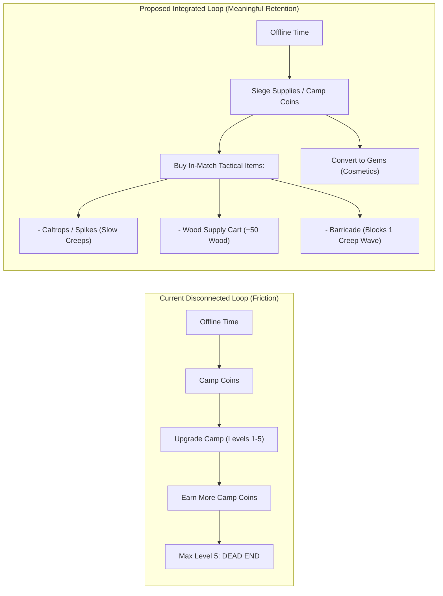
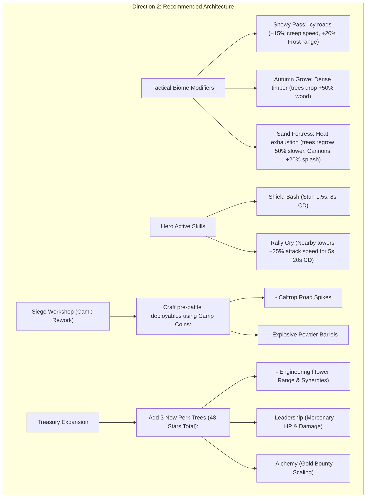

# Bimbleguard — Engagement, Retention, and Gameplay Variety Analysis
**Document Version:** 1.0 (Audit Baseline)  
**Date:** October 2026  
**Status:** Design Evaluation & Strategic Roadmap  
**Target Engine:** Godot 4.x

---

## 1. Executive Summary & First-Time Player Evaluation (FTUE)

Bimbleguard presents a compelling and distinctive hybrid: the strategic planning of a Tower Defense game combined with the visceral, moment-to-moment physical engagement of a top-down Action RPG. The tactile rhythm of running through groves, felling timber with physical swings, and placing defensive structures under time pressure establishes an immediate, satisfying tactile hook.

### 1.1 The First 15 Minutes: Player Journey Walkthrough

```mermaid
journey
    title First-Time Player Experience (FTUE)
    section Onboarding & First Wave
      Boot into Green Valley: 5: Player charmed by clean low-poly style
      Tutorial prompt to chop tree: 5: Highly tactile, satisfying timber fall
      Build first Archer Tower: 4: Clear affordance on fixed slot
      First Chupacabra wave spawns: 5: Exciting active melee brawler feel
    section Mid-Battle Realization
      Wave 3 scouts run past hero: 3: Sudden panic; multi-lane attention split
      Hero takes hits from enemies: 2: Expects death, but hero is immortal; tension evaporates
      Waiting 30s between waves: 2: Chopping trees feels like a chore without wave summon
    section Post-Battle Progression
      Victory screen (3 Stars): 5: Celebratory fanfare and confetti
      Open Royal Treasury: 4: Clear, rewarding perk upgrades
      Open Camp Panel: 1: Confusion; idle coins have no clear game impact
```

### 1.2 Cognitive Friction Points in the Current Build
1. **The Multitasking Dilemma:** During Waves 4–8 of Level 1, the player must juggle tree chopping, watching 4 ingress points, and placing towers. Because towers require hero physical proximity ($1.25\text{ m}$) to construct, players often miss building a critical tower because the hero was stuck chopping a tree on the opposite side of the map.
2. **Hero Immortality Dissonance:** The hero has a health bar ($100\text{ HP}$), red hit-flash, hurt audio, and recoil physics. New players initially play conservatively to avoid damage. However, upon discovering that the hero **cannot die** and incurs no penalty for reaching $0\text{ HP}$, combat loses its survival stakes. The hero transforms into an invulnerable meat-shield.
3. **The Wave Waiting Slump:** Between waves, the game enforces a fixed $25\text{--}30\text{s}$ lull. While necessary for tree chopping in early waves, by Wave 10+ the player often has surplus wood and is forced to idle waiting for the timer to expire. The absence of an **"Early Wave Call"** button creates pacing drag.
4. **Placement System Ambiguity:** The game features two parallel placement paradigms: predefined stone slots and free $0.5\text{ m}$ grid Warcraft-style placement via the Workbench button. Novice players exclusively use fixed slots because the Workbench button is visually tucked into the corner and never explicitly introduced in the tutorial.

---

## 2. In-Depth Gameplay Pillars Analysis

### A. Core Gameplay: Hero vs. Towers Balance & Recovery

```
Early Game (Waves 1-7)        Mid Game (Waves 8-20)          Late Game (Waves 21-40)
[ Hero Dominant ]       --->  [ Balanced Synergy ]     --->  [ Towers Dominant ]
Hero sword (14 dmg) one-shots  Hero holds weak flank;         Hero damage (45 max) negligible
creeps (12-22 HP); towers feel  towers handle heavy swarms;   against 200+ HP creeps; hero
secondary and slow.            whirlwind clears clusters.     relegated to emergency staller.
```

#### 1. Hero vs. Towers Dynamic
- **Early-Game Skew:** In the first 5 waves of any level, the hero's basic swing ($14\text{ dmg}$, $0.5\text{s}$ cooldown) and Whirlwind ($22.4\text{ dmg}$, $2.2\text{m}$ AoE) deal significantly more DPS than an Archer Tower ($9\text{ dmg}$, $0.6\text{s}$ cooldown). Players question the necessity of investing scarce gold into towers when the knight can single-handedly clear the lane.
- **Late-Game Marginalization:** As wave HP scales exponentially (e.g., $1.045^w$ to $1.116^w$), creep health pools reach $150\text{--}500+\text{ HP}$. Even with a Tier 3 forged blade ($45\text{ dmg}$), the hero cannot quickly dispatch creeps and is forced into a purely supportive role (body-blocking, slowing with whirlwind, or repairing walls).
- **The Ideal Balance:** The hero should maintain high tactical utility across all phases not through raw DPS, but through **crowd control, armor stripping, tactical repositioning, and tower leadership aura**.

#### 2. Recovery Mechanics from Tactical Mistakes
- **Tower Selling:** Returning $70\%$ of invested gold and wood is well-balanced. It penalizes careless placement slightly while allowing tactical pivots.
- **Gate Leaks:** The castle life pool is unforgiving. A leaked Boss King drains 5 lives instantly. While field repairs exist ($+2\text{ lives for } 25\text{ wood}$), wood is often exhausted during crisis moments. Adding emergency barrier items or castle defensive abilities (e.g., "Boiling Oil" or "Gate Slam") would give players agency to recover from catastrophic lane collapses.

---

### B. Level Design: Topology, Variety, and Wave Pacing

#### 1. The "Six Levels, One Arena" Syndrome
Across all 6 campaign levels, the underlying mechanics remain virtually identical:
- **Identical Spatial Bounding:** Every single map occupies an identical $44 \times 30\text{ m}$ bounding rect.
- **Identical Symmetrical Convergence:** Enemies spawn from 4 to 6 exterior edge portals and travel inward toward the centrally situated castle.
- **Identical Resource Counts:** Exactly 20 choppable trees per map, providing no variance in resource abundance or scarcity.
- **Identical Slot Counts:** 16 slots on Level 1, 17 on Level 2, and 18 slots on Levels 3–6.

| Level | Visual Biome | Intended Theme | Reality in Code |
|---|---|---|---|
| **Level 1** | Green Meadow | Peaceful Valley | Standard 4-portal central convergence. |
| **Level 2** | Dark Forest | Overgrown Thicket | Same layout + 1 extra lane; no sightline obstruction. |
| **Level 3** | Royal Road | Paved Highway | Same layout; longer wave count (40 waves). |
| **Level 4** | Snowy Pass | Frozen Waste | Cosmetic snow albedo; zero friction/ice mechanics. |
| **Level 5** | Autumn Grove | Deciduous Forest | Cosmetic orange foliage; standard terrain. |
| **Level 6** | Sand Fortress | Arid Desert | Cosmetic sand albedo; standard terrain. |

**The Missed Opportunity:** The biomes are purely aesthetic texture swaps. There are no environmental hazards (e.g., blizzards slowing towers, slippery ice accelerating creeps, sandstorms obscuring archer vision, or narrow canyon bottlenecks forcing single-file lines).

---

### C. Progression: Goals and the "Star Cliff"

```
[0 Stars] ------------------------ [28 Stars] ------------------------ [58 Stars]
    │                                   │                                   │
    ▼                                   ▼                                   ▼
Rapid, Meaningful Progression    ★ THE STAR CLIFF ★               Stagnant Progression
Every star upgrades a perk       All 7 perks fully maxed;          30 surplus stars with
(Gold, Wood, Speed, Towers).    Zero remaining perk sinks.        zero spending target.
High satisfaction.              Perceived progression halts.      Loss of reward incentive.
```

#### 1. Short-Term vs. Long-Term Progression
- **Short-Term (Sessions 1–5):** Highly engaging. Players rapidly earn stars on Levels 1–3, upgrade starting gold/wood, and forge stronger blades.
- **Mid-Term (Sessions 6–15):** Players beat all 6 levels on Normal, earning 18 campaign stars, and reach wave 20+ in Endless, accumulating ~28 stars.
- **The "Star Cliff" Crisis:** At exactly 28 stars, **all 7 Royal Perk trees are $100\%$ maxed out**. However, the game offers 58 total stars (18 Campaign + 30 Endless + 10 Daily). For the remaining 30 stars, the UI displays an accumulating surplus number with **nothing to buy**. This removes the primary mechanical incentive to master Nightmare difficulty or climb Endless Siege tiers.

---

### D. Replayability: Crowns, Endless Scaling, and Daily Seeds

#### 1. Difficulty Crowns (Hard & Nightmare)
- In the current build, Hard and Nightmare apply flat mathematical scaling ($+7\%$ / $+15\%$ HP, $-10\%$ / $-20\%$ lives).
- This creates "stat-check" gameplay: if the player executes the optimal build order, they win; if numbers fall short, they lose. Replayability would be dramatically heightened if higher difficulties introduced **new creep affixes** (e.g., "Shielded Fast Scouts", "Regenerating Bosses", "Tough Air Swarms") or restricted slots rather than pure stat bloat.

#### 2. Endless Siege Mode
- The exponential scaling formula ($\text{HP} \propto 1.078^w$) and surprise waves (Swarm, Air, Armor) function exceptionally well as a score-chasing mode.
- However, the optimal strategy stagnates: Frost + Lightning chaining dominates because Frost slow is percentage-based and Lightning scales with target density. Cannon towers fall off sharply due to ground-only targeting and slow reload speeds.

#### 3. Daily Challenge (The Bright Spot)
- Daily Challenge is currently the most replayable mode in the game. The deterministic UTC date seed combined with 6 modifier presets (e.g., *Archers & Frost*, *Iron Hide*, *Fast Waves*) forces players to abandon comfort builds and solve tactical puzzles.
- **Recommendation:** Expand from 6 presets to 14 presets, introducing daily terrain modifications and hero-restricted modifiers.

---

### E. Retention & Economy Friction: The Disconnected Camp

#### 1. The Camp Offline Coin Dead-End
The current `scripts/camp.gd` system introduces passive offline idle coin accumulation ($10\text{--}30\text{ coins/hour}$ up to a $16\text{h}$ cap). However:
- **Camp Coins cannot be spent on anything except upgrading the Camp itself.**
- Players collect coins $\to$ upgrade camp level $\to$ camp earns more coins $\to$ player upgrades camp level.
- At Level 5 (max), coins accumulate indefinitely with zero game impact.
- **Player Reaction:** Players feel misled. They invest days checking in to collect coins, only to discover the coins have no link to hero gear, tower strength, or cosmetics.



#### 2. Match Length Fatigue
- Levels 3 and 6 have 40 waves. At $25\text{s}$ per wave plus wave combat, a single match spans $18\text{--}24\text{ minutes}$.
- On mobile devices, 20+ minute sessions cause battery drain and fatigue. Campaign levels should ideally cap at 20–25 waves, preserving 40+ wave endurance strictly for Endless Siege.

---

### F. Presentation and Game Feel

1. **Visual Clarity During Swarms:** The low-poly aesthetic is charming and clean. However, during Wave 20+ multi-lane convergence, models clip heavily into each other around castle gates. Elite creeps ($1.3\times$ scale) are difficult to distinguish from standard creeps in the chaos; they need a distinct glowing elemental aura or overhead skull badge.
2. **Audio Monotony:** The single 38-second synthesized music loop plays continuously across all 6 levels, all menus, and all modes. Across a 20-minute battle, this causes auditory fatigue. Adding biome-specific instruments (e.g., icy bells for Snowy Pass, dry hand-drums for Sand Fortress) and wave-state music transitions (ambient lull vs. percussion-heavy combat) would elevate production value dramatically.

---

## 3. Three Distinct Design Directions

### Direction 1: Minimal Improvements (Preserve & Polish)
*Focus: Address immediate design flaws, eliminate friction, and fix economy disconnects without expanding scope or adding heavy assets.*

1. **Repurpose Camp Coins into "Battle Supplies":**
   - Eliminate Camp Coins as a separate currency. Instead, Camp offline collection directly awards **Gems** (e.g., 5–15 Gems/day) and **Starting Resource Caches** (e.g., $+20\text{ Gold} / +20\text{ Wood}$ consumable token for the next match).
2. **Add an "Early Wave Call" Button:**
   - Tap an on-screen trumpet icon to summon the next wave immediately.
   - Awards an instant bonus: $+1\text{ Gold per second skipped}$. Eliminates idle waiting for skilled players.
3. **Hero Consequence (Knockout State):**
   - If hero HP reaches 0, the hero falls into a 10-second "Knocked Out" animation at the castle gate.
   - Hero cannot chop or fight for 10 seconds; towers must hold the line alone. Restores tactical tension without causing immediate defeat.
4. **Surplus Star Sink in Royal Treasury:**
   - Add an 8th "Mastery" perk card that unlocks once all 7 trees are maxed (28 stars).
   - Allows dumping extra stars into minor infinite scaling: $+0.5\%$ Tower Damage and $+0.5\%$ Hero Damage per star.
5. **Elite Creep Visual Aura:**
   - Attach a pulsating red/gold shader outline to all Elite creeps for immediate visual threat identification.

---

### Direction 2: Recommended Direction (Balanced Overhaul)
*Focus: Optimal balance of high player engagement, deep variety, and manageable development effort.*



#### Detailed Breakdown of Direction 2:
1. **Interactive Biome Mechanics:**
   - *Level 4 (Snowy Pass):* Frozen paths increase creep walking speed by $+15\%$, but Frost Towers gain $+20\%$ attack range and apply $+10\%$ stronger slow.
   - *Level 5 (Autumn Grove):* Rich timber grove. Trees provide 16 wood per felling instead of 12, allowing heavy tower construction.
   - *Level 6 (Sand Fortress):* Scorching heat. Trees regrow in $90\text{s}$ instead of $60\text{s}$. Cannon Towers cause secondary ground fire patches.
2. **Hero Active Tactical Toolkit:**
   - In addition to Whirlwind, introduce two complementary hero abilities unlocked via the Treasury:
     - **Shield Bash:** Single-target stun ($1.5\text{s}$ duration, $8\text{s}$ cooldown). Allows hero to stop a charging Boss King or Elite Brute in its tracks.
     - **Commander's Horn:** War horn blast granting $+25\%$ attack speed to all towers within $6.0\text{ m}$ for $5\text{ seconds}$ ($20\text{s}$ cooldown). Encourages hero to stand near tower batteries during peak swarms.
3. **Camp Reworked as "Siege Workshop":**
   - Transform offline coins into **Workshop Crafting Tokens**.
   - Players craft single-use tactical deployables before entering battle:
     - *Spike Traps:* Placed on paths to damage and slow the first 10 creeps that cross.
     - *Powder Keg:* Placed on path; explodes when hit by hero attack or cannon shell, dealing $150\text{ AoE damage}$.
4. **Treasury Expansion (Fixing the Star Cliff):**
   - Introduce 3 additional perk trees, raising total max star capacity to **48 Stars**:
     - *Engineering:* Enhances tower range and Frost/Lightning synergy bonus.
     - *Leadership:* Increases Mercenary max health to $120\text{ HP}$ and allows hiring a 3rd mercenary.
     - *Alchemical Greed:* Increases gold drops from elite creeps and bosses by $+15\% \to +30\%$.
5. **Campaign Wave Truncation:**
   - Rebalance Level 3 to 25 waves (down from 40) and Level 6 to 30 waves (down from 40). Reserve 40+ wave endurance challenges for Endless Siege.

---

### Direction 3: Ambitious Direction (Future Evolution)
*Focus: Transform Bimbleguard into an expansive, genre-defining title with high replayability, hero depth, and multiplayer co-op.*

1. **Dynamic Path Chokepointing / Free Maze-Building:**
   - Expand the Warcraft TD system to allow players to construct continuous stone walls and barricades that dynamically redirect creep pathfinding using Godot's NavigationServer3D.
   - Creeps will attack walls if no path to the castle exists, creating true labyrinthine defense gameplay.
2. **Hero Class Specialization:**
   - Provide 3 distinct selectable heroes at match launch:
     - *Sir Reginald (The Knight):* Melee brawler, heavy armor, whirlwind, shield bash, castle fortification specialist.
     - *Lady Lyra (The Ranger):* Ranged longbow, rapid tree chopping, caltrop traps, sniper critical hits against flyers.
     - *Archmage Eldon (The Elementalist):* Ranged magic bolts, elemental blink teleportation, global frost nova, tower damage overcharging.
3. **Asymmetric Multi-Phase Boss Raids:**
   - Boss Kings possess active boss mechanics:
     - Phase 1: Heavy march with damage-absorbing bone shield.
     - Phase 2: Ground slam that disables adjacent towers for 4 seconds.
     - Phase 3: Enrage sprint toward the castle; hero must body-block with defensive stance.
4. **Full 2-Player Co-Op Siege Mode:**
   - Expand the existing Firebase lockstep foundation into full 2-player cooperative campaign defense.
   - Shared castle life pool, private gold/wood resource economies, and cross-lane combo attacks (Player 1 slows with Frost Mage, Player 2 detonates with Cannon Knight).

---

## 4. Prioritized Action Matrix: Impact vs. Implementation Effort

```
    HIGH IMPACT  ▲
                 │   [Quick Win]                     [Strategic Gem]
                 │   * Early Wave Call Button        * Tactical Biome Mechanics
                 │   * Connect Camp to Supplies      * Hero Shield Bash & Horn
                 │   * Treasury Star Sinks           * Treasury Expansion (48★)
                 │   * Hero Knockout State
                 │
                 │   [Low ROI]                       [Ambitious Bets]
                 │   * Cosmetic Sound Packs          * Free Maze-Building TD
                 │   * Minor UI Polish               * 3 Playable Hero Classes
                 │                                   * Co-op Campaign Raids
    LOW IMPACT   ┼──────────────────────────────────────────────────────────►
                 LOW EFFORT                                     HIGH EFFORT
```

### Actionable Implementation Roadmap

| Priority | Proposed Improvement | Expected Player Impact | Implementation Effort | Recommended Direction |
|:---:|---|:---:|:---:|:---:|
| **P1** | **Early Wave Call Button** (Trumpet button; $+1\text{G/s}$ skipped bonus) | **HIGH** (Eliminates downtime, speeds pacing) | **LOW** (~1 day; add timer bypass & gold bonus) | Direction 1 & 2 |
| **P2** | **Hero Knockout / Defeat State** (10s revival delay at castle on 0 HP) | **HIGH** (Restores combat tension & risk) | **LOW** (~1 day; state machine addition in `hero.gd`) | Direction 1 & 2 |
| **P3** | **Treasury Star Sinks & Expansion** (Fix 28★ cliff with new perk trees) | **HIGH** (Restores long-term motivation) | **MEDIUM** (~2 days; new `.tres` definitions & UI) | Direction 1 & 2 |
| **P4** | **Camp Rework into Siege Workshop** (Coins buy deployable spikes/traps) | **HIGH** (Fixes dead currency, adds tactical depth) | **MEDIUM** (~3 days; deployable item system) | Direction 2 |
| **P5** | **Tactical Biome Mechanics** (Icy paths on L4, wood bonus on L5, heat on L6) | **HIGH** (Breaks map uniformity, adds variety) | **MEDIUM** (~3 days; environmental mutators) | Direction 2 |
| **P6** | **Hero Active Abilities** (Shield Bash stun & Commander's Horn tower buff) | **HIGH** (Dramatically elevates mid/late game hero role) | **MEDIUM** (~3 days; 2 abilities & HUD controls) | Direction 2 |
| **P7** | **Campaign Wave Length Pacing** (Trim L3 & L6 from 40 waves to 25–30) | **MEDIUM** (Reduces mobile fatigue) | **LOW** (~0.5 days; balance configuration) | Direction 1 & 2 |
| **P8** | **Elite Creep Visual Outlines & Biome Audio Stems** | **MEDIUM** (Improves combat readability & sound) | **LOW** (~1 day; shader overlay & audio cues) | Direction 1 & 2 |
| **P9** | **Multi-Hero Class System** (Knight, Ranger, Mage) | **VERY HIGH** (Massive replayability) | **HIGH** (~2–3 weeks; new models, rigs, skills) | Direction 3 |
| **P10**| **Dynamic Warcraft Maze-Building** (Dynamic navmesh path altering) | **VERY HIGH** (Transforms genre positioning) | **VERY HIGH** (~3–4 weeks; navmesh architecture) | Direction 3 |
