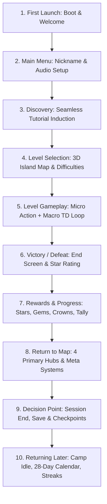

# Phase 5: Player Journey Audit — Bimbleguard

**Auditor:** Player Journey, QA & Implementation Lead  
**Engine & Target:** Godot 4.7.2 (GL Compatibility) / Android Mobile & Desktop  
**Version Audited:** v0.6.0  
**Date:** 2026-10-21  

---

## Executive Overview

Bimbleguard is designed as a hybrid action tower defense title combining micro-control (hero movement, manual melee attack/spin, tree chopping, villager trade) with macro-strategy (tower placement on designated grid slots, branching elemental upgrades, path choke points, economy management).

This audit traces the complete, end-to-end 10-step player lifecycle: from a fresh install's first second of execution to long-term Day 28+ retention loops. Each step evaluates:
1. **What the player sees** (visuals, viewport layout, UI components)
2. **What the player can do** (inputs, interactions, accessible branches)
3. **What the game communicates** (feedback, banners, tooltips, cues)
4. **What works correctly** (validated functional strengths)
5. **Where friction, repetition, or confusion occurs** (UX/gameplay pain points)
6. **Smallest high-impact change** (surgical improvement to elevate experience)

---

## Step 1: First Launch (Cold Boot & Routing)

### 1. What the Player Sees
* **Splash / Boot:** A crisp blue background (`boot_splash/bg_color = #335cc7`), the Bimbleguard emblem (`ui/app/splash.png`), loading into `scenes/boot.tscn`.
* **Welcome Screen (`scenes/welcome.tscn`):** Clean landscape screen with safe area margins applied (`ScreenUtil.safe_margins()`). The game title appears on the left with 3D/stylized mascot art (`$Safe/Center/Row/Art/GameTitle`).
* **Authentication Choice:** On the right, two prominent primary buttons appear:
  * "Создать аккаунт" (`Create account`)
  * "Войти" (`Sign in`)
  * Below them is a secondary, low-friction link: "Играть без аккаунта" (`Play without an account`).
  * A subtle crash-reporting privacy notice (`WELCOME_CRASH_NOTE`) sits at the bottom.

### 2. What the Player Can Do
* Tap "Create account" or "Sign in" to open `EmailAuthDialog` (email + password form).
* Tap "Play without an account" (`choose_guest()`) to jump directly into the game without network roadblocks.
* On Android, press the hardware Back button (which dismisses an open auth dialog or cleanly exits the app).

### 3. What the Game Communicates
* Establishes that online features (cloud saves, cross-device sync, global leaderboards) exist, but guest play is 100% permitted and will not hinder gameplay or progression.
* Reassures the player that local saves will work completely offline.

### 4. What Works Correctly
* **Zero network blocking:** `Online.start(false)` runs non-blocking in the background. If offline, the guest flow proceeds instantly without freezing or showing network error popups.
* **Display cutout awareness:** Safe area margins are computed dynamically from `DisplayServer.get_display_safe_area()`, preventing notch overlap on modern punch-hole and pill cutouts.

### 5. Friction, Repetition, or Confusion
* **Premature Account Interrogation:** Presenting an account registration/login modal before the player has experienced even 5 seconds of gameplay violates hyper-casual and mid-core mobile onboarding best practices. Many players bounce immediately when greeted by "Create Account" before playing.
* **Static Visuals:** The welcome screen lacks dynamic animation (no particle drift or idling hero model), feeling somewhat sterile for a fantasy action title.

### 6. Smallest High-Impact Change
* **Default to Instant Guest Play with Deferred Registration:** Auto-route first-time players directly into the nickname screen and interactive tutorial. Demote "Create Account" to an optional map banner or post-Level 1 celebration toast (`"Save your progress to cloud - Link Email"`).

---

## Step 2: Initial Setup & Nickname Screen

### 1. What the Player Sees
* **Scene (`scenes/nickname.tscn`):** Centered panel with the subtitle "Как тебя зовут, защитник?" (`NICK_SUBTITLE`), an active text input box (`NameEdit`), a character counter (`%d/16`), a dynamic feedback status label, and a large "В бой!" (`GoButton`).
* If Firebase is active and the player has an existing account, an additional secondary button "У меня уже есть аккаунт" (`NICK_HAVE_ACCOUNT`) appears.

### 2. What the Player Can Do
* Type a custom nickname (3 to 16 characters: Latin, Cyrillic, numbers, spaces, hyphens, underscores).
* Watch real-time validation feedback.
* Tap "В бой!" to submit the name.
* On mobile, the virtual keyboard slides up.

### 3. What the Game Communicates
* Live feedback dynamically updates:
  * Empty: "От 3 до 16 символов" (`NICK_HINT`, neutral blue).
  * Valid: "Отличное имя!" (`NICK_GREAT`, light green).
  * Invalid: "Слишком короткое", "Недопустимые символы", or profanity warning (`ERROR_COLOR`).
* Upon submission, displays "Проверяем имя..." (`NICK_CHECKING`), followed by "Добро пожаловать, {name}!" (`NICK_WELCOME`) with a 0.9-second pleasant confirmation pause before transitioning.

### 4. What Works Correctly
* **Keyboard Height Handling:** `ScreenUtil.keyboard_height()` tracks virtual keyboard expansion on mobile and hides decorative art (`_art.visible = not compact`) to keep the input field and submit button comfortably above the keyboard.
* **Offline Fallback:** If offline, `Online.reserve_nickname()` cleanly marks the name as locally saved (`NICK_OFFLINE_SAVED`), changing the button text to "Продолжить" without blocking.

### 5. Friction, Repetition, or Confusion
* **Mandatory Keyboard Prompt on Fresh Launch:** For mobile players wanting instant action, typing a custom name on first boot is an unnecessary speed bump.
* **No Random Name Generator / Dice Button:** Players struggling to invent a name have no "quick pick" option.

### 6. Smallest High-Impact Change
* **Add a "Random Name" (Dice) Icon:** Pre-populate the input field with a generated fantasy moniker (e.g., `BimbleKnight_42`, `ForestGuard_7`), allowing the player to tap "В бой!" with exactly one touch.

---

## Step 3: Discovery of the Next Action (Tutorial Induction)

### 1. What the Player Sees
* Immediate transition into `scenes/main.tscn` running in dedicated tutorial mode (`LevelCatalog.tutorial = true`, Level 1).
* The 3D world loads: lush green clearing, the castle gate, chopping trees, stone paths, and empty tower slots.
* A prominent yellow pointer arrow (`Tutorial.draw_pointer()`) pulses downward with a high-contrast dark outline, focusing on the nearest choppable tree.
* Top coach box (`Coach`) displays clear step-by-step guidance: step indicator (e.g. `1/8`), objective title, instruction body, and a "Пропустить" (`Skip`) button.

### 2. What the Player Can Do
* Read the coach prompt or tap "Пропустить" to bring up the skip confirmation modal.
* Move the hero using the on-screen virtual joystick or keyboard controls (WASD).
* Approach highlighted objects to trigger contextual actions.

### 3. What the Game Communicates
* Clearly introduces the dual-currency core premise: Wood is collected manually by the hero in the forest; Gold is earned by defeating attacking monsters.
* Pauses wave timers indefinitely (`HOLD_SECONDS = 36000.0`) so the player never feels rushed or overwhelmed while learning controls.

### 4. What Works Correctly
* **Event-Driven Signal Architecture:** The tutorial never relies on fragile sleep timers; it connects directly to core engine signals (`hero.wood_gathered`, `waves.wave_cleared`, `build.tower_built`, `build.tower_upgraded`).
* **Modal Guard:** Accidental double-taps on step dialogs are rejected by `MODAL_GUARD_MS = 450`.
* **Dynamic Retargeting:** The visual pointer recalculates positions every 10 frames (`RETARGET_FRAMES = 10`), seamlessly tracking moving enemies or changing hero positions.

### 5. Friction, Repetition, or Confusion
* **Initial Wood Requirement Clarity:** Players occasionally wander around after chopping one tree without realizing they need 2-3 logs before a tower slot becomes buildable.
* **Virtual Joystick Initial Visibility:** On certain ultra-wide aspect ratios, the joystick base sits slightly close to the bottom-left bezel.

### 6. Smallest High-Impact Change
* **Resource Goal Counter in Step Coach:** Update the coach header during the chop step to show a live resource tally: `"Руби лес: 15/30 дерева"`, making the finish condition unmistakable.

---

## Step 4: Level Selection & Map Progression

### 1. What the Player Sees
* **3D Archipelago Map (`scenes/level_select.tscn`):** A low-poly stylized island floating in sea water.
* **Site Badges:** Numbered circular nodes (`Level1` to `Level6`). Unlocked levels display their number with a 3-star underbar; locked levels display a silver padlock. The currently chosen level has an enlarged scale (`NODE_SCALE_CHOSEN = 1.14`) and subtle bounce.
* **Top Navigation Bar:** Game title, Gems chip (`HudPill`), Coins chip, Stars pill, Sound toggle, Achievements crown, Settings gear, Profile villager, and Cloud sync status.
* **Bottom Hub Bar:** 4 consolidated primary tabs:
  1. `Rewards` (Streak & Quests, flame icon)
  2. `Treasury` (Perks & Camp upgrades, chest icon)
  3. `Game Modes` (Daily Run, Co-op, Leaderboards, hourglass icon)
  4. `Shop` (Cosmetics & Gold, shopping cart icon)
* **Level Detail Card (Right Side):** Level emblem, title (e.g. "Лесная застава"), star rating, endless siege record, Difficulty Segments (`Обычный`, `Тяжёлый`, `Кошмар`), and the large green "В бой!" (`PlayButton`).

### 2. What the Player Can Do
* Tap any unlocked level badge on the island to select it.
* Toggle difficulty segments (`Normal`, `Hard`, `Nightmare`).
* Inspect high scores, records, and star thresholds.
* Tap "В бой!" to launch the campaign battle, or "Осада" (`EndlessButton`) to start endless wave defense.
* Open any bottom hub panel or top bar utility.

### 3. What the Game Communicates
* Camera smoothly frames all unlocked sites using dynamic frustum calculations (`_fit_camera()`).
* Difficulties display modifiers clearly:
  * Hard: +30% enemy HP, +20% enemies, +25% gold reward, 15 lives.
  * Nightmare: +60% enemy HP, +40% enemies, +50% gold reward, 10 lives.
  * If locked, explains unlock criteria: `"Пройди на 3 звезды на обычном"` (`MAP_DIFF_LOCK_1`).

### 4. What Works Correctly
* **Adaptive Camera Frustum:** `_fit_camera()` calculates the bounding box of site coordinates and adjusts `h_offset`, `v_offset`, and `fov` to guarantee zero overlap with the top bar, tab bar, or right-hand level card.
* **Difficulty Crowns:** Beating a level on Hard or Nightmare awards a permanent colored crown badge (White / Orange / Purple) visible directly on the 3D map node.

### 5. Friction, Repetition, or Confusion
* **Visual Lock State on Difficulty Tabs:** When a player taps a locked "Hard" tab, the tab is simply disabled, which can feel unresponsive; the unlock hint is tucked in small text below.
* **Endless Mode Discoverability:** First-time players often miss the "Осада" button because it sits underneath the giant "В бой!" button in a muted secondary style.

### 6. Smallest High-Impact Change
* **Pulsing Indicator on Newly Unlocked Features:** When a level is completed with 3 stars, trigger a short golden sparkle on the "Hard" difficulty tab to announce its availability.

---

## Step 5: Level Gameplay (Core Action-TD Loop)

### 1. What the Player Sees
* **Tactical Battlefield (`scenes/main.tscn`):** Isometric 3D arena. Winding dirt path from enemy portals to the castle gate. Pre-placed stone tower foundations (`TowerSlot`), scattered harvestable trees, and wandering peaceful villagers.
* **Player Hero (Knight):** Responsive character model equipped with broadsword and woodsman's axe.
* **HUD Overlay:**
  * Top bar: Castle Lives (`set_lives`), Gold count, Wood count, Wave indicator (`Wave N / Total`), Wave timer banner (`WAVE_NEXT_IN`).
  * Threat Vignette: Red screen-edge warning pulsing when monsters approach within 4.5m of the castle (`_update_threat_detection()`).
  * Bottom Right Controls: Large primary Attack/Chop button (dynamically switches icon between sword and axe), Whirlwind Spin special attack button with radial cooldown sweep.
  * Bottom Left Controls: Virtual floating joystick for analog movement.
  * Bottom Center: Contextual Command Card (displays available towers when a slot is tapped, or trade/hire options near villagers/camps).

### 2. What the Player Can Do
* Steer the hero anywhere across walkable navigation meshes (`WalkGrid`).
* Walk up to trees to highlight them with a green ring; tap Attack to chop for wood (+10 wood per fell, logs auto-pickup).
* Tap an approaching enemy to automatically pursue and engage in melee combat; tap Spin for a 360-degree area-of-effect sweep.
* Tap an empty tower slot to inspect build choices:
  * Archer Tower (Single-target physical, fast air/ground)
  * Cannon Tower (Splash physical, slow, ground-only)
  * Frost Tower (Ice slow aura, magic)
  * Lightning Tower (Chain electrical damage)
* Tap existing towers to upgrade, inspect range rings (both current and next-tier preview rings), or sell for partial gold refund.
* Walk near friendly villagers to trade surplus wood for emergency gold, or visit the Lumberjack/Mercenary camps to hire autonomous helpers.
* Toggle 2x game speed or strategic zoom-out camera (`StrategicView`).

### 3. What the Game Communicates
* Wave incoming direction banners: "С севера!", "С востока!" with directional portal ground arrows (`LaneHint`).
* Floating text popups: `+10 Wood`, `+12 Gold`, `Castle Upgraded!`.
* Imminent danger warning: Screen vignette reddens and pulses when enemies near the base.
* Visual range rings: Solid cyan circle for current tower range, dotted ring for upgraded range.

### 4. What Works Correctly
* **Dynamic Attack Button Switch:** `_update_target_ring()` detects whether the hero is facing a harvestable tree or an enemy, instantly updating the HUD button icon and reticle color.
* **Target Pursuit:** Tapping an enemy activates automated pursuit (`test_hero_fixes.gd`), preventing awkward melee whiffs against moving slimes.
* **Checkpoint Engine:** The battle state (wave, resources, built towers, health) auto-saves every wave clear and on application minimize (`BattleCheckpoint`).

### 5. Friction, Repetition, or Confusion
* **Multitasking Overload:** In intense waves (e.g. Waves 8-10 with split lanes), running across the map to chop wood while simultaneously defending two gates can feel frantic.
* **Accidental Slot Selection While Moving:** Tapping near the knight while dodging projectiles occasionally selects an adjacent tower slot, opening the command card and obstructing the view.

### 6. Smallest High-Impact Change
* **Proximity Deselect Guard:** Automatically clear tower slot selection if the knight moves more than 5.5m away from the selected slot (already verified in `test_threat_alarm.gd`), keeping the combat screen clean.

---

## Step 6: Success or Failure (Battle End Screen)

### 1. What the Player Sees
* **Victory State:**
  * Cheerful fanfare audio (`_victory_sound`).
  * Big golden header: "ПОБЕДА!" (`HUD_VICTORY`).
  * 3 Large animated stars: lit up based on remaining castle life percentage (100% lives = 3 stars, >50% = 2 stars, >0% = 1 star).
  * Crown announcement banner if Hard/Nightmare was beaten.
  * Comprehensive combat statistics panel:
    * Total monster kills & gold earned (`END_STATS_1`).
    * Wood harvested, towers constructed, and clear time (`END_STATS_2`).
    * Gained gems and First-Run bonus notice.
  * Navigation buttons: "На карту" (`To the map`) and "Заново" (`Restart`).
* **Defeat State:**
  * Somber defeat chime (`_defeat_sound`).
  * Red header: "ПОРАЖЕНИЕ" (`END_DEFEAT`).
  * Dynamic tactical tip randomly chosen from `DEFEAT_TIPS`:
    * `"Совет: Ледяная башня замедляет быстрых врагов"`
    * `"Совет: Улучшай меч в кузнице, чтобы наносить больше урона"`
    * `"Совет: Почини замок за дерево, если враги прорвались"`
  * Statistics summary of the fallen defense.
  * Action buttons: "Ещё раз" (Try again) and "На карту" (To the map).

### 2. What the Player Can Do
* Review performance stats and rewards.
* Tap "На карту" to exit to `level_select.tscn`.
* Tap "Заново" to immediately restart the battle with reset resources and fresh waves.

### 3. What the Game Communicates
* Accurately communicates exactly why 3 stars were or were not achieved (`"Сохрани все жизни для 3 звёзд"`).
* If defeated, offers actionable tactical advice tailored to common player mistakes.

### 4. What Works Correctly
* **Clean Tree Pausing:** `battle_end.gd` pauses the scene tree safely without leaking input states, immediately canceling active hero orders and clearing selections.
* **Guaranteed Progress Flush:** `flush_progress()` writes the save file to disk immediately upon battle completion.

### 5. Friction, Repetition, or Confusion
* **No "Next Level" Button:** On victory, the player must tap "На карту", wait for map load, tap the next island node, and tap "В бой!". This adds unnecessary friction to campaign progression.
* **Tip Specificity on Defeat:** Defeat tips are randomly selected rather than checking what actually killed the player (e.g. boss leak vs swarm leak).

### 6. Smallest High-Impact Change
* **Add "Следующий уровень" (Next Level) Button on Victory:** When the player earns at least 1 star and the next level is unlocked, display a primary "Следующий" button on the victory card that loads `Level ID + 1` directly.

---

## Step 7: Rewards & Progress Updates

### 1. What the Player Sees
* **Wallet & Currency Tally:**
  * Stars gained: permanently incremented on the profile (`Perks.earned_stars()`).
  * Gems gained: `Economy.award_level_win()` calculates first-time star rewards and difficulty crown rewards, displaying `+N Gems` (`END_GEMS`).
  * First Run Bonus: First victory of the UTC day displays `+5 Gems` and `x2 Treasury Coins`.
* **Achievement / Quest Toasts:**
  * If a battle action unlocked an achievement (e.g. "Построить 5 башен", "Срубить 20 деревьев"), a slide-in banner pops up with the crown icon and gem reward.

### 2. What the Player Can Do
* Watch animated reward counters accumulate.
* Note newly acquired star points for spending in the Treasury.

### 3. What the Game Communicates
* Establishes a transparent, generous economy: Every star earned awards gems; every difficulty crown awards gems; daily play awards gems; achievements award gems.
* Informs the player that stars are not just a vanity score—they are the literal currency used to upgrade permanent account talents.

### 4. What Works Correctly
* **Idempotent Wallet Ledger:** `Wallet.claim()` records rewards under immutable deterministic keys (e.g. `lv1s1`, `lv1s2`, `lv1c1`, `fw:2026-10-21`). A replayed level or interrupted sync never double-pays or loses currency.
* **Event Multipliers:** `Events.reward_mult()` automatically scales gem payouts during active seasonal events.

### 5. Friction, Repetition, or Confusion
* **Celebration Weight:** Gaining a new star or crown lacks punchy audio-visual feedback (no particle confetti or star chime sequence), feeling somewhat understated.

### 6. Smallest High-Impact Change
* **Staggered Star Ping Animation:** Stagger star lighting by 0.25 seconds with an ascending sound pitch (`pitch_scale = 1.0, 1.2, 1.4`), giving victory a gratifying tactile payoff.

---

## Step 8: Return to Map & Exploration of Meta Hubs

### 1. What the Player Sees
* Return to the 3D map scene (`level_select.tscn`).
* Top bar currency chips (`GemsChip`, `CoinsChip`) reflect updated balances.
* Notification red dots (`_dot()`) appear on relevant bottom hub tabs if rewards or upgrades are claimable:
  * `Rewards` tab has a red dot if daily streak or quests are ready to claim.
  * `Treasury` tab has a red dot if unspent stars exceed perk costs.
  * `Game Modes` tab has a red dot if the Daily Trial hasn't been attempted today.

### 2. What the Player Can Do
* **Hub 1: Rewards (`StreakPanel`):**
  * View 7-day login streak progress and claim today's reward.
  * Inspect 3 daily quests (e.g. "Defeat 30 slimes", "Build 4 lightning towers").
  * Access the Camp (idle coins collector) and 28-day cumulative calendar.
* **Hub 2: Treasury (`PerksPanel`):**
  * Spend earned stars on permanent RPG perk nodes:
    * Sharp Sword (+Hero melee damage)
    * Lumberjack Axe (+Wood gathered per chop)
    * Reinforced Walls (+Castle starting lives)
    * Master Builder (+Tower damage percentage)
    * Swift Boots (+Hero movement speed)
* **Hub 3: Game Modes (`ModesPanel`):**
  * Launch the **Daily Challenge** (unique daily modifier, e.g. armored slimes, double speed).
  * Enter **Co-op Lobby** (`coop_lobby.tscn`) to host or join 2-player shared defense.
  * View **Global Leaderboards** (`RecordsPanel`).
* **Hub 4: Shop (`shop.tscn`):**
  * Browse cosmetic knight skins, weapon trails, and base themes purchasable with gems.
* **Top Bar Utility Modals:**
  * Achievements (`AchievementsPanel`): claim completed milestones.
  * Encyclopedia (`EncyclopediaPanel`): browse Towers, Bestiary, and Village stats.
  * Settings (`SettingsPanel`): audio sliders, language selection, graphics tiers.

### 3. What the Game Communicates
* Clear hierarchy: Primary progression is horizontal on the island; vertical meta-progression is organized neatly into the 4 bottom tabs.
* Red notification dots guide the eye to where value is waiting to be claimed.

### 4. What Works Correctly
* **Consolidated 4-Tab Hub Architecture:** Following commit `c8495bc`, the previous clutter of 8 loose buttons was consolidated into 4 logical hubs, drastically improving layout breathing room and tablet/phone ergonomics.
* **Non-Destructive Navigation:** Opening any panel creates a clean modal frame (`DialogFrame`); tapping Outside or Android Back cleanly closes the topmost panel without resetting map state.

### 5. Friction, Repetition, or Confusion
* **Nested Camp & Calendar Access:** To reach the Camp or 28-Day Calendar, the player must tap `Rewards` -> then tap small sub-buttons inside the `StreakPanel`. Players who don't explore sub-menus may overlook their offline treasury coins.

### 6. Smallest High-Impact Change
* **Camp Quick-Collect Badge on Main Map:** If the Camp coin vault is full (>80% capacity), display a small coin collection icon directly hovering over the castle on the 3D island map, allowing 1-tap harvesting.

---

## Step 9: Decision to Continue or Leave

### 1. What the Player Sees
* An enticing gameplay crossroad:
  * Next campaign level unlocked with fresh biome terrain.
  * Replaying previous levels on "Hard" to win crowns.
  * Trying "Осада" (Endless) to push leaderboards.
  * Taking on the Daily Challenge.
  * Spending stars in the Treasury to power up the hero.
* Or, if ready to leave: Hardware Back button on Android or app switcher minimize.

### 2. What the Player Can Do
* Start another battle immediately.
* Experiment with hero builds in the Treasury.
* Press Back to exit the game cleanly via `get_tree().quit()`, or switch apps.

### 3. What the Game Communicates
* Provides clear goals: Unlocking Level 2, completing daily quests, or saving gems for a desired hero skin.
* Reassures the player that progress is permanently saved.

### 4. What Works Correctly
* **Lifecycle State Persistence:** `main.gd` handles `NOTIFICATION_APPLICATION_PAUSED` and `NOTIFICATION_APPLICATION_FOCUS_OUT` by immediately flushing saves (`flush_progress()`) and writing mid-battle checkpoints (`_save_checkpoint()`).
* **Clean Android Back Stack:** Back closes panels in strict LIFO order (Gems panel -> Camp -> Calendar -> Daily -> Achievements -> Treasury -> Records -> Settings -> Encyclopedia -> Exit App).

### 5. Friction, Repetition, or Confusion
* **No "Quit Game" Confirmation Dialog:** Pressing Back on the root map immediately quits the application without a brief confirmation ("Are you sure you want to quit?"), which can cause accidental exits if tapped by mistake.

### 6. Smallest High-Impact Change
* **Add Root Exit Confirmation Toast / Dialog:** When Back is pressed on the root map, require a second Back tap within 2.0 seconds (`"Нажмите ещё раз для выхода"`) or show a simple confirmation prompt.

---

## Step 10: Returning to the Game Later (Retention Loops)

### 1. What the Player Sees
* **Instant Resume:** Returning players bypass the Welcome and Nickname screens entirely, loading into the Map in under 1.5 seconds.
* **App Launch Rewards (`Economy.on_app_open()`):**
  * Streak Check-in: Displays day streak reward toast.
  * First Run of the Day: Ready to pay +5 gems and 2x camp coins on the first win.
  * 28-Day Calendar: Step ready to claim.
  * Camp Treasury: Offline coins waiting to be collected (calculated based on elapsed hours).
  * Checkpoint Resume: If a battle was interrupted, selecting that level displays a "Продолжить бой (Волна N)" prompt.

### 2. What the Player Can Do
* Collect offline Camp coins accumulated while away.
* Claim the 28-Day cumulative calendar reward (Day 7/14/21/28 milestones offer massive gem bundles).
* Play the Daily Run to compete on the global leaderboard.
* Resume an in-progress battle checkpoint.

### 3. What the Game Communicates
* Respects the player's offline time by rewarding absence via the Camp's passive income generator.
* Welcomes the player back with clear daily goals and streak progression.

### 4. What Works Correctly
* **Clock Rollback & Anti-Cheat Protection:** `Camp.pending_coins()` enforces strictly monotonic Unix timestamps; winding the device clock backward awards 0 coins and prevents exploitation (`test_retention.gd`).
* **Cumulative Calendar Design:** Unlike unforgiving streak systems that reset to Day 1 upon a single missed day, the 28-Day Calendar in `calendar28.gd` never resets on skipped days; it simply advances to the next step whenever the player returns.
* **Checkpoint Fidelity:** `BattleCheckpoint` faithfully restores wave number, hero sword tier, castle lives, built towers, upgrade tiers, and villager states (`test_checkpoint.gd`).

### 5. Friction, Repetition, or Confusion
* **Multiple Disconnected Claims:** The returning player currently has to manually open 3 separate screens to collect everything: Streak panel, Calendar panel, and Camp panel.

### 6. Smallest High-Impact Change
* **Unified "Welcome Back!" Pop-up:** Upon first opening the app each calendar day, present a single consolidated "Daily Tribute" modal summarizing:
  * Streak Day + Reward
  * Calendar Step + Reward
  * Camp Offline Coins + "Collect All" button.
  This transforms returning into a joyful, 1-tap dopamine hit.

---

## Comprehensive Journey Summary Matrix

| Step | Core Activity | Player Perception | Friction Point | High-Impact Solution |
| :--- | :--- | :--- | :--- | :--- |
| **1. First Launch** | Boot & Account Setup | Confused by login form before playing | Auth modal before gameplay | Default to instant guest play; defer sign-up |
| **2. Nickname** | Identity Creation | Necessary chore | No random moniker generator | Add "Dice" random name button |
| **3. Discovery** | Tutorial Induction | Guided and clear | Wood chopping goal tally not explicit | Add "Wood: X/30" goal counter to coach header |
| **4. Level Selection** | 3D Map & Difficulties | High visual charm, clear nodes | Locked Hard/Nightmare modes seem disabled | Add golden unlock pulse when 3 stars earned |
| **5. Gameplay** | Hybrid Action-TD Loop | Thrilling micro/macro balance | Combat multitasking can overwhelm | Proximity auto-deselect on distant tower slots |
| **6. Battle End** | Victory / Defeat Screen | Informative stats, clear rating | Must return to map before next level | Add "Next Level" direct action button on victory |
| **7. Rewards** | Currency & Gem Tally | Generous and deterministic | Star acquisition lacks celebratory punch | Add staggered star pop with rising audio pitch |
| **8. Return to Map** | Exploring 4 Meta Hubs | Structured and organized | Camp & Calendar buried in sub-menus | Add Camp quick-collect badge directly on 3D map |
| **9. Session End** | Save & App Exit | Reliable persistence & back stack | Accidental root exit on Back button | Add "Press Back again to exit" double-tap guard |
| **10. Returning Later**| Offline Retention Loops | High reward satisfaction | 3 separate manual collection panels | Unified "Welcome Back" daily harvest modal |
