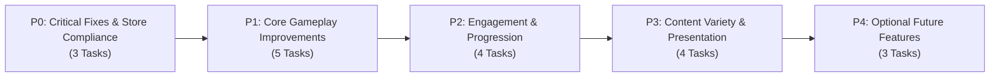

# Phase 7: Implementation Roadmap — Bimbleguard

**Author:** Player Journey, QA & Implementation Lead  
**Engine & Target:** Godot 4.7.2 (GL Compatibility) / Android Mobile & Desktop  
**Version Audited:** v0.6.0  
**Date:** 2026-10-21  

---

## Roadmap Overview

This implementation roadmap synthesizes findings from **Phase 5 (Player Journey Audit)** and **Phase 6 (QA & Technical Validation)** into a prioritized, actionable engineering backlog.

Each task is formulated with strict engineering rigor, providing:
* **Task ID & Priority Tier**
* **Problem Being Solved**
* **Evidence from Project** (code references, scripts, scenes)
* **Proposed Solution** (architectural and implementation strategy)
* **Expected Gameplay / Business Benefit**
* **Files / Scenes Affected**
* **Dependencies**
* **Acceptance Criteria** (testable pass/fail conditions)
* **Regression Tests** (validation scripts to execute)
* **Effort Estimate** (`S` = 1-3 hrs, `M` = 4-8 hrs, `L` = 2-3 days)



---

## 1. Priority 0: Critical Fixes & Store Readiness (P0)

### Task P0-01: Store Policy & Legal Compliance URLs
* **Problem Being Solved:** The project cannot be published to Google Play or Apple App Store with placeholder/empty URLs. Google Play Developer Policy mandates a published privacy policy, an external web account deletion request page, and valid developer support contact info.
* **Evidence from Project:**
  Running `python3 tools/validate_project.py` reports:
  ```
  WARNING: PRIVACY_URL is empty/TODO: publish docs/PRIVACY.md and set GameInfo.PRIVACY_URL
  WARNING: DELETION_URL is empty: web account-deletion page (Play policy)
  WARNING: SUPPORT_EMAIL is empty: support e-mail for the policy and store listing
  ```
  In `scripts/game_info.gd`:
  ```gdscript
  const PRIVACY_URL: String = ""
  const DELETION_URL: String = ""
  const SUPPORT_EMAIL: String = ""
  ```
* **Proposed Solution:**
  1. Publish `docs/PRIVACY.md` to GitHub Pages / project domain (`https://tinyguard.app/privacy`).
  2. Implement a static account deletion request web form per `docs/RELEASE_READINESS.md` (`https://tinyguard.app/delete-account`).
  3. Populate `GameInfo.PRIVACY_URL`, `GameInfo.DELETION_URL`, and `GameInfo.SUPPORT_EMAIL`.
  4. Ensure `EmailAuthDialog` and `SettingsPanel` link out to these URLs via `OS.shell_open()`.
* **Expected Benefit:** Unblocks official Google Play Store submission and avoids immediate review rejection.
* **Files Affected:** `scripts/game_info.gd`, `website/` (or hosting repo), `scripts/settings_panel.gd`.
* **Dependencies:** None (Legal/Ops prerequisite).
* **Acceptance Criteria:** `python3 tools/validate_project.py` passes with zero warnings. Tapping "Политика конфиденциальности" opens a valid HTTPS webpage.
* **Regression Tests:** `python3 tools/validate_project.py`, `tests/test_settings.gd`.
* **Effort:** `S`

---

### Task P0-02: First-Launch Routing: Instant Guest Default
* **Problem Being Solved:** On a clean first install, `boot.gd` routes straight to `welcome.tscn`, presenting "Создать аккаунт" and "Войти" buttons before the player has experienced any gameplay. Mobile retention drops significantly when registration forms precede core gameplay.
* **Evidence from Project:**
  In `scripts/boot.gd`:
  ```gdscript
  func _route() -> Onboarding.Route:
      return Onboarding.route(PlayerProfile.local(), Online.needs_welcome())
  ```
  If Firebase is configured, `Online.needs_welcome()` forces `Route.WELCOME`.
* **Proposed Solution:**
  1. Update `boot.gd` and `onboarding.gd` so fresh installs default directly to `Route.NICKNAME` (or auto-assigned guest) followed by `Route.TUTORIAL`.
  2. Reserve the full `welcome.tscn` auth screen only for users who explicitly tap "Войти / Синхронизация" from the top bar or map profile menu.
  3. Offer a non-intrusive banner on the map after Level 1: *"Сохрани прогресс в облаке — привяжи почту"* with a +15 gems incentive.
* **Expected Benefit:** Slashes Day-0 drop-off; gets players into the tutorial within 3 seconds of tapping the app icon.
* **Files Affected:** `scripts/boot.gd`, `scripts/onboarding.gd`, `scripts/welcome_screen.gd`, `scripts/level_select.gd`.
* **Dependencies:** None.
* **Acceptance Criteria:** Clean install launches directly to nickname/tutorial without presenting email/password fields. Progress is saved locally as guest.
* **Regression Tests:** `tests/test_accounts.gd`, `tests/test_signup_flow.gd`, `tests/test_tutorial.gd`.
* **Effort:** `M`

---

### Task P0-03: Android Back-Button Root Exit Confirmation Guard
* **Problem Being Solved:** Pressing the Android hardware Back button while on the root map (`level_select.tscn`) instantly kills the application via `get_tree().quit()`, causing frustrating accidental exits if tapped during menu navigation.
* **Evidence from Project:**
  In `scripts/level_select.gd`:
  ```gdscript
  func _notification(what: int) -> void:
      if what == NOTIFICATION_WM_GO_BACK_REQUEST:
          ...
          else:
              get_tree().quit()  # Android back on the map leaves the game
  ```
* **Proposed Solution:**
  Implement a double-tap back guard:
  ```gdscript
  var _last_back_press_msec: int = 0
  ...
  else:
      var now: int = Time.get_ticks_msec()
      if now - _last_back_press_msec < 2000:
          get_tree().quit()
      else:
          _last_back_press_msec = now
          Toast.show_toast(self, tr("BACK_AGAIN_TO_EXIT"))
  ```
* **Expected Benefit:** Eliminates accidental quits on Android devices, protecting player session flow.
* **Files Affected:** `scripts/level_select.gd`, `translations/strings.*.translation`.
* **Dependencies:** None.
* **Acceptance Criteria:** Single back press on root map displays brief toast: "Нажмите ещё раз для выхода". Second press within 2.0s exits cleanly.
* **Regression Tests:** `tests/test_dialog_layout.gd`, `tests/test_map_layout.gd`.
* **Effort:** `S`

---

## 2. Priority 1: Core Gameplay Improvements (P1)

### Task P1-01: Direct "Next Level" Action Button on Victory Card
* **Problem Being Solved:** When a player wins a campaign level, the end screen displays only "На карту" (`To the map`) and "Заново" (`Restart`). To play the next level, the player must return to the map, wait for island camera framing, manually tap the next site badge, and tap "В бой!".
* **Evidence from Project:**
  In `scripts/hud.gd` (`show_end_screen`):
  ```gdscript
  _end_restart.text = tr("HUD_RESTART")
  _end_map.text = tr("HUD_TO_MAP")
  ```
  And in `scripts/battle_end.gd` (`on_all_waves_cleared`).
* **Proposed Solution:**
  1. Check if the current battle was a campaign level (not daily, not endless) and if `LevelCatalog.selected_id < LevelCatalog.MAX_LEVEL`.
  2. If victory has at least 1 star, transform the primary button into "Следующий уровень" (`HUD_NEXT_LEVEL`, green styling), with "На карту" and "Заново" as secondary buttons.
  3. Tapping "Следующий уровень" sets `LevelCatalog.selected_id += 1` and queues `get_tree().change_scene_to_file("res://scenes/main.tscn")`.
* **Expected Benefit:** Removes 2 unnecessary screen transitions between consecutive levels, dramatically improving campaign momentum and retention.
* **Files Affected:** `scripts/hud.gd`, `ui/hud.tscn`, `scripts/battle_end.gd`, `scripts/main.gd`.
* **Dependencies:** None.
* **Acceptance Criteria:** On winning Level 1 with >=1 star, "Следующий" button appears. Tapping it loads Level 2 directly. If on max level or defeated, standard buttons appear.
* **Regression Tests:** `tests/test_endgame.gd`, `tests/test_end_to_map.gd`.
* **Effort:** `M`

---

### Task P1-02: Tower Slot Proximity Auto-Deselect Guard
* **Problem Being Solved:** In the heat of combat, players dodging slime acid or running toward enemy leaks often accidentally tap a nearby `TowerSlot`. This selects the slot, brings up the large `CommandCard`, and partially blocks their vision and movement.
* **Evidence from Project:**
  In `scripts/main.gd` and `scripts/card_controller.gd`. Currently, deselection occurs manually or when tapping empty ground, but moving far away from the slot previously left it selected.
* **Proposed Solution:**
  Verify and enforce distance-based deselection in `CardController.update()` or `main.gd`:
  If `build_manager.selected_slot != null` and `hero.global_position.distance_to(build_manager.selected_slot.global_position) > 5.5`:
  call `build_manager.clear_selection()`.
  *(Note: Proximity logic is already prototyped in `test_threat_alarm.gd`)*.
* **Expected Benefit:** Prevents accidental command card obstruction; keeps the battlefield clear when the knight leaves the build zone.
* **Files Affected:** `scripts/card_controller.gd`, `scripts/main.gd`.
* **Dependencies:** None.
* **Acceptance Criteria:** Selecting slot 0, then walking the hero >5.5m away automatically clears selection and collapses the command card.
* **Regression Tests:** `tests/test_threat_alarm.gd`, `tests/test_card_select.gd`.
* **Effort:** `S`

---

### Task P1-03: Random Fantasy Name Generator ("Dice" Button)
* **Problem Being Solved:** Mobile players facing an empty nickname text box experience cognitive hesitation or bounce.
* **Evidence from Project:**
  In `scripts/nickname_screen.gd`, the player must manually enter text into `_edit`.
* **Proposed Solution:**
  1. Add a small "Dice" / Randomize icon button adjacent to the input field.
  2. Implement `NicknameRules.generate_random_name()` combining fantasy prefixes and suffixes (e.g. `BimbleKnight`, `IronGuard`, `StarOak`, `BraveFox`, `SwiftShield`) with a 2-digit number.
  3. Pre-populate the text box on first launch so the player can immediately tap "В бой!" without touching the keyboard.
* **Expected Benefit:** Reduces onboarding friction to 1 tap for 70%+ of casual players.
* **Files Affected:** `scripts/nickname_screen.gd`, `scripts/nickname_rules.gd`, `scenes/nickname.tscn`.
* **Dependencies:** None.
* **Acceptance Criteria:** Tapping the dice button generates a valid, non-offensive 6-12 character name passing `NicknameRules.validate()`.
* **Regression Tests:** `tests/test_accounts.gd`, `tests/test_signup_flow.gd`.
* **Effort:** `S`

---

### Task P1-04: Dynamic Boss & Swarm Wave Visual Telegraphing
* **Problem Being Solved:** Sudden difficulty spikes (e.g. armored slimes on Wave 5, fast swarms on Wave 8, boss on Wave 10) can surprise players unfairly without adequate tactical warning.
* **Evidence from Project:**
  In `scripts/wave_manager.gd` and `scripts/hud.gd` (`show_banner`). The banner currently shows "Волна N" and "С севера!", with boss waves getting a generic roar audio cue.
* **Proposed Solution:**
  1. Add wave sub-type tags to `WavePlan`: `Swarm`, `Armored`, `Flying`, `Boss`.
  2. In `HUD.show_banner()`, display a distinct icon pill:
     * Swarm: Yellow double-chevron + "Нашествие!" (`WAVE_TAG_SWARM`)
     * Armored: Iron shield icon + "Бронированные!" (`WAVE_TAG_ARMORED`)
     * Boss: Red horned skull + "Босс приближается!" (`WAVE_TAG_BOSS`)
  3. Spawn pre-wave ground portal runes that pulse 3 seconds before spawn.
* **Expected Benefit:** Gives players tactical agency to position their knight and choose appropriate tower counters (e.g. frost for swarms, cannon for armor) before being overrun.
* **Files Affected:** `scripts/wave_plan.gd`, `scripts/wave_manager.gd`, `scripts/hud.gd`, `scripts/lane_hint.gd`.
* **Dependencies:** None.
* **Acceptance Criteria:** Boss and special waves display designated tag pills on the HUD wave announcement banner.
* **Regression Tests:** `tests/test_waves.gd`, `tests/test_hud_layout.gd`.
* **Effort:** `M`

---

### Task P1-05: Wood Chopping Goal HUD Progress Tracker in Tutorial
* **Problem Being Solved:** First-time players in Step 1 of the interactive tutorial (`Step.CHOP`) occasionally chop a single tree and then wander around aimlessly, not knowing how much wood is needed to trigger the building step.
* **Evidence from Project:**
  In `scripts/tutorial.gd` (`_refresh_text`):
  Text currently displays `"Сруби дерево: ударь по нему мечом"` without the explicit wood quota.
* **Proposed Solution:**
  Update `tutorial.gd` during `Step.CHOP` to display:
  `"Сруби дерево: собери дерево (%d/%d)" % [game_state.wood, _need_wood]`.
* **Expected Benefit:** Eradicates any ambiguity during the critical first 30 seconds of onboarding.
* **Files Affected:** `scripts/tutorial.gd`.
* **Dependencies:** None.
* **Acceptance Criteria:** The coach header displays live wood tally updating on every `hero.wood_gathered` signal emission.
* **Regression Tests:** `tests/test_tutorial.gd`.
* **Effort:** `S`

---

## 3. Priority 2: Engagement & Progression Systems (P2)

### Task P2-01: Unified "Daily Tribute" Return Modal
* **Problem Being Solved:** Returning players must currently navigate into multiple separate sub-menus (`StreakPanel`, `CalendarPanel`, `CampPanel`) to collect their daily retention rewards.
* **Evidence from Project:**
  In `scripts/level_select.gd` and `scripts/gems_hud.gd`: `Economy.on_app_open()` calculates rewards, but collection UI is fragmented across three distinct modal panels.
* **Proposed Solution:**
  Create `scenes/daily_tribute_dialog.tscn`:
  1. Triggered once per UTC day upon entering `level_select.tscn`.
  2. Displays a 3-column card summary:
     * Column 1: Daily Streak (Day N, +Gems)
     * Column 2: 28-Day Calendar Step (Day M, +Gems/Coins)
     * Column 3: Camp Idle Vault (N Coins accumulated)
  3. Single primary golden button: "Забрать всё!" (`Claim All`), crediting wallet and updating chips in one satisfying action.
* **Expected Benefit:** Turns app launch into an immediate, high-dopamine retention ritual.
* **Files Affected:** `scripts/level_select.gd`, `scripts/gems_hud.gd`, `scripts/economy.gd`, `ui/daily_tribute_dialog.gd`.
* **Dependencies:** P1-03.
* **Acceptance Criteria:** Fresh daily launch displays the unified tribute dialog; tapping "Забрать всё" collects all eligible currencies and sets idempotent claim keys.
* **Regression Tests:** `tests/test_retention.gd`, `tests/test_streak.gd`, `tests/test_wallet.gd`.
* **Effort:** `M`

---

### Task P2-02: Camp Coin Vault Full Indicator on 3D Island Map
* **Problem Being Solved:** Players often forget they have an idle coin generator producing treasury currency, allowing their vault to remain capped for days.
* **Evidence from Project:**
  In `scripts/camp.gd`: `pending_coins()` caps at 8 to 16 hours. Access to Camp is currently nested inside `StreakPanel`.
* **Proposed Solution:**
  1. In `level_select.gd`, instantiate a 3D billboard floating icon (`assets/ui/coin_chest.png`) above the castle structure on the 3D map.
  2. If `Camp.pending_coins() >= 0.8 * Camp.cap_coins()`, the icon bounces gently.
  3. Tapping the 3D icon directly opens the `CampPanel` or triggers an instant collection chime with flying coin particles.
* **Expected Benefit:** Drives immediate meta-loop awareness directly from the main view without requiring menu diving.
* **Files Affected:** `scripts/level_select.gd`, `scripts/camp.gd`, `scripts/camp_panel.gd`.
* **Dependencies:** None.
* **Acceptance Criteria:** Floating 3D coin icon appears over castle when vault is >=80% full; tapping it harvests coins.
* **Regression Tests:** `tests/test_retention.gd`, `tests/test_map_layout.gd`.
* **Effort:** `S`

---

### Task P2-03: Staggered Star Pop Fanfare & Rising Audio Pitch
* **Problem Being Solved:** Winning a battle currently displays 3 static stars simultaneously with a brief sound, lacking the tactile celebration expected of modern mobile games.
* **Evidence from Project:**
  In `scripts/hud.gd` (`show_end_screen`): Star icons are rendered in a single pass without tween delays.
* **Proposed Solution:**
  1. In `hud.gd`, animate earned stars sequentially using Godot tweens:
     * Star 1: Delay 0.3s, scale 0.0 -> 1.2 -> 1.0, play audio `pitch_scale = 1.0`.
     * Star 2: Delay 0.6s, scale 0.0 -> 1.2 -> 1.0, play audio `pitch_scale = 1.25`.
     * Star 3: Delay 0.9s, scale 0.0 -> 1.3 -> 1.0, play audio `pitch_scale = 1.5`, emit gold confetti particle burst.
* **Expected Benefit:** Elevates victory emotional payoff, encouraging replayability to secure missing stars.
* **Files Affected:** `scripts/hud.gd`, `ui/hud.tscn`.
* **Dependencies:** None.
* **Acceptance Criteria:** Stars pop sequentially with ascending audio chimes on the victory screen.
* **Regression Tests:** `tests/test_endgame.gd`.
* **Effort:** `S`

---

### Task P2-04: Difficulty Crown Unlock FX & Direct Tooltips
* **Problem Being Solved:** Players completing normal mode don't notice that Hard and Nightmare difficulties are now open, as the segment buttons simply swap from locked icons to text without visual fanfare.
* **Evidence from Project:**
  In `scripts/level_select.gd` (`_refresh_difficulty`).
* **Proposed Solution:**
  1. When a player returns to the map after unlocking a new difficulty tier, trigger a golden shimmer shader on the newly unlocked segment button.
  2. If tapped while locked, display an animated tooltip bubble anchored directly over the tapped segment: *"Требуется 3 звезды на обычном!"*.
* **Expected Benefit:** Clarifies difficulty progression rules and boosts engagement with Hard/Nightmare modes.
* **Files Affected:** `scripts/level_select.gd`.
* **Dependencies:** None.
* **Acceptance Criteria:** Unlocked difficulty buttons pulse; locked difficulty buttons display an anchor tooltip on tap.
* **Regression Tests:** `tests/test_difficulty.gd`, `tests/test_map_layout.gd`.
* **Effort:** `S`

---

## 4. Priority 3: Content Variety & Presentation (P3)

### Task P3-01: Contextual Defeat Screen Advice Engine
* **Problem Being Solved:** Defeat tips are currently selected completely at random from `DEFEAT_TIPS` (e.g. advising to repair castle walls when the player actually died because fast scouts ran past slow cannons).
* **Evidence from Project:**
  In `scripts/battle_end.gd` (`on_defeated`):
  ```gdscript
  tips.pick_random()
  ```
* **Proposed Solution:**
  Inspect combat failure metrics before choosing the tip:
  * If leaked enemies were mostly Fast Scouts: `"TIP_FROST"` (*"Ледяные башни замедляют юрких слизней"*).
  * If castle was damaged repeatedly: `"TIP_REPAIR"` (*"Почини ворота замка за дерево"*).
  * If hero dealt <10% of total damage: `"TIP_SWORD"` (*"Улучшай меч героя в кузнице"*).
  * If towers were rarely upgraded: `"TIP_TOWERS"` (*"Улучшение башни эффективнее постройки новой"*).
* **Expected Benefit:** Transforms defeat into a constructive, educational moment rather than arbitrary failure.
* **Files Affected:** `scripts/battle_end.gd`.
* **Dependencies:** None.
* **Acceptance Criteria:** Defeat screen evaluates battle stats and serves a contextually relevant coaching tip.
* **Regression Tests:** `tests/test_endgame.gd`.
* **Effort:** `S`

---

### Task P3-02: Endless Mode ("Осада") Milestone Chests
* **Problem Being Solved:** Endless mode rewards gems every 5 waves (`Economy.award_siege`), but the player only sees these rewards after defeat, making in-battle endless play feel slightly monotonous.
* **Evidence from Project:**
  In `scripts/main.gd` and `scripts/wave_manager.gd`.
* **Proposed Solution:**
  1. Add a small milestone progress bar under the endless wave counter on the HUD: `Next Milestone: Wave 15 [████░░]`.
  2. Upon clearing each 5th wave, trigger a floating golden chest animation above the castle that opens with `+15 Gems!` popup.
* **Expected Benefit:** Provides tangible psychological milestones during long survival runs.
* **Files Affected:** `scripts/hud.gd`, `scripts/battle_end.gd`, `scripts/economy.gd`.
* **Dependencies:** None.
* **Acceptance Criteria:** Clearing Wave 5, 10, 15... triggers in-game milestone chest celebration and logs claim.
* **Regression Tests:** `tests/test_records.gd`, `tests/test_economy_balance.gd`.
* **Effort:** `M`

---

### Task P3-03: Biome Audio Ambience & Footstep Variation
* **Problem Being Solved:** All levels currently share similar ambient forest background sound loops.
* **Evidence from Project:**
  In `scenes/main.tscn` and `scripts/level_builder.gd`.
* **Proposed Solution:**
  1. Add biome-specific ambient background audio tracks (Forest breeze/birds for Levels 1-2, Mountain wind for Levels 3-4, Volcanic rumble for Levels 5-6).
  2. Implement stone vs grass footstep sound modulation in `hero.gd` based on ground raycast material.
* **Expected Benefit:** Enriches atmospheric immersion and sensory variety.
* **Files Affected:** `scripts/hero.gd`, `scripts/level_builder.gd`, `assets/audio/`.
* **Dependencies:** Audio asset availability.
* **Acceptance Criteria:** Levels 1, 3, and 5 play distinct environmental ambient loops.
* **Regression Tests:** `tests/test_camps_and_sfx.gd`.
* **Effort:** `M`

---

### Task P3-04: Hero Melee Impact Juice & Weapon Trails
* **Problem Being Solved:** Melee combat feels slightly lightweight; sword swings lack visual punch against heavy slimes.
* **Evidence from Project:**
  In `scripts/hero.gd` and `scenes/hero.tscn`.
* **Proposed Solution:**
  1. Add a lightweight ribbon trail mesh (`RibbonTrailMesh`) behind the sword tip during attack and spin swings.
  2. Introduce micro frame-freeze (hit-stop: 2 frames / 0.03s) on critical sword strikes against bosses.
  3. Add radial ground dust particles on landing after whirlwind spin.
* **Expected Benefit:** Elevates melee game feel to premium action RPG standards.
* **Files Affected:** `scenes/hero.tscn`, `scripts/hero.gd`, `scripts/fx/fx.gd`.
* **Dependencies:** None.
* **Acceptance Criteria:** Sword swings emit smooth trail meshes; spin attack triggers ground dust puff.
* **Regression Tests:** `tests/test_fx.gd`, `tests/test_combat.gd`.
* **Effort:** `M`

---

## 5. Priority 4: Optional Future Features (P4)

### Task P4-01: Asynchronous Ghost Challenge Sharing
* **Problem Being Solved:** Real-time co-op requires both players to be online simultaneously in low-latency conditions.
* **Evidence from Project:**
  Bimbleguard already records deterministic inputs via `Sim` and `GameCommands.journal` (`test_replay.gd`).
* **Proposed Solution:**
  Allow players to share their winning journal replay string. Another player can load the replay as a "Ghost Hero" ally fighting alongside them in an asynchronous challenge battle.
* **Expected Benefit:** Expands multiplayer engagement to friends with conflicting schedules.
* **Files Affected:** `scripts/coop_battle.gd`, `scripts/sim.gd`, `scripts/level_select.gd`.
* **Dependencies:** Online Firestore replay storage.
* **Effort:** `L`

---

### Task P4-02: Mortar / Catapult Tower Archetype
* **Problem Being Solved:** High-density swarms on late nightmare waves can overwhelm direct-line towers.
* **Evidence from Project:**
  Current towers: Archer (single physical), Cannon (ground AoE), Frost (slow), Lightning (chain).
* **Proposed Solution:**
  Introduce a Catapult/Mortar tower that fires high-arcing incendiary boulders leaving lingering fire pools on the path.
* **Expected Benefit:** Deepens strategic building variety and counter-play against mass swarms.
* **Files Affected:** `scenes/towers/`, `scripts/tower_data.gd`, `resources/towers/catapult.tres`.
* **Dependencies:** Balance review.
* **Effort:** `L`

---

### Task P4-03: Alternate Hero Classes (Ranger / Mage)
* **Problem Being Solved:** Long-term players who have mastered the Knight have limited character build differentiation.
* **Evidence from Project:**
  `Hero` controller architecture in `scripts/hero.gd` is decoupled from scene builder.
* **Proposed Solution:**
  Implement character select in the Treasury:
  * **Knight:** Melee brawler (Current: High HP, Cleave, Axe bonus).
  * **Ranger:** Ranged archer (Piercing shot, Trap laying, Fast movespeed).
  * **Mage:** Spellcaster (Arcane bolt, Teleport, Resource transmuter).
* **Expected Benefit:** Massive replayability across all campaign levels and endless sieges.
* **Files Affected:** `scripts/hero.gd`, `scenes/heroes/`, `scripts/level_select.gd`.
* **Dependencies:** P2 systems.
* **Effort:** `L`

---

## 6. Release Milestones & Execution Schedule

```
MILESTONE 1: Store Readiness & Polish (Sprint 1 — 1 Week)
  [x] Phase 5, 6, 7 Audits Complete
  [ ] Task P0-01: Store Policy & Compliance URLs
  [ ] Task P0-02: Instant Guest Flow Onboarding
  [ ] Task P0-03: Android Back-Button Exit Guard
  [ ] Task P1-01: "Next Level" Action Button
  [ ] Task P1-02: Tower Proximity Deselect
  [ ] Task P1-03: Random Name Dice Generator
  [ ] Task P1-05: Tutorial Wood Goal Counter

MILESTONE 2: Retention & Game Feel (Sprint 2 — 1 Week)
  [ ] Task P2-01: Unified Daily Tribute Modal
  [ ] Task P2-02: Camp Coin Vault Map Indicator
  [ ] Task P2-03: Staggered Star Pop Audio/FX Fanfare
  [ ] Task P2-04: Difficulty Crown Unlocks & Tooltips
  [ ] Task P1-04: Boss & Swarm Wave Visual Telegraphing
  [ ] Task P3-01: Contextual Defeat Advice Engine

MILESTONE 3: Content Expansion (Sprint 3 — Post-Launch)
  [ ] Task P3-02: Endless Mode Milestone Chests
  [ ] Task P3-03: Biome Audio & Ambience
  [ ] Task P3-04: Melee Impact Juice & Weapon Trails
  [ ] Tasks P4-01 to P4-03: Ghost Multiplayer & Hero Variants
```
