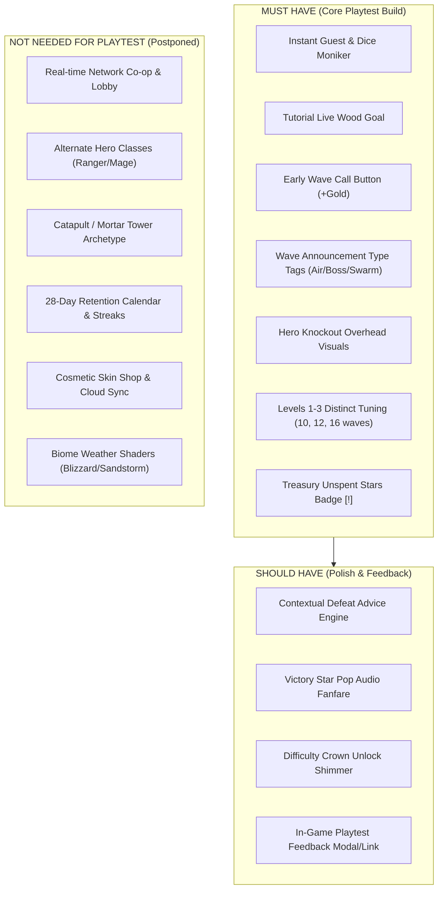
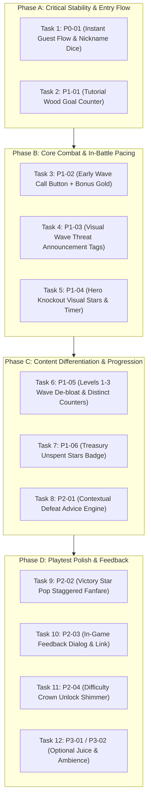

# Phase 8: Actionable Development Backlog & Playtest Roadmap — Bimbleguard

**Document Version:** 1.0 (Actionable Backlog)  
**Date:** 2026-10-22  
**Target:** Playable Alpha Test Build for 10–12 Human Playtesters  
**Engine & Platform:** Godot 4.7.2 (GL Compatibility) / Android Mobile & Desktop  
**Status:** Planning & Prioritization (Pre-Implementation)

---

## 1. Executive Summary & Strategic Objective

The comprehensive 7-phase audit of Bimbleguard revealed a strong, distinctive hybrid of **Top-Down Action RPG** and **Warcraft-style Tower Defense**. However, the current build suffers from three core barriers preventing successful external playtesting:
1. **Onboarding speed bumps:** Account prompts and manual typing before gameplay.
2. **Pacing drags:** Long wave counts (up to 40 waves in Level 3) with mandatory 30-second dead-time lulls between waves.
3. **Mechanical monotony across early levels:** Levels 1, 2, and 3 feature similar layouts, symmetric creep convergence, and identical tree/slot counts, differing primarily in wave bloat rather than distinct player skills tested.

### The Playtest Goal
> **Produce the smallest possible build that is technically stable, understandable, fast-paced, mechanically distinct across the first 3 levels, and ready for hands-on evaluation by 10–12 human testers.**

All non-essential meta-features (28-day retention calendars, real-time multiplayer co-op, additional hero classes, complex cosmetic shops, and biome hazard shaders) are **strictly postponed**.

---

## 2. PLAYTEST MVP DEFINITION

The Playtest MVP is intentionally scoped to the minimum set of features required to validate that Bimbleguard is **fun, comprehensible, and strategically engaging** for a first-time player.

### A. MUST HAVE (Required before handing build to testers)
1. **Frictionless Boot to Battle:** Instant guest flow on fresh launch, pre-populated nickname with a 1-tap "Dice" randomizer (`P0-01`).
2. **Crystal-Clear Tutorial:** Live objective tally during wood chopping (`10/20 Wood`) so testers never wander aimlessly (`P1-01`).
3. **Pacing Control ("Early Wave Call"):** An in-battle button during wave downtime allowing testers to immediately trigger the next wave with a +5..+10 bonus gold reward, eliminating the 25–30s idle slump (`P1-02`).
4. **Tactical Wave Telegraphing:** HUD tags indicating incoming special threats (Air, Fast Swarm, Armored, Boss) so player deaths feel fair and preventable (`P1-03`).
5. **Hero Knockout Overhead Feedback:** Clear visual stars/countdown over the downed knight during the 8-second knockout, ensuring players understand they are stunned at the gate, not permanently dead or bugged (`P1-04`).
6. **Mechanically Distinct Levels 1–3:** Scaled-down wave counts (10, 12, 16 waves) where each level tests a distinct tactical counter:
   - Level 1: Basics, ground choke points, Archer + Cannon.
   - Level 2: High-speed swarms, lane stalling, Frost + Mercenaries.
   - Level 3: Flying bats & armored golems, anti-air Lightning + Archer. (`P1-05`).
7. **Treasury Progression Guidance:** An unspent stars indicator (`[!]` badge) on the Treasury hub so players immediately invest stars into permanent perks after Level 1 (`P1-06`).

### B. SHOULD HAVE (High-value polish if sprint time permits)
1. **Contextual Defeat Advice:** Tips on defeat screen matching the actual cause of failure (e.g. recommend Frost if leaked creeps were fast, recommend Archer if leaked creeps were flying bats) (`P2-01`).
2. **Victory Star Fanfare:** Staggered audio-visual star animation on victory card to maximize emotional payoff (`P2-02`).
3. **Difficulty Crown Unlock Callout:** Visual pulse on Hard/Nightmare difficulty buttons when unlocked with 3 stars (`P2-03`).
4. **Tester Feedback Button:** A simple pause menu / map button opening a short Google Form / Typeform link for tester feedback (`P2-04`).

### C. NOT NEEDED FOR FIRST PLAYTEST (Explicitly Postponed)
- **Multiplayer / Co-op Systems (`test_coop_*.gd`):** Core TD validation must precede network testing.
- **Alternate Hero Classes (Ranger / Mage):** High asset and balance cost; Knight covers all core mechanics.
- **New Tower Archetypes (Catapult / Mortar):** The 4 existing towers (Archer, Cannon, Frost, Lightning) are fully sufficient.
- **Offline Camp / Idle Coins:** Completely removed from main menu, remains eliminated.
- **28-Day Retention Calendar & Daily Streaks:** Testers test 1–3 sessions; long-term meta-loops are irrelevant for MVP.
- **Cosmetics Shop & Gems Monetization:** Pure vanity layer.

---

## 3. FIRST-PLAYER EXPERIENCE EVALUATION

Tracing the target 10-step flow for a new playtester:

| Step | Player Action / Goal | Current Point of Failure / Friction | Required Solution |
| :--- | :--- | :--- | :--- |
| **1. Install / Launch** | Open app, reach menu in <3 seconds | May display `welcome.tscn` with email auth forms if Firebase is configured | Force clean guest default route; defer all account creation (`P0-01`) |
| **2. Nickname** | Pick name and press "В бой!" | Blank text box requires typing on virtual keyboard; cognitive hesitation | Add "Dice" randomizer icon; pre-fill valid fantasy moniker (`P0-01`) |
| **3. Start Tutorial** | Learn movement, chopping, building | Chopping prompt doesn't state how much wood is needed; player wanders | Coach header shows live progress tally: `10/20 Дерева` (`P1-01`) |
| **4. Basic Combat** | Fight creeping chupacabras | Hero feels either like an invincible solo brawler or gets knocked out without feedback | Overhead dizzy stars + 8s countdown over hero during knockout (`P1-04`) |
| **5. Build & Expand** | Construct towers, manage waves | Mandatory 30-second delay between waves forces boring idling | Add "Вызвать волну (+10 золота)" button during intermissions (`P1-02`) |
| **6. Finish Level 1** | Clear wave 10, achieve victory | End card previously forced exit to map | *"Следующий уровень"* button is now primary (Already verified!) |
| **7. Receive Reward** | Earn 3 Stars + Gems | Stars appear statically without celebration; reward purpose unclear | Staggered pop with rising audio pitch (`P2-02`) |
| **8. Progression Choice** | Upgrade stats before Level 2 | Player might tap "Next Level" without realizing Treasury perks exist | Badge `[!]` on Treasury hub when unspent stars > 0 (`P1-06`) |
| **9. Start Level 2** | Expect a new challenge | Level 2 currently has 25 waves with almost identical symmetrical layout | Rebalance Level 2 to 12 waves focused on Fast Swarms & Frost (`P1-05`) |
| **10. Experience Variety**| Encounter distinct enemies | Level 3 currently has 40 waves (!), making the test session exhausting | Cut Level 3 to 16 waves with explicit Flying Bat & Armor focus (`P1-05`) |

---

## 4. LEVEL VARIETY CHECK: LEVELS 1, 2, AND 3

### The Current Reality
In `resources/levels.json`, Levels 1, 2, and 3 use the same $44 \times 30\text{ m}$ bounding box, the same 20 harvestable trees, symmetrical ingress paths, and identical fixed tower slot distribution. The primary distinction currently is **extreme wave bloat**:
- **Level 1:** 15 waves (~8 mins)
- **Level 2:** 25 waves (~14 mins)
- **Level 3:** 40 waves (~22 mins! Unplayable for a casual mobile level 3)

### Comparative Analysis & Playtest Tuning Matrix

| Axis | Level 1: "Лесная застава" (Valley) | Level 2: "Тёмная чаща" (Forest) | Level 3: "Королевский тракт" (Highway) |
| :--- | :--- | :--- | :--- |
| **Theme & Premise** | Basic choke defense & harvest | Rapid scout swarm & lane stalling | Combined Air strike & Heavy armor |
| **Wave Count** | **10 Waves** (was 15) | **12 Waves** (was 25) | **16 Waves** (was 40) |
| **Paths Active** | 4 paths, sequential activation | 2 paired dual-paths (split focus) | 5 paths, flying creeps cut corners |
| **Primary Creep Types** | Normal Slime, Scout (w3), Boss King (w10) | Fast Scouts (mass swarms), Splitters | Flying Bats (w6), Armored Golems (w10), Shamans |
| **Core Tower Counters** | Archer (single) + Cannon (ground splash) | **Frost Tower** (AoE slow) + **Mercenaries** | **Lightning Tower** (chain air) + Upgraded Cannon |
| **Hero Role** | Primary early slayer + tree harvester | Flank staller (holds one lane while towers hold the other) | Emergency response (air targets bypass hero, hero must hunt Golems) |
| **Resource Pressure** | Low (ample wood near base) | Medium (trees are spread out, risk leaving base) | High (trees scarce near gates, must venture into creep lines) |
| **Starting Resources** | 90 Gold, 40 Wood, 20 Lives | 100 Gold, 50 Wood, 15 Lives | 120 Gold, 60 Wood, 10 Lives |
| **Skill Tested** | Basic economy & tower building | Multi-lane attention & crowd control | Anti-air priority targeting & armor bursting |

---

## 5. ACTIONABLE TASK BACKLOG

### Priority 0: Critical Stability & Friction (P0)

---

#### Task P0-01: Instant Guest Flow & Nickname Dice Generator
* **ID:** `P0-01`
* **Priority:** `P0`
* **Problem:** First-time launch presents an account login screen (if online enabled) or an empty nickname text box with mandatory virtual keyboard entry, causing cognitive bounce.
* **Why it matters to the player:** Mobile testers expect to touch the icon and be defending the castle within 5 seconds without typing or registering.
* **Exact affected scene/script/system:** `scripts/boot.gd`, `scripts/onboarding.gd`, `scripts/nickname_screen.gd`, `scenes/nickname.tscn`.
* **Proposed Solution:**
  1. Set `boot.gd` routing to bypass `welcome.tscn` directly into `nickname.tscn` for fresh installs.
  2. In `nickname_screen.gd`, add a "Dice" button (`DiceButton`) next to the text field.
  3. Pre-fill the input field with a randomized fantasy moniker from `NicknameRules` (e.g. `Рыцарь_42`, `Страж_07`).
  4. Allow 1-tap progression via "В бой!".
* **Estimated size:** `S` (2 hours)
* **Dependencies:** None.
* **Acceptance Criteria:** Fresh install launches to nickname screen with a pre-filled valid name. Tapping the dice generates a new name. Tapping "В бой!" starts the tutorial immediately.
* **Regression Test:** `tests/test_signup_flow.gd`, `tests/test_accounts.gd`.
* **Source audit document:** `05_player_journey.md` (Step 1 & 2), `07_implementation_roadmap.md` (`P0-02`, `P1-03`).

---

### Priority 1: Core Gameplay & Playtest MVP (P1)

---

#### Task P1-01: Tutorial Wood Goal Live Progress Counter
* **ID:** `P1-01`
* **Priority:** `P1`
* **Problem:** In Step 1 of the tutorial (`Step.CHOP`), the coach text only says "Сруби дерево: ударь по нему мечом", leaving players unsure of how much wood is required to proceed.
* **Why it matters to the player:** Prevents confusing wandering in the very first 30 seconds of gameplay.
* **Exact affected scene/script/system:** `scripts/tutorial.gd` (`_refresh_text`).
* **Proposed Solution:**
  Update the coach string in `Step.CHOP` to dynamically display collected vs target wood:
  `"Сруби дерево: собери древесину (%d/%d)" % [game_state.wood, _need_wood]`.
* **Estimated size:** `S` (1 hour)
* **Dependencies:** None.
* **Acceptance Criteria:** Coach text updates live on every log pickup until quota is met, immediately transitioning to the tower building step.
* **Regression Test:** `tests/test_tutorial.gd`.
* **Source audit document:** `05_player_journey.md` (Step 3), `07_implementation_roadmap.md` (`P1-05`).

---

#### Task P1-02: Early Wave Call ("Вызвать волну") with Gold Bonus
* **ID:** `P1-02`
* **Priority:** `P1`
* **Problem:** Between waves, players face a mandatory 25–30 second wait. When towers are built and wood is harvested, players are forced to wait idly.
* **Why it matters to the player:** Pacing drag is the #1 complaint in Tower Defense playtests. An early summon button gives impatient players control and risk-reward agency.
* **Exact affected scene/script/system:** `scripts/hud.gd`, `ui/hud.tscn`, `scripts/wave_manager.gd`, `scripts/game_state.gd`.
* **Proposed Solution:**
  1. During wave downtime (when `_wave_timer > 0`), display a pulsing button on the top HUD wave banner: `"В бой! (+%d золота)"` (`CallWaveButton`).
  2. Gold bonus scales with remaining time: `bonus = round(remaining_seconds * 0.3) + 5`.
  3. Tapping the button immediately sets `_wave_timer = 0.0`, awards bonus gold, spawns floating `+N Gold` text, and triggers wave horns.
* **Estimated size:** `M` (3 hours)
* **Dependencies:** None.
* **Acceptance Criteria:** Button appears only during intermission. Tapping it starts wave immediately and credits bonus gold. Button disappears once wave begins.
* **Regression Test:** `tests/test_waves.gd`, `tests/test_hud_layout.gd`.
* **Source audit document:** `04_engagement_and_variety.md` (Section 1.2), `02_systems_inventory.md` (`HUD-001`).

---

#### Task P1-03: Visual Wave Threat Announcement Tags
* **ID:** `P1-03`
* **Priority:** `P1`
* **Problem:** Sudden spikes of Fast Scouts, Armored Golems, Flying Bats, or Boss King appear without tactical warning, causing sudden castle leaks that feel unfair.
* **Why it matters to the player:** Players need clear visual telegraphs to prepare counters (e.g. build Frost for swarms, build Archer/Lightning for flying bats).
* **Exact affected scene/script/system:** `scripts/wave_plan.gd`, `scripts/wave_manager.gd`, `scripts/hud.gd` (`show_banner`).
* **Proposed Solution:**
  1. In `wave_plan.gd`, inspect the wave composition and attach metadata tags: `TAG_SWARM`, `TAG_ARMOR`, `TAG_AIR`, `TAG_BOSS`.
  2. In `HUD.show_banner()`, display an alert chip with an icon and localized subtitle:
     - Swarm: Yellow double-chevron + "Нашествие быстрых чупакабр!"
     - Air: Cyan wings + "Воздушная тревога! Летучие мыши!"
     - Armor: Gray shield + "Тяжёлая броня! Нужен сплэш!"
     - Boss: Red skull + "Приближается Босс!"
* **Estimated size:** `M` (3 hours)
* **Dependencies:** None.
* **Acceptance Criteria:** Waves featuring scouts, bats, golems, or bosses display designated warning chips on the HUD banner.
* **Regression Test:** `tests/test_waves.gd`, `tests/test_hud_layout.gd`.
* **Source audit document:** `07_implementation_roadmap.md` (`P1-04`).

---

#### Task P1-04: Hero Knockout Overhead Visual Feedback & Countdown
* **ID:** `P1-04`
* **Priority:** `P1`
* **Problem:** Hero Knockout transports the knight to the castle gate for 8s, but players lack clear in-world feedback (overhead dizzy stars / timer), making them question if the game is frozen or broken.
* **Why it matters to the player:** Clear state communication prevents frustration when a player makes a combat mistake.
* **Exact affected scene/script/system:** `scripts/hero.gd`, `scenes/hero.tscn`.
* **Proposed Solution:**
  1. Attach a 3D billboard node `OverheadStatus` to `hero.tscn`.
  2. When `knocked_out` fires, display rotating dizzy stars and a floating radial countdown timer (`8.0s -> 0.0s`).
  3. Gray out hero model slightly (`modulate` or material albedo tint) while knocked out.
  4. On `revived`, trigger a quick yellow shield sparkle and restore full visual tint.
* **Estimated size:** `S` (2 hours)
* **Dependencies:** None (Hero knockout logic already committed).
* **Acceptance Criteria:** When hero HP hits 0, overhead dizzy stars and live seconds countdown appear above the knight at the castle gate until 8.0s expires.
* **Regression Test:** `tests/test_combat.gd`, `tests/test_gameplay.gd`.
* **Source audit document:** `04_engagement_and_variety.md` (Section 1.2), `05_player_journey.md` (Step 5).

---

#### Task P1-05: Levels 1–3 Tactical Rebalance & Wave De-bloat
* **ID:** `P1-05`
* **Priority:** `P1`
* **Problem:** Levels 1, 2, and 3 suffer from excessive wave counts (15, 25, 40 waves) and lack distinct tactical identities, exhausting testers with repetitive gameplay.
* **Why it matters to the player:** Each level must test a different skill so the player feels meaningful progression and varied tactical problems to solve.
* **Exact affected scene/script/system:** `resources/levels.json`, `scripts/wave_plan.gd`, `scripts/level_builder.gd`.
* **Proposed Solution:**
  1. **Level 1:** Cut to **10 waves**. Focus on teaching choke-point ground defense with Archer (single) and Cannon (AoE). Boss King on wave 10.
  2. **Level 2:** Cut to **12 waves**. Focus on Fast Scout swarms and Splitters. Introduce early need for Frost Tower slowing aura and Mercenary guards.
  3. **Level 3:** Cut to **16 waves** (from 40!). Introduce Flying Bats at wave 6 (requiring Archer/Lightning anti-air) and Armored Golems at wave 10.
* **Estimated size:** `M` (4 hours)
* **Dependencies:** None.
* **Acceptance Criteria:** Campaign Levels 1, 2, and 3 play in 5, 7, and 10 minutes respectively; each requires distinct tower builds to earn 3 stars.
* **Regression Test:** `tests/test_waves.gd`, `tests/test_difficulty.gd`, `tests/run_all.sh`.
* **Source audit document:** `04_engagement_and_variety.md` (Section 2.B), `03_game_design_document.md` (Section 5).

---

#### Task P1-06: Treasury Unspent Stars Notification Badge
* **ID:** `P1-06`
* **Priority:** `P1`
* **Problem:** After beating Level 1, players earn 3 Stars but receive no prompt or visual cue indicating that the Treasury tab has upgrades ready to purchase.
* **Why it matters to the player:** Talent upgrades (Perks) are the primary motivational reward of the campaign; missing them leads to entering Level 2 underpowered.
* **Exact affected scene/script/system:** `scripts/level_select.gd`, `scripts/perks_panel.gd`.
* **Proposed Solution:**
  1. In `level_select.gd`, check `Perks.unspent_stars()`.
  2. If `unspent_stars > 0`, display an animated golden badge `[!]` on the Treasury tab icon (`TreasuryButton`).
  3. When Treasury is opened, highlight perk buttons that can be afforded with the current star balance.
* **Estimated size:** `S` (2 hours)
* **Dependencies:** None.
* **Acceptance Criteria:** Gaining stars in battle immediately renders a notification dot/badge on the Treasury button on the map until stars are spent.
* **Regression Test:** `tests/test_records_panel.gd`, `tests/test_map_layout.gd`.
* **Source audit document:** `05_player_journey.md` (Step 8), `07_implementation_roadmap.md` (`P2-04`).

---

### Priority 2: Playtest Polish & Player Feedback (P2)

---

#### Task P2-01: Contextual Defeat Advice Engine
* **ID:** `P2-01`
* **Priority:** `P2`
* **Problem:** Defeat tips are picked at random from a static array, occasionally advising to repair walls when the player actually died because flying bats were ignored.
* **Why it matters to the player:** Constructive feedback prevents rage-quitting by teaching testers how to adapt their strategy.
* **Exact affected scene/script/system:** `scripts/battle_end.gd` (`on_defeated`).
* **Proposed Solution:**
  Inspect combat failure metrics before choosing the tip:
  - If leaked enemies were mostly Flying Bats: `"TIP_AIR"` (*"Пушки не стреляют по воздуху! Строй башни лучников и молний"*).
  - If leaked enemies were Fast Scouts: `"TIP_FROST"` (*"Ледяные башни замедляют быстрых чупакабр"*).
  - If castle took damage repeatedly: `"TIP_REPAIR"` (*"Чини ворота замка за дерево прямо в бою"*).
  - If hero rarely attacked: `"TIP_HERO"` (*"Используй вихревой удар героя в толпе врагов"*).
* **Estimated size:** `S` (2 hours)
* **Dependencies:** None.
* **Acceptance Criteria:** Defeat screen analyzes leak causes and presents the most relevant advice string.
* **Regression Test:** `tests/test_endgame.gd`.
* **Source audit document:** `07_implementation_roadmap.md` (`P3-01`).

---

#### Task P2-02: Staggered Star Pop Fanfare & Rising Audio Pitch
* **ID:** `P2-02`
* **Priority:** `P2`
* **Problem:** Victory screen currently pops 3 stars simultaneously without animation, dampening the emotional reward.
* **Why it matters to the player:** Tactical games rely on strong audiovisual gratification upon victory.
* **Exact affected scene/script/system:** `scripts/hud.gd` (`show_end_screen`).
* **Proposed Solution:**
  Animate earned stars sequentially using Godot tweens:
  - Star 1: 0.2s delay, pop scale, pitch 1.0.
  - Star 2: 0.5s delay, pop scale, pitch 1.25.
  - Star 3: 0.8s delay, pop scale, pitch 1.5 + gold particle burst.
* **Estimated size:** `S` (2 hours)
* **Dependencies:** None.
* **Acceptance Criteria:** Stars pop sequentially with ascending chimes on victory.
* **Regression Test:** `tests/test_endgame.gd`.
* **Source audit document:** `07_implementation_roadmap.md` (`P2-03`).

---

#### Task P2-03: Playtester Feedback Dialog & Web Link
* **ID:** `P2-03`
* **Priority:** `P2`
* **Problem:** Testers currently have no direct in-game mechanism to report feedback, bugs, or ratings.
* **Why it matters to the player:** Streamlines feedback submission without leaving the application or switching apps.
* **Exact affected scene/script/system:** `scripts/level_select.gd`, `scripts/pause_menu.gd`, `scripts/game_info.gd`.
* **Proposed Solution:**
  1. Add `FEEDBACK_URL` to `game_info.gd` (linking to a Google Form / Discord / Telegram feedback bot).
  2. Add a prominent "Оставить отзыв" (Feedback) button in the pause menu and under settings on the map.
  3. Clicking opens the feedback URL via `OS.shell_open()`.
* **Estimated size:** `S` (1 hour)
* **Dependencies:** None.
* **Acceptance Criteria:** Tapping feedback button opens feedback form in default web browser.
* **Regression Test:** `tests/test_settings.gd`.
* **Source audit document:** `05_player_journey.md` (Step 9).

---

#### Task P2-04: Difficulty Crown Unlock Shimmer & Tooltips
* **ID:** `P2-04`
* **Priority:** `P2`
* **Problem:** Players completing normal mode don't notice that Hard/Nightmare modes are open; locked buttons are silently disabled.
* **Why it matters to the player:** Increases replayability for advanced testers who want greater challenge.
* **Exact affected scene/script/system:** `scripts/level_select.gd` (`_refresh_difficulty`).
* **Proposed Solution:**
  1. Trigger a subtle gold shimmer when Hard mode first unlocks.
  2. If tapped while locked, show a brief toast: *"Пройди на 3 звезды на обычном!"*.
* **Estimated size:** `S` (1.5 hours)
* **Dependencies:** None.
* **Acceptance Criteria:** Unlocked difficulties pulse; locked difficulty tabs explain unlock criteria on tap.
* **Regression Test:** `tests/test_difficulty.gd`.
* **Source audit document:** `07_implementation_roadmap.md` (`P2-04`).

---

### Priority 3: Optional Polish & Post-Playtest (P3)

---

#### Task P3-01: Hero Weapon Swing Trail & Impact Dust
* **ID:** `P3-01`
* **Priority:** `P3`
* **Problem:** Sword swings and whirlwind lack visual impact and weight against dense enemy clusters.
* **Why it matters to the player:** Visual game feel ("juice") enhances tactile satisfaction in melee combat.
* **Exact affected scene/script/system:** `scenes/hero.tscn`, `scripts/hero.gd`.
* **Proposed Solution:** Add a lightweight ribbon trail mesh (`RibbonTrailMesh`) behind the sword tip and dust particles on spin landing.
* **Estimated size:** `M` (4 hours)
* **Dependencies:** None.
* **Acceptance Criteria:** Sword swings emit ribbon trails; whirlwind spin emits radial dust puff.
* **Regression Test:** `tests/test_fx.gd`.
* **Source audit document:** `07_implementation_roadmap.md` (`P3-04`).

---

#### Task P3-02: Biome Ambient Sound Loops
* **ID:** `P3-02`
* **Priority:** `P3`
* **Problem:** All levels currently share identical ambient audio tracks.
* **Why it matters to the player:** Enhances sensory differentiation between biomes.
* **Exact affected scene/script/system:** `scenes/main.tscn`, `scripts/level_builder.gd`.
* **Proposed Solution:** Assign distinct ambient loops for Meadow (birds/breeze), Forest (deep wind/insects), and Highway.
* **Estimated size:** `M` (3 hours)
* **Dependencies:** Audio asset availability.
* **Acceptance Criteria:** Level 1 and Level 2 play distinct ambient sound loops.
* **Regression Test:** `tests/test_camps_and_sfx.gd`.
* **Source audit document:** `07_implementation_roadmap.md` (`P3-03`).

---

## 6. STRICT IMPLEMENTATION ORDER

The backlog is organized into four sequential phases respecting all technical dependencies:

### Phase A — Critical Stability & Entry Flow
* **TASK 1:** `P0-01` — Instant Guest Flow & Nickname Dice Generator (`S`)
* **TASK 2:** `P1-01` — Tutorial Wood Goal Live Progress Counter (`S`)
* **Expected Outcome:** First-time player boots directly to nickname screen with a pre-filled name, enters tutorial in 1 tap, and seamlessly finishes tutorial step 1 with clear visual quotas.

### Phase B — Core Combat & In-Battle Pacing
* **TASK 3:** `P1-02` — Early Wave Call ("Вызвать волну") with Gold Bonus (`M`)
* **TASK 4:** `P1-03` — Visual Wave Threat Announcement Tags (Air, Swarm, Armor, Boss) (`M`)
* **TASK 5:** `P1-04` — Hero Knockout Overhead Visual Feedback & Countdown (`S`)
* **Expected Outcome:** Zero dead-time between waves; players control pacing; incoming threats are telegraphed; hero knockout state is completely transparent.

### Phase C — Content Differentiation & Progression
* **TASK 6:** `P1-05` — Levels 1–3 Tactical Rebalance & Wave De-bloat (`M`)
* **TASK 7:** `P1-06` — Treasury Unspent Stars Notification Badge (`S`)
* **TASK 8:** `P2-01` — Contextual Defeat Advice Engine (`S`)
* **Expected Outcome:** Levels 1, 2, and 3 test distinct skills and play in 5–10 minutes instead of 20+; players naturally upgrade perks in the Treasury between battles; failure teaches rather than frustrates.

### Phase D — Playtest Preparation & Feedback
* **TASK 9:** `P2-02` — Staggered Star Pop Fanfare & Rising Audio Pitch (`S`)
* **TASK 10:** `P2-03` — Playtester Feedback Dialog & Web Link (`S`)
* **TASK 11:** `P2-04` — Difficulty Crown Unlock Shimmer & Tooltips (`S`)
* **TASK 12 (Optional):** `P3-01` & `P3-02` — Visual weapon trails & ambient biome audio (`M`)
* **Expected Outcome:** High audiovisual satisfaction upon winning; built-in channel for playtesters to submit qualitative ratings and bug reports.

---

## 7. RECOMMENDED POSTPONEMENTS AND CUTS

To maintain strict discipline and avoid scope creep before playtesting, the following features from the audit are **explicitly postponed or cut**:

1. **Real-Time Network Co-op & Lobby System:**
   - *Rationale:* Testing network latency and lockstep synchronization with 10-12 testers before single-player combat is proven fun wastes testing bandwidth.
   - *Status:* **POSTPONE** until after campaign balance validation.
2. **Alternate Hero Classes (Ranger / Mage):**
   - *Rationale:* Introduces 2 additional skill trees, new animations, and complex balance variables.
   - *Status:* **POSTPONE** to Post-Launch expansion.
3. **New Tower Archetypes (Catapult / Mortar):**
   - *Rationale:* Existing 4 towers (Archer, Cannon, Frost, Lightning) provide a complete rock-paper-scissors dynamic.
   - *Status:* **POSTPONE**.
4. **28-Day Retention Calendar & Streak Unification:**
   - *Rationale:* Playtesters will test the game across 1–3 sessions; long-term daily check-in loops are irrelevant for testing core gameplay feel.
   - *Status:* **POSTPONE**.
5. **Cosmetics Shop & Skin Unlocks:**
   - *Rationale:* Purely aesthetic meta-layer with zero gameplay impact.
   - *Status:* **POSTPONE**.
6. **Camp Offline Coin Generator:**
   - *Rationale:* Already removed from menu; was a disconnected idle loop that confused players.
   - *Status:* **PERMANENTLY CUT**.
